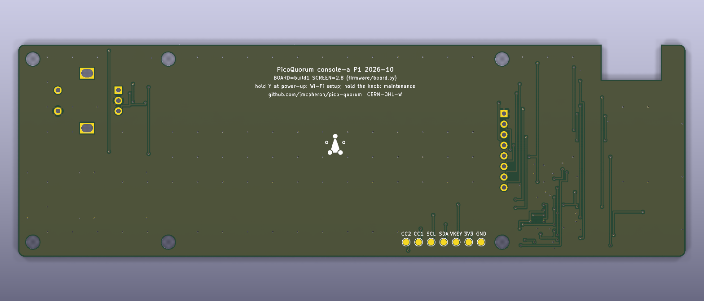

# console-a P1: the console on one board

> **Status: drawn, not ordered.** Checks pass and the fab files are ready to upload for a quote.
> Two things must be checked on the bench before an order: the screen module's size and pin order
> (drawn from a placeholder), and the plug's fit on a real key-c.

| top | back |
|---|---|
|  |  |

KiCad renders. KiCad has no 3D models for the Pico, the screen or the knob here, so only their pads
show. The white rectangle is the screen module's outline.

**What it is:** Build 1 on one board, plus a port for key-c. The pins are Build 1's, so it runs
today's console image with `BOARD = "build1"` and `SCREEN = "2.8"` in `secrets.py`. That means no
firmware change and no new release. The parts:
- **A Raspberry Pi Pico 2 W,** soldered flat by its castellations. JLCPCB places it. Its micro-USB
  stays the power and update port, at the board's bottom edge. The antenna end overhangs a cut-out
  in the board's top edge, as the Pico 2 W datasheet asks (section 2.2.1).
- **Build 1's 2.8″ 320×240 ST7789 module** on its own 8-pin header.
- **A knob with push,** and Sign, Back, Device and Reject buttons.
- **A vertical USB-C plug** that key-c slides onto, with the protection
  [PROPOSALS.md](../key-pcb/PROPOSALS.md#the-console-end-of-key-c) asks for.
- **A status LED,** for a later firmware.

Why this one, and the other boards considered (cheaper, smaller, with a battery), are in
[OPTIONS.md](OPTIONS.md).

| | |
|---|---|
| Board | 160 × 51 mm, 2 layers, 1.6 mm, lead-free HASL. A 14.2 × 8.5 mm cut-out under the antenna |
| Parts | U1 Pico 2 W, J1 USB-C plug 918-118A2021Y40002, U2 AP22653W6-7, U3/U4 USBLC6-2SC6, D1 ESD5Z5V0, D2 red LED, SW1 PEC11R-4215F-S0024, SW2–SW5 K2-1102SP-K4SC-04, J2 the screen's 1×8 header, 13 resistors, 2 capacitors |
| Files | `console-a/` (KiCad 10), `console-a/fab/` (Gerber zip SHA-256 `cb03f1ae…`, `bom.csv`, `cpl.csv`) |
| Checks | ERC 0 · DRC 0 · unconnected 0 · parity clean (`tools/keypcb check console-a`) |
| Source | `gen_console.py`, with its footprints in `lib/` |

## The pins

The first block is Build 1's map from `firmware/board.py` and `firmware/atecc.py`.
`gen_console.py` reads both files and stops if its table disagrees with them.

| signal | GPIO | firmware |
|---|---|---|
| screen DC, CS, SCK, MOSI, RST, BL | GP8, 9, 10, 11, 12, 13 | `DC, CS, SCK, MOSI, RST, BL` |
| Sign (A), Back (B), Device (X), Reject (Y) | GP15, 17, 19, 21 | `BUTTONS` |
| knob push, A, B | GP1, GP2, GP3 | `ENC_SW`, and `ENC_B`/`ENC_A` (see below) |
| key SDA, SCL | GP4, GP5 | `atecc.py` defaults |
| key power enable | GP6 | new: pulled up, so the key is on |
| key power fault | GP14 | new: the switch's open-drain flag |
| CC1, CC2 sense | GP26, GP27 (ADC0, ADC1) | new |
| status LED | GP22 | new |

Today's console image never touches the new pins, so it sees the key powered and nothing else.

**Knob direction.** The knob's A goes to GP2 and B to GP3, the same as the bench, through the
0 Ω resistors R10 and R11. The firmware reads them the other way round (`ENC_A, ENC_B = 3, 2`)
because the bench knob counted backwards. If this knob counts backwards too, move the 0 Ω resistors
to R12 and R13. That swaps the wires without a firmware change.

**Power-up holds,** printed on the back: hold Reject (Y) for Wi-Fi setup, hold the knob for
maintenance.

## The key port

key-c's USB-C socket carries I2C, not USB: SDA on D+, SCL on D−, power on VBUS, and a 5.1 kΩ Rd on
each CC pin. On the console:
- **J1, a vertical plug.** The key stands upright in the gap between the Pico and the screen.
  - The case needs a slot or dock around it: the plug's solder joints shouldn't take a sideways
    push on the key.
  - Only A6 and A7 are wired. key-c joins A6 to B6 and A7 to B7 itself, so either way up its SDA and
    SCL meet A6 and A7.
- **U2 feeds the key's VBUS (VKEY) from 3V3.** It is current-limited to 80 mA (ILIM to GND; the
  datasheet gives 40–120 mA), reverse-blocking, and discharges its output when off. The key needs
  under 20 mA.
  - EN is GP6 with a 10 kΩ pull-up, so the key is on unless firmware drives GP6 low.
  - Its fault flag goes to GP14.
  - A device that pushes 5 V onto VBUS meets U2's reverse blocking, and D1 clamps spikes.
- **2.2 kΩ pull-ups (R1, R2) on SDA and SCL, to VKEY.** The key has none. Pulling up to VKEY
  instead of 3V3 means a key that's switched off isn't powered through its I2C pins.
- **CC sense.** CC (A5) and VCONN (B5) each have a 10 kΩ pull-up to 3V3 and a 1 kΩ resistor into an
  ADC pin. With a key in, each reads about 1.1 V. With nothing in, 3.3 V.
  - Plugged straight in, with no cable, a key shows its Rd on both lines. PROPOSALS.md's "exactly
    one Rd" rule is for a key on a cable.
  - A future firmware check here should expect both lines.
- **ESD on every line.**
  - U3 (USBLC6) on SDA and SCL, U4 on the two CC lines, D1 (ESD5Z5V0) on VKEY.
  - The USBLC6 rails go to always-on 3V3, never VKEY, so the CC pull-ups can't feed the key through
    them.

## Getting a quote

Upload to https://jlcpcb.com, as for key-b
([ORDERING.md](../key-pcb/ORDERING.md#6-key-b-fully-assembled-by-jlcpcb)):
1. `console-a/fab/console-a-gerbers.zip`. It reads 160 × 51 mm, 2 layers.
2. Choose: qty 5, 1.6 mm, lead-free HASL, any mask colour, "Remove mark" if offered.
3. Turn on **PCB Assembly**: Economic, top side.
4. Upload `console-a/fab/bom.csv` and `console-a/fab/cpl.csv`.
5. In the placement preview, check every pin 1. Pay most attention to U1 (turned 180°: its pin 1
   is at the bottom right), J1, U2–U4 and D1.

JLCPCB's stock and prices on 2026-10-07:

| ref | part | LCSC | stock | each |
|---|---|---|---|---|
| U1 | Raspberry Pi Pico 2 W | C42394205 | 82, extended | $11.68 |
| J1 | 918-118A2021Y40002, vertical USB-C plug, 16 pins | C399939 | 850, extended | $0.60 |
| U2 | AP22653W6-7 | C2158037 | 8,847, extended | $0.27 |
| U3, U4 | USBLC6-2SC6 (ST's own) | C7519 | ~49,800, extended | $0.18 |
| D1 | ESD5Z5V0 | C502546 | ~131,000, extended | $0.02 |
| SW2–SW5 | K2-1102SP-K4SC-04, 6 × 6 mm, 9 mm tall | C129461 | 6,236, extended | $0.08 |
| D2 | red LED 0603 | C2286 | basic | |
| R, C | 0402 resistors (C25744, C25879, C11702, C17168), 100 nF 0402 (C1525), 10 µF 0603 (C19702) | | basic | |

Not in the BOM:
- R12 and R13 aren't fitted (see knob direction).
- **You solder** the knob, Bourns PEC11R-4215F-S0024 (LCSC C143790, 5,871 in stock, $2.35), and
  the screen's 1×8 header.
- At 20 or more, JLCPCB's Standard assembly can solder these two as well.

**Rough cost:** about $24 a console for 5, $18 for 20 and $17 for 100. That's before the screen
module, shipping and tax.
- Six extended part types bring about $28 of fixed fees an order.
- The Pico is $11.68 of each board at JLCPCB's price.
- At 100, JLCPCB doesn't have enough Picos. Pre-order them there, or buy them (about $7 retail) and
  send them in as consigned parts.
- OPTIONS.md has how these estimates were made.

## Before ordering

1. **Measure the screen module and fix `SCREEN` in `gen_console.py`.** The footprint is a
   placeholder: an 86 × 50 mm board, the header 2.54 mm in from its left edge, and an M3 hole 3 mm
   in from each corner. Check:
   - the outline and the four holes
   - where the header sits, and which end is pin 1
   - the printed pin labels, top to bottom with the header on the left (drawn here as GND, 3V3, CS,
     MOSI, SCL, DC, RST, BL)
   - how tall the parts on its back are

   Then run `tools/keypcb gen-console`, `check`, `fab` and `render` again.
2. **When key-c arrives, check the plug.**
   - A key-c slides onto a loose 918-118A2021Y40002 and seats fully.
   - Each of A5 and B5 reads 5.1 kΩ to the shell.
   - Measure how far the key stands up, for the case.
3. **Decide the case heights.** The buttons are 9 mm tall. The knob's shaft is 15 mm. The screen
   sits as high as its header puts it.
4. **Optional: a Wi-Fi check.** On Build 1, with a key standing beside the Pico 2 W's antenna, check
   that the console still joins your network well. The key's nearest edge is about 28 mm from the
   antenna.

## Regenerating

`tools/keypcb gen-console` rewrites `console-a/` and `lib/` from `gen_console.py`, the same way
`gen-cd` does for key-c and key-d.
- It places the parts from the `PARTS` table and routes every track with a small grid router at
  the end of the file. So a moved part or a measured screen only needs a rerun.
- It takes about 30 seconds.
- Once the board is edited in the KiCad GUI, the KiCad files are the source of truth: don't run it
  again.

## Next

1. Get a quote with the files as they are, to see the real price.
2. Measure the screen module and regenerate.
3. Check the plug on a real key-c.
4. Draw the case: a dock for the key, a cover or guard over Sign, and openings for the micro-USB and
   BOOTSEL.
5. Order 5.

## Log (newest first)

- **2026-10-07:** drawn.
  - Options compared in OPTIONS.md.
  - Parts chosen from JLCPCB's stock: the plug, the switch, the knob and the buttons.
  - Board generated by `gen_console.py` and checked with `tools/keypcb check console-a` (ERC 0,
    DRC 0, unconnected 0, parity clean).
  - The screen footprint is a placeholder.
