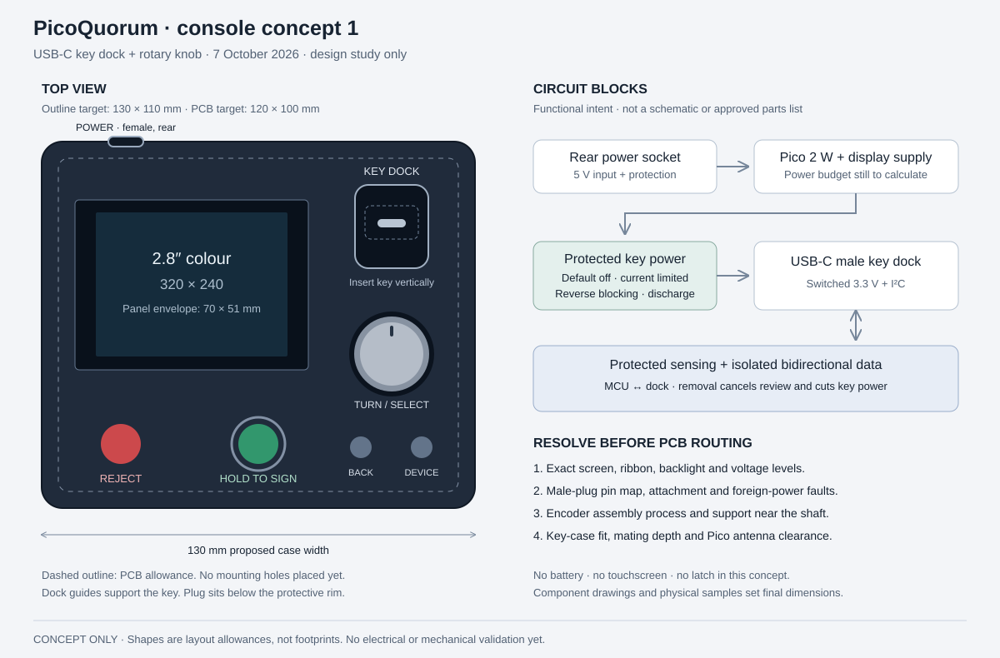

# Console PCB, concept 1

The separate [M1 prototype carrier](../console-pcb-m1/README.md) has a 1.3 inch
colour LCD module, eight SMT buttons, a Pico 2 W module and internal key-adapter
pads. Its routed KiCad files and manufacturing quote package are separate from
the earlier knob/dock concept and CAD studies below.

2026-10-07. **Design in progress, not fabrication files.** A controls subcircuit and
native KiCad placement study now exist. The complete schematic, routing, physical fit
and hardware tests are unfinished. Do not order from these drafts.

Start with [component research and CAD status](RESEARCH.md). The
[controls drawing](review/controls.svg) comes from `controls.kicad_sch`; the
[placement drawing](review/placement.svg) comes from `placement-study.kicad_pcb`.
They are separate studies, not a schematic/PCB pair ready for manufacturing.

The chosen direction is a colour screen, a rotary knob, and a USB-C key dock. Favour
straightforward assembly and supported parts over the lowest component price. Start with
external power and no battery. Quantities to quote later: 5 prototypes, 20 and 100 consoles.



## Face and case

The sketch proposes a 130 x 110 mm case and a 120 x 100 mm main PCB. These are layout
allowances, not measured component fits. Case height is open until the display, plug,
encoder and Pico stack is drawn in section. The face is horizontal for this first study.

| item | proposed allowance | detail still to settle |
|---|---|---|
| Screen, left | 70 x 51 mm panel envelope | 2.8 inch colour, 320 x 240 landscape; exact panel and ribbon exit |
| Knob, right | 24 mm diameter cap | shaft length, detents, push force and support |
| Key dock, back right | 22 x 25 mm footprint | upright insertion; pocket must fit the final key case |
| Sign and Reject, front left | 12 mm button caps | Sign recessed behind a rim; Reject unobstructed |
| Back and Device, front right | two smaller buttons | preserve B and X functions while the UI is reviewed |
| Power, back | USB-C female socket | separate from the male key dock; label POWER |

The ordered key is a 16 x 36 mm PCB with a female connector. It stands upright in this
proposal. Its case, finger clearance and insertion path need a side-view fit study. The
dock footprint is not the key's full height. Do not change the ordered P2 key board.

Support the key case with guide walls. Keep the plug below their rim. Use a stop and
clearance stack based on the connector's mating drawing: the pocket must allow full
mating without forcing the connector past its travel. Allow easy one-hand removal;
no locking latch in this revision. Support the main PCB near the plug and encoder.
The solder pads must not be the only path for insertion or sideways loads.

The panel mounts to the case with a compliant support. Insert its ribbon into a locking
connector after soldering. Do not load the glass or fold its ribbon sharply. Place the
Pico antenna at an enclosure edge, with the manufacturer's copper/component keepout and
clearance from the display, key, metal knob and case hardware. The sketch does not place
the Pico or establish that these clearances fit.

## Parts to evaluate

These are candidates and requirements, not a purchasing BOM. Stock, full order codes,
footprints, assembly availability and mating dimensions remain to be checked.

| function | candidate or requirement | reason / open point |
|---|---|---|
| Processor | Raspberry Pi Pico 2 W, without headers | existing firmware; castellated carrier mounting; assembler must accept the module and thermal process |
| Encoder | Bourns PEC11J, detented version with push switch | SMD; choose full shaft/detent/switch code after a feel sample |
| Key plug | GCT USB4151 vertical Type-C plug family | documented docking part; 24 contacts, SMD signal terminals and through-hole shell stakes; confirm exact version and process |
| Screen | 2.8 inch, 240 x 320 native, four-wire SPI ST7789, no touch | prefer wide viewing angles and a locking FPC connector; exact part unselected |
| Screen comparison | EastRising ER-TFT028A3-4 | documented plug-in FPC and 50.20 x 69.30 mm outline; directional viewing, so not an IPS selection |
| Buttons | documented SMT tactile switches and case-held caps | separate A, B, X and Y; full part and actuation force open |
| Power input | USB-C receptacle, 5 V sink, no PD negotiation | independent Rd on each CC; input protection and current budget needed |
| Key power | current-limited, reverse-blocking switch, default off | TPS2553 family is a comparison candidate, not selected; its 75 mA typical lower limit and fault behaviour require review |
| Bus protection | bidirectional isolation with powered-off and foreign-voltage protection, plus connector ESD protection | exact parts open; preserve ATECC wake timing and open-drain signalling |

The PEC11J datasheet specifies 100,000 rotational cycles and 20,000 switch cycles. It
calls for one reflow pass, discourages hand soldering, and does not recommend aqueous
washing. Agree the assembly sequence before layout. A mostly single-side assembly is
a goal, not a constraint that overrides mechanical support or antenna clearance.

The working encoder choice is now PEC11J-9215F-S0015; its 30 detents / 15 pulses
need a click-count check with the current driver. The four working button choices
are TL3305AF160QG. Full findings and assembly limits are in [RESEARCH.md](RESEARCH.md).
The USB4151 drawing specifies a 0.8 mm board. A small supported dock board is under
consideration so the main board can stay 1.6 mm; its stack and internal connection
are not yet designed.

The display comparison part lists 2.8 V typical supply and 70 mA typical backlight
current. It is not a drop-in replacement for the bench display module. Check logic
levels, supply limits, SPI mode straps and LED wiring in the exact datasheet before
choosing regulators or a backlight driver. GP13 controls the driver; it does not power
the LED string. A new panel still needs colour, orientation and readability checks.

## Circuit blocks

```text
Rear POWER socket (5 V)
    -> input protection and supply isolation -> Pico VSYS
    -> display supplies / backlight driver (after panel selection)

Pico 3V3 -> default-off, current-limited, reverse-blocking switch -> KEY_VCC
KEY_VCC -> dock VBUS; controlled discharge; key-side bus pull-ups

GP4/GP5 <-> protected, isolatable I2C path <-> dock D+/D- <-> key SDA/SCL
Dock attachment contacts -> protected sensing -> presence / fault handling
GP6 -> key power request; hardware fault conditions must override it

GP8..GP13 -> display control and SPI; GP13 -> backlight driver control
GP3/GP2/GP1 <- encoder A/B/push
GP15/GP17/GP19/GP21 <- Sign/Back/Device/Reject
```

This is a functional diagram, not a wireable schematic. Check the Pico regulator's
available current under Wi-Fi load before assigning display and key loads to 3V3.
Keep a service route to Pico BOOTSEL, RUN and SWD. If Pico micro-USB remains accessible,
the external supply arrangement must tolerate both power inputs without backfeeding.

### The key port

The port uses Type-C mechanics but carries I2C and switched 3.3 V, not USB data or a
standard USB power-source interface. Never connect dock VBUS straight to GP6, 3V3 or 5 V.

The existing [socket-and-cable proposal](../key-pcb/PROPOSALS.md#the-console-end-of-key-c)
is background, not a direct-plug schematic. A plug has CC/VCONN roles that differ from
a receptacle's CC1/CC2 arrangement. Trace the selected plug and the P2 receptacle pin
by pin, in both orientations. Do not copy the rule "exactly one Rd" from the cable
proposal without establishing what this mating pair actually exposes. Do not tie
attachment-sense contacts together or energize VCONN by assumption.

Required behaviour:

- Power and bus drive default off during reset, boot, removal and fault.
- Stable attachment permits controlled power-up. It does not authenticate a key or
  prove full mechanical seating. Confirm the chip and reject unsupported devices.
- Removal cancels an unfinished approval, cuts power and releases the bus. Reinserted
  keys must not inherit the previous review or hold-to-sign state.
- Limit short-circuit current in hardware. Validate switch tolerance, startup current,
  thermal behaviour and shutdown; do not equate the limit with normal key current.
- Block foreign VBUS from the console supply, both powered and unpowered. A load switch
  alone does not protect SDA, SCL or the attachment-sense inputs.
- Isolate MCU bus pins from externally driven voltages and an unpowered key. Start with
  the earlier 2.2 kohm switched pull-up proposal only as a value to calculate and measure.
  External VBUS must not turn those pull-ups into a path to an unprotected GPIO.
- Protect exposed contacts against ESD. ESD suppression is not sustained overvoltage
  protection. Specify the charger/adapter fault envelope before choosing devices.
- Controlled discharge must not short an externally powered VBUS. Check this explicitly.

## Proposed GPIO reservation

Preserve current `firmware/board.py` assignments where possible. Nothing changes firmware
in this draft. In particular, the knob A/B naming below follows the current driver,
whose ordering differs from the older breadboard labels.

| GPIO | proposed function |
|---|---|
| 1 | encoder push; maintenance at boot |
| 3, 2 | encoder A, B; verify direction and steps per detent on selected part |
| 4, 5 | key SDA, SCL through protection |
| 6 | key power request, external default-off bias |
| 7 | reserved for attachment/fault logic |
| 8, 9, 10, 11, 12, 13 | display DC, CS, SCK, MOSI, RESET, backlight control |
| 15, 17, 19, 21 | A/Sign, B/Back, X/Device, Y/Reject; Y also Wi-Fi setup at boot |
| 26, 27 | reserve for protected attachment sensing if analog sensing is chosen |
| 28 | spare analog input; no battery in this revision |

GP26/27 are reassigned from the old Build 1 Trust M reset / key-ID plan. Do not use
this draft with that harness. No console signing, key provisioning or lock behaviour
changes are authorized by this design document.

## Before a manufacturing quote

1. Select the exact display, plug, encoder and switches. Obtain drawings and check
   assembler stock or sourcing, packaging and solder process. Resolve the power budget.
2. Draw the electrical schematic, including the actual plug pin map and all fault paths.
   Review every powered/unpowered combination and check the firmware work required.
3. Draw the mechanical stack and print a dock/knob fit sample. Check actual key-case fit,
   full connector engagement, removal, board flex and antenna clearance.
4. Route the PCB with mounting holes, test access and source-location silkscreen. Run
   ERC, DRC, connectivity and schematic/PCB parity checks; inspect footprints and 3D fit.
5. Export Gerbers, drills, BOM, placement file, assembly drawings and STEP models. Quote
   5/20/100 separately, including module installation, screen insertion, enclosure,
   programming and testing. A quote is not permission to place an order.

Before a production batch, bench-check controlled startup, short and foreign-power
faults, hot removal, both key orientations, bus rise time and wake timing. Exercise the
complete review/reject/hold-to-sign flow on test keys. Do not provision, lock or write
hardware without a separate explicit request. The signing site remains `quorum.sign_it`.

## Sources and checks

Manufacturer pages checked 2026-10-07:

- [Pico 2 W](https://www.raspberrypi.com/products/raspberry-pi-pico-2/?variant=pico-2-w).
- [PEC11J datasheet](https://www.bourns.com/docs/product-datasheets/pec11j.pdf).
- [GCT plug selector](https://gct.co/usb-connector/usb-plug) and
  [USB4151 introduction](https://gct.co/news/gct-launches-vertical-mount-usb-type-c-plug-aimed-at-docking-designs).
- [Display comparison](https://www.buydisplay.com/2-8-inch-tft-lcd-display-capacitive-touch-screen-st7789v-spi-240x320).
- [TPS2553 family datasheet](https://www.ti.com/lit/ds/symlink/tps2553.pdf).

Read against the repository README, hardware notes, ordered key-C P2 description,
Build 1 pin map, `firmware/board.py`, `firmware/knob.py` and console button handling.
The concept drawing is an editable SVG. Its panel and control shapes are layout
envelopes, not component footprints. See [CHECKS.md](CHECKS.md) for the controls ERC,
placement DRC findings and the checks still missing. No supplier stock, assembly
quote, circuit simulation, physical fit or hardware behaviour has been verified.
