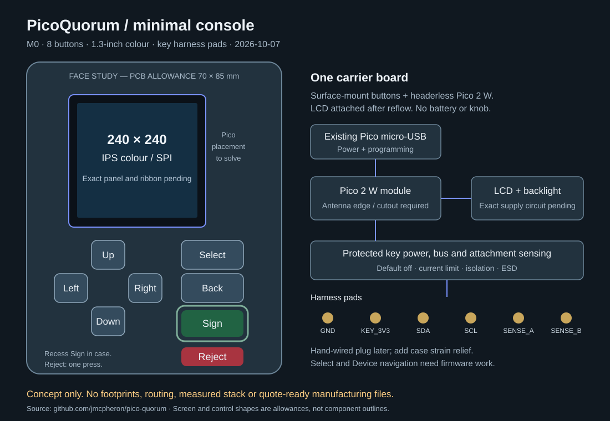

# Minimal console, M0

The separate [M1 prototype carrier](../../console-pcb-m1/README.md) has routed KiCad
files and a manufacturing quote package. It uses a Waveshare LCD module and a
separate protected key adapter, as chosen by the user. The M0 brief below is
historical; its bare-panel candidate, six-pad bank and cost allowance do not apply
to M1.

2026-10-07. **Design brief only. Not fabrication files.**

The chosen direction is a small colour screen, eight surface-mount buttons, a
headerless Pico 2 W soldered to a carrier, and solder pads for the key harness.
No rotary encoder or key dock on this PCB. This supersedes the knob concept as the
current direction. The older CAD studies remain separate and do not describe M0.

## Working choices

| item | working choice | still to check |
|---|---|---|
| Processor | Raspberry Pi Pico 2 W, without headers, castellated mounting | assembler sourcing, official land pattern and paste stencil |
| Screen | 1.3 inch IPS colour, 240 x 240, ST7789, four-wire SPI, no touch | exact panel drawing, supply limits, ribbon, backlight and driver settings |
| Controls | eight E-Switch TL3305AF160QG SMT tactile switches | supplier cost, land pattern, cap/plunger fit and force sample |
| Main PCB | two layers, 1.6 mm FR-4; start with a 70 x 85 mm allowance | fit, routing, mounting holes and antenna cutout |
| Power | Pico's existing micro-USB socket | socket and BOOTSEL access through the case; power budget |
| Key | labelled solder pads for a hand-wired harness | final harness, protected power/bus circuit and attachment sensing |
| Case | simple plastic case, supported screen and button plungers | mechanical drawing; recessed Sign and accessible Reject |

Power through the Pico is an assumption for minimum cost. No battery, charger,
extra power socket, joystick mechanism, touch controller or SD card is planned.
The buttons are individual switches in a directional cross, not a joystick part.
The board size is a starting allowance, not a verified fit or minimum size.

The Pico is already a complete processor, flash, regulator and radio board. Use it
as a module rather than designing those circuits again for a 20-100 unit batch.
Its official datasheet supports surface mounting. Follow its underside-pad rules,
paste recommendation and 14 x 9 mm antenna cutout. Put the antenna at an edge and
keep the screen, wires and case hardware away from it in three dimensions.
The face sketch does not establish module placement or antenna clearance.

## Screen and assembly

The low-cost candidate is **EastRising ER-TFT013-2**, without touch. The supplier
describes a 240 x 240 IPS ST7789V2 panel, four-wire SPI and a solder-type FPC.
Its indexed listing shows **US$3.34 each at 10**. This is a price reference, not a
confirmed configured price, stock check or assembly quote. The product page and
PDF returned HTTP 403 when opened. Pinout, dimensions, voltage and LED wiring
have not been verified, so do not assign its footprint or buy production stock yet.

A solder-type ribbon removes the connector cost but needs a controlled soldering
step after reflow. Do not send the LCD glass through the PCB reflow process.
Ask the assembler to price that step. If they cannot support it economically,
compare a documented 240 x 240 panel with a locking FPC connector. Compare total
assembly cost, not just the panel price. The whole product will not be assembled
in one reflow pass even though its buttons and Pico use surface mounting.

Keep the existing 240 x 240 drawing size. A different ST7789 panel still needs
initialisation, offset, colour-order, inversion, SPI-speed and readability checks.
Select the display rail and backlight circuit from the exact panel specification.
GP13 controls the backlight circuit; it must not supply LED current directly.
Check Wi-Fi peak load, regulator headroom and panel/key current together.

## Eight controls

The user chose separate Sign and Reject. Keep Select and Back as well.
Use one switch per GPIO to ground, active low, with 10k external pull-ups to 3V3.
Use the same switch model for all eight to simplify sourcing and placement.
No switch matrix or extra input chip is needed. Case-held caps are separate parts.

| control | proposed GPIO | current firmware relationship |
|---|---|---|
| Up | 2 | existing joystick Up |
| Down | 18 | existing joystick Down |
| Left | 16 | existing joystick Left |
| Right | 20 | existing joystick Right |
| Select | 3 | existing joystick press pin; needs console action handling |
| Back | 17 | existing B; also maintenance at boot |
| Sign | 15 | existing A; dedicated, guarded, hold to sign |
| Reject | 21 | existing Y; one press; also Wi-Fi setup at boot |

This is not an unchanged-firmware replacement for the Waveshare board: X/Device
on GP19 is absent. Provide a visible Device entry through navigation, and give
Select its own action handling. Keep GP19 available as a test pad if useful.
Review UI hints so they name the actual buttons rather than A/B/X/Y.

No firmware is changed in this design brief. Later changes must preserve all-page
review, the existing hold times, red pages, release-to-cancel behaviour and one-press
Reject, including while Sign is held. Entering review while Select is held must not
start signing. Key removal must discard review and hold state. Signing remains in
`quorum.sign_it`, over the hash rebuilt by the console.

## Key wiring pads

Use a solder-pad bank, provisionally at 2.54 mm pitch, with these labels:

| pad | function |
|---|---|
| GND | key ground |
| KEY_3V3 | switched, current-limited, reverse-blocked key supply |
| SDA | protected key-side SDA; Pico GP4 behind isolation |
| SCL | protected key-side SCL; Pico GP5 behind isolation |
| SENSE_A | first protected attachment-sense path |
| SENSE_B | second protected attachment-sense path |

Six pads allow the eventual harness to retain both CC sense paths if available.
The key-side USB-C receptacle uses D+ for SDA and D- for SCL. It is not a USB device.
A chosen cable or male plug may expose CC differently; prove its actual continuity
in both orientations before choosing detection thresholds. No connector is selected
or fitted on this carrier. Do not change the ordered key-C P2 board.

Pads save the dock mechanics and connector. They do not replace the protected key
interface. GP6 requests power through a default-off switch, never directly into
KEY_3V3. Reserve GP7 and GP26/27 for fault/attachment logic. Keep power and bus off
during reset, removal and faults. Include hardware current limiting, foreign-power
blocking, bus isolation, ESD protection and suitable pull-ups. Use the earlier
[key-port requirements](../README.md#the-key-port) for the electrical review.
Exact parts and the tolerated external fault voltage remain open.

Provide harness strain relief through the case or nearby non-plated holes. Keep
wires away from the antenna. Solder pads must not carry plug-insertion loads.
If the final harness omits detection conductors, resolve removal behaviour before
connecting a key; do not treat a four-wire harness as a finished hot-plug interface.

## Cost allowance

The Pico manufacturer's current product brief lists **US$7** for Pico 2 W.
Together with the indexed LCD reference, that is about **US$10.34** before the
remaining parts or any assembly. The LCD figure is conditional as described above.

For planning only, allow another US$1-2 for eight switches and their pull-ups,
US$2-5 for display/key support circuits, and US$4-12 for the PCB and assembly.
That makes a rough **US$18-30 electronics allowance per unit at 100 units**.
Those three ranges are engineering allowances, not researched supplier prices.
They may be exceeded, particularly by module sourcing and ribbon soldering.
At 20 units, setup and sourcing fees weigh more; obtain a separate quote rather
than applying the 100-unit allowance.

This excludes the key, harness/plug, case, caps, programming, functional testing,
shipping, tax, compliance work and design costs. The allowance is not an order price.
[bom-draft.csv](bom-draft.csv) records candidates and unresolved parts, not a PCBA BOM.

## Next files and checks

First obtain the exact display drawing and assembler process/cost, and confirm the
Pico module assembly route. The arriving key samples must establish the harness
interface before its circuit is frozen. No further user choice is needed to research
those items under the working assumptions above.

Then draw the complete KiCad schematic and PCB. Include the power/backlight and
protected key circuits, module antenna cutout, mounting, strain relief, SWD, RUN,
BOOTSEL access and source-location silkscreen. Check footprints against drawings.
Run ERC, DRC, connectivity and schematic/PCB parity checks, and inspect the mechanical
stack. Export Gerbers, drills, a BOM with supplier codes, placement file and assembly
drawings. Request separate 5/20/100 prices, including any consigned Pico modules and
LCD soldering. This brief and SVG cannot support an accurate PCBA upload yet.

Before a production batch, test panel readability, every button, boot shortcuts,
Wi-Fi under load, key startup/wake timing, short and foreign-power faults, removal
during review/hold, and the complete review/reject/sign flow with test keys.
No order, board write, provisioning, lock or key ceremony is part of this draft.

## Sources and checks

Manufacturer sources checked 2026-10-07:

- [Pico 2 W datasheet](https://datasheets.raspberrypi.com/picow/pico-2-w-datasheet.pdf), sections 2.2 and 2.2.1.
- [Pico 2 product brief, including W list price](https://pip-assets.raspberrypi.com/categories/1088-raspberry-pi-pico-2-w/documents/RP-008302-DS-2-pico-2-product-brief.pdf).
- [EastRising ER-TFT013-2 listing](https://www.buydisplay.com/1-3-inch-tft-lcd-display-ips-square-panel-screen-240x240-for-smart-watch), search-index content only; direct page/PDF blocked.
- [E-Switch TL3305 datasheet](https://www.e-switch.com/wp-content/uploads/2023/01/TL3305.pdf), SMT A-body candidate; 160 gf version.

Read against the repository README, hardware docs, ordered key-C P2 description,
`firmware/board.py`, `firmware/lcd.py` and `firmware/quorum.py`.
The SVG is a face/block sketch, not a copper layout or measured enclosure.
Checked SVG XML parsing, eight control labels, six pad labels, CSV structure and
`git diff --check`. No ERC/DRC, CI firmware/web/browser suites, fit test, electrical
test, live stock check or supplier quote ran. Only design documents were added.
Quick Look thumbnail generation failed to initialise in the sandbox; no rendered
image inspection was completed.
