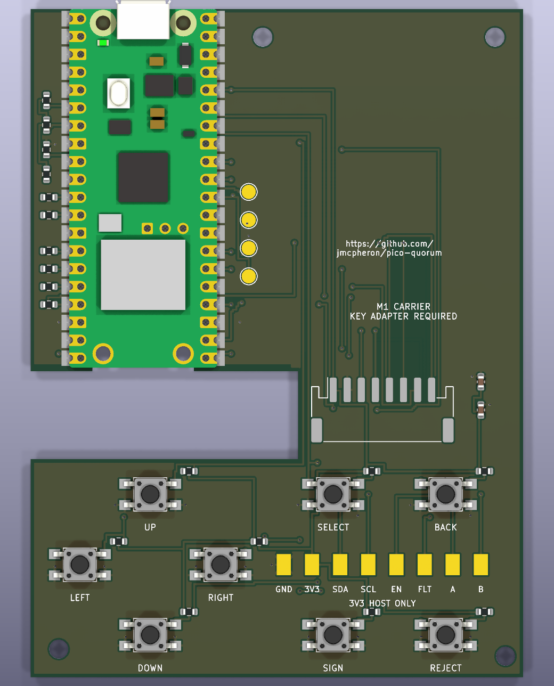

# M1 prototype console carrier

2026-10-07. Native KiCad schematic and routed PCB for the eight-button prototype.
The user chose an LCD module and a separate protected key adapter. The carrier
can now be quoted as a PCB assembly. It has not been built or bench-tested.



- [Native schematic](m1.kicad_sch), [PCB](m1.kicad_pcb), [project](m1.kicad_pro).
- [Quote package](fab/m1-quote.zip), including Gerbers/drills, BOM, placement,
  schematic, assembly drawing, bare-board STEP, reports and file hashes.
- [Assembly and quote instructions](ASSEMBLY.md), including both harness pinouts.
- [Circuit drawing](review/m1.svg) and [placement drawing](review/placement.svg).

The carrier is 70 x 95 mm, two layers, with all 30 fitted parts on top. It has a
headerless Pico 2 W, eight SMT buttons, a JST PH LCD connector, 33R display series
resistors, local decoupling, host bus pull-ups, a default-off request pull-down,
four debug/service pads and eight internal key-adapter pads. Power comes from
the Pico's micro-USB socket. No battery or rotary control is included.

The display is Waveshare's 1.3inch LCD Module, SKU 15867, bought and mounted separately.
It uses a keyed harness rather than a soldered bare-panel ribbon. The adapter's
protection circuit is not on this board. Do not connect a USB-C plug or key directly
to the host pads. See ASSEMBLY.md for what that separate adapter must do.

The PCB's radio cutout and copper void follow the Pico module footprint. The main
board neck carries the traces around the antenna area. Keep the LCD, cable and
case hardware clear of that area. The screen envelope is an allowance: no enclosure
or complete assembly stack has been checked. The render uses the stock Pico W model
as a shape stand-in for Pico 2 W; the LCD and J1 connector body are not modelled.

## Checks completed

KiCad 10.0.6: ERC **0 errors / 0 warnings**; all-severity DRC **0 findings**;
unconnected items **0**; schematic/PCB parity **0**. No custom DRC exclusions were
added. The reports also list KiCad's default ignored checks. The export script
verifies that the 30 BOM references equal the placement references, and that all
are on the top side. Both checks passed.

Compared the Pico footprint, underside pads and stencil drawing with the maker's
PDF. Checked the switch's pad dimensions and internally common terminals. Checked
the JST PH family, pitch and header dimensions; the downloaded JST land-pattern
page could not be fully rendered because the local PDF reader lacks its font map.
The connector uses the stock KiCad footprint and still needs assembler drawing review.
Read the LCD's manual and circuit, including the backlight transistor and opposite
connector numbering. Inspected the exported schematic and PCB render.

Ran `git diff --check` and whitespace checks on new text files. Exported and checked
the Gerber/drill archive, BOM/CPL reference sets and file hashes. No firmware, web or
browser CI suites ran: this change is hardware CAD and supporting files only.
No installed dependency, board write, chip provisioning, lock, supplier quote or order.

Some local KiCad checks/rendering crashed in the filesystem sandbox. They completed
outside it. KiCad also logged a font-config notice; circuit/PCB checks completed.
PCB scripts use the existing key-board schematic helper and installed KiCad Python.
No dependency was added.

## Still to check

Assembler acceptance of the Pico module, stencil, JST footprint and parts sourcing;
LCD harness continuity and physical stack; button plungers and Sign recess; milled
cutout corner radii; Wi-Fi and supply behaviour under load; protected adapter design
and tests; Select/Device navigation and the existing review/reject/hold-to-sign checks.
Quote the carrier now, then resolve those before making or using a complete console.

`bootstrap.py` made the initial native files. It deliberately produces an unrouted
board and refuses to overwrite without `--force`. **Do not rerun it on this routed
design.** The native files are now the source. Regenerate exports with:

```sh
python3 hardware/console-pcb/minimal/m1/export.py
```

That command needs `kicad-cli`. STEP/rendering additionally use the installed KiCad
models. The `console_m1` symbol and footprint libraries are local to this project.
No change to the signing site, firmware image, ordered key-C board or release tags.
