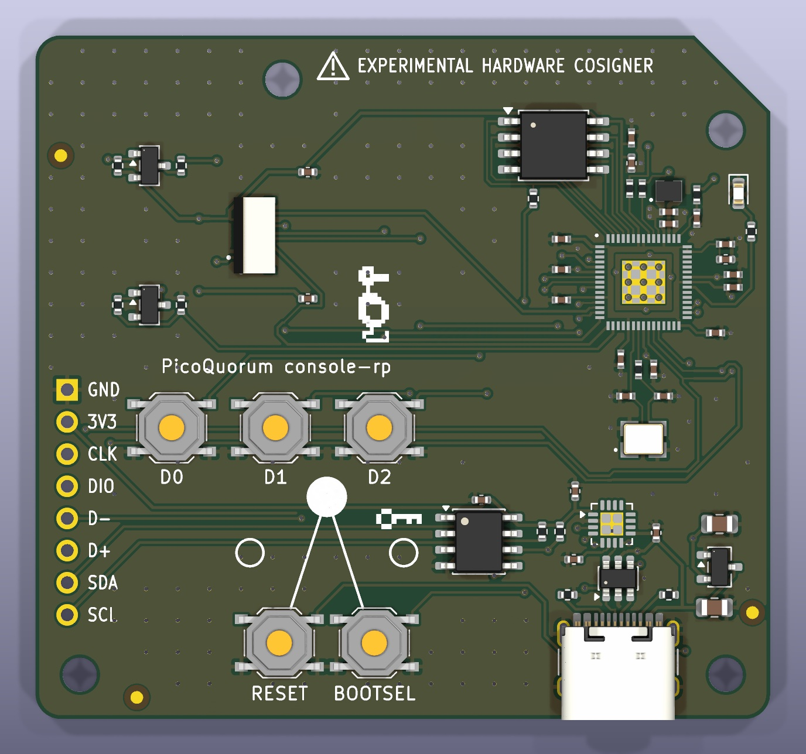

# console-rp: the console on an RP2350, with no radio

*Design, 2026-10-29. Written by a script and read back by KiCad 10: the schematic (netlist and ERC)
and the board, routed (DRC). The fab files for JLCPCB are in [console-rp/fab/](console-rp/fab/) and
pass `tools/keypcb jlc console-rp`. Two real panels were checked against J2 ([The panel](#the-panel)).
Five ordered from JLCPCB on 2026-10-29, fully assembled
([the order](../../buildlog/2026-10-29-console-rp-order.md)), and received on 2026-11-04. The first
one is up on a bench script ([bench/BRINGUP.md](bench/BRINGUP.md)); the console's firmware for it is
not written yet.*

## Rev B, 46 × 70: in the generator only, not placed (2026-11-06)

`gen_console_rp.py` now places the short bar 2 mm thinner and 5.5 mm taller, 46 × 70:
- **All of the extra height is in the top strip** (`DY`). The glass's top is at y 12.0, not 6.5, and
  everything under it moves down 5.5 with it. H1 and H2 have the strip to themselves, for the
  case's posts. FID1 moves down to y 8.0, out of the warning's line.
- **D0, D1 and D2 are 10 mm apart** (`PITCH`), not 8.2. D1 stays under the middle footer slot's
  middle. D0 and D2 are 1.8 mm further out than their slots' middles, still inside the slots.
- **U1's block moves 2 mm left** with the right edge. The key (U5, C23, R6, R7) moves 1 mm left. The
  USB-C's block stays at the left edge. The channel between the USB block and the key, where
  LINK_TX and LINK_RX run, is 3.4 mm, down from 4.4.
- `jb()`'s numbers are now taken from J1 at `J1_DRAWN`, so the USB copper moves with J1. Before,
  they were plain board positions.

**Not placed, routed or checked with KiCad.** This was done in a cloud session without KiCad.
There, a scratch script read each part's pads and courtyard from the routed board, put them at the
new places, and checked courtyards, the board's edge, the holes' and fiducials' rings, the glass's
rules, and the generator's drawn copper against other nets' pads. It found nothing the 48 × 64.5
placement doesn't also show. That is a preview, not DRC: it doesn't check silkscreen text, or
anything the router will draw.

**The generator is now ahead of the board.** The routed board, its fab files, the golden pictures,
the renders and what follows down to "Rerouting" are still the 48 × 64.5 board's (commit
`04141ce`). Until the board is placed again:
- `tools/keypcb gen-console-rp check` and `jlc` check that board with the new numbers;
- the case (`cad/consoles/rp.py`) stops at its check of the generator against `fab/cpl.csv`.

The risk is the route. At 45 mm the router left lines open round U1's left side. At 46 mm it isn't
known.

On the Mac:
1. Delete `console-rp/console-rp.kicad_pcb`.
2. Run `tools/keypcb gen-console-rp`.
3. Run `tools/keypcb route console-rp`, then `gen-console-rp tidy`.
4. Make the hand steps the new route needs. The 48 × 64.5 route's steps 3–5 don't carry over (see
   "Rerouting" below).
5. Run `gen-console-rp check`, `fab`, `jlc console-rp` and `jlc --selftest`.
6. Redraw the case: `MARK` and `back_text` in `cad/consoles/rp.py` are absolute.

## Rev B: the short bar, routed, its fab files written (2026-11-05)

`gen_console_rp.py` now describes rev B: rev A's circuit on a small portrait board, 48 × 64.5 mm.
Two earlier rev B boards were routed and passed every check the same day, but weren't ordered: the
square board of [the rev B plan](REV-B-PLAN-2026-11-05.md) (58 × 54, a corner cut)
is commit `3be2e70b`, and a taller candy bar, 45 × 83, was never committed. The board, its fab
files, the golden pictures, the renders and PINS.md in this folder are the short bar's. The rest of
this README, from the first picture down, is still rev A's, as ordered. Rev A's generator, board and
fab files are commit `4a349cc`.

What the generator places, top to bottom:
- **the top strip:** H1 and H2, and the warning between them;
- **the glass,** 31.0 × 17.6 (the datasheet's), centred across, its top at y 6.5. Under it, placed
  from the glass's corner (`gl()`): J2, the backlight switch, their capacitors and the dragon. The
  LED is right of it;
- **J3** down the right edge beside the glass, not fitted: seven holes, GND, 3V3, CLK, DIO, RUN,
  D+ and D−, for a header at the bench and for a jig's pogo pins. Its last two are level with the
  bench USB's lines out of U1's block, so they run straight in on the front;
- **Picoquorum console-rp,** then **D0, D1 and D2** at `slot()`: x 15.75, 23.95 and 32.15, y 30.5;
- **RESET and BOOTSEL** at the left, x 5.0 and 14.5, y 39. The front has no mark now; it is on the
  back;
- **U1's block** at the bottom right, written as offsets from U1 so it moves as one. The flash is
  above it, under D2;
- **the USB-C** on the left edge, low: the plug comes in from the left. The square board's block
  round it (U2, the CH343P, the regulator and their parts) turned with it a quarter turn (`j1()`);
- **the key** (U5) at the bottom, between the USB block and U1's;
- **H3 and H4** in the bottom corners, and three fiducials: FID3 is on the left edge, where J3 was.

The BOM (57 parts) is the square board's. So is the netlist, but for J3: the jig's seven pads
(TP1–TP7) are gone into it, RUN is on it now, and the key's bus is off it (R6's and R7's pads have
it for a key on wires). The cut corner and the key port's zone went with the square outline.

**Routed and checked on the Mac** (KiCad 10.0.6, Freerouting 2.5, 2026-11-05):
- `tools/keypcb gen-console-rp`: ERC 0, KiCad's netlist matches the table.
- At 45 mm wide the router left LCD_SCK, LCD_CS, USB D− and a ground island open: nine lines leave
  U1's left side through one channel. At 48 mm it routes.
- **A ground review of the first short-bar route** (2026-11-05, before any order) found:
  - U1's exposed pad, its only ground but the regulator's pin, met the rest of the ground through
    one via. Back tracks had fenced the back under it in. The candy bar's route had two.
  - The flash's six lines had ground under 27–44 % of their length (rev A: 85–90 %).
  - U2's ground (the USB's ESD clamp) had no way to the pour.

  So the generator now has, for the route only, a keep-out on the back round U1, under the flash
  and under the bench USB's lines (`AROUND_U1`), so the back there stays one ground. It also has
  U2's ground to a via in U2's middle, with VBUS from pin 5 past it to a via of its own; R1's 3V3
  on down the front to C9's; a ring round each fiducial that tracks keep out of.
- That route still had J3 at the left edge, far from U1: the bench USB, SWD and the key's bus ran
  50–90 mm each across the back, 655 mm of back tracks in all. So J3 moved beside U1 (see above).
- **The route after J3 moved** took four tries. The router first left LCD_CS shut in behind
  LCD_DC's via; with CS drawn out to a via, it fenced D1 in with its own ground tracks; with the
  screen's four lines and D0 and D1 drawn out of U1's left side (`BUS`), it routed, but took USB
  D+ and VBUS across the back and LINK_TX and LINK_RX round them, which shut U2's ground via in
  again. So the USB-C's D+, D− and VBUS through U2 are now drawn as the first short-bar route had
  them (`USB`), with a keep-out on the back from U2's ground via to the left edge (`AROUND_U2`).
- Freerouting 2.5 draws ground tracks even with the Ground class left out (`-inc Ground`): KiCad's
  Specctra export puts every net in one class, so there is no Ground class for it to leave out.
  Tried in scratch, not in `tools/keypcb`: with GND in a class of its own, Freerouting leaves it,
  but counts it as unrouted and skips its optimizer, and the import came back with signal lines
  open; with GND taken out of the netlist, 32 to 33 signal connections stayed open.
- Freerouting gives the same route for the same board file. Placing the board again gives new
  UUIDs, and a different route.
- Then, on the routed board:
  1. `tools/keypcb gen-console-rp tidy`;
  2. J2's pin 2, the panel's only ground, was shut in by LCD_LEDA's via. That via moved 0.5 mm
     down, under pin 1, to (20.25, 17.45), and a ground via went in left of pin 2, at
     (20.20, 16.60);
  3. two ground vias where C4's, C5's, C10's and C23's part of the front pour met nothing else,
     at (27.09, 52.16) and (31.33, 46.63);
  4. BTN_D2's 0.12 mm neck at (25.5, 35.0), on the back, widened to 0.15 mm;
  5. LCD_CS's drawn via at (33.30, 51.55) taken off: the router went on along the front from it.

  **Don't reroute this board.** See below for why, and for what carries over to a new one.
- Checked after, with scripts on the board's copper (scratch, not in the repo):
  - The ground is one piece: every part of either pour meets the rest. U1's exposed pad meets the
    main pour through 3 separate vias at the least (the first route: 1): the back pour under U1 is
    its own piece, joined to the main front pour by two vias and, through the front round C4, C5,
    C10 and C23, to the main back pour by a third. With those three vias taken off, KiCad's
    connectivity finds the ground in two pieces. (It said 6 here before: a scratch script had
    joined copper that doesn't touch.)
  - Back tracks: 375 mm (before J3 moved: 655). Each line's length now (before): the bench USB's
    D+ 12 mm and D− 8 mm, all on the front (60 and 59, mostly on the back); SWCLK 39 mm, all on
    the front (93); SWDIO 34 (81); SDA and SCL 23 each (67 and 61). RUN is longer, 76 mm (67), 65
    of it on the back: it goes to J3 at the right edge now, and to RESET at the left.
  - Ground under each fast line, now (before J3 moved): the flash's six
    100 % (100 %); the crystal's 88–100 % (89–100 %); the screen's SCK 85 % (39 %), MOSI 67 %
    (64 %), CS 74 % (61 %), DC 73 % (47 %); the bench USB 92 and 88 % (82 and 77 %); USB D+ 89 %
    (92 %), D− 42 % (49 %); SWCLK 63 % (74 %); LINK_TX 47 % (55 %), LINK_RX 39 % (28 %).
- `tools/keypcb gen-console-rp check`: DRC with schematic parity is clean but for J1's and J3's
  footprints. Nothing else is in Raspberry Pi's areas.
- `tools/keypcb jlc console-rp`: every check passes. Warnings: U3's heat, as on rev A (about 82 °C
  over the air at 0.12 A, by the datasheet's 400 °C/W), and J3.2 "joined to a pour by solid
  copper". That one is wrong: the check counts any pour on the pad's net, and J3.2 (3V3, at
  45.5, 25.6) is about 19 mm from the only 3V3 pours, under U1. The flash's lines are over ground
  at 100 %, and U1's pad meets the main pour through 3 vias, both at the least `jlc_spec()` asks.
  The golden pictures are this route's. `--selftest` catches 12 of 12.

**Rerouting, and what carries over to a new revision.** The routed board's copper comes from three
places:
- **The generator:** the placement and the netlist, and every track and via it draws, each locked
  so the router leaves it. That's Raspberry Pi's copper round U1, the flash's lines, the lines out
  of U1 (`BUS`, `SWD`), the bench USB (`BENCH`), the USB-C's lines (`USB`), J2's pins 1 and 2
  (`PANEL_PINS`), the ground and 3V3 ties (`TIES`, `HAND_VIAS`), and the keep-outs the router obeys
  (`AROUND_U1`, `AROUND_U2`).
- **Freerouting:** everything else.
- **The hand steps** above.

Freerouting gives the same route only for the same board file. Placing the board again writes new
UUIDs, and any change to the generator moves something, so the route comes out different. The hand
steps were made on this route's copper and don't fit another. So a new route is a new board to
check, and `tools/keypcb gen-console-rp` won't place over a routed board.

What carries over:
- Everything the generator draws. A board placed from it was checked against this one: every
  track and via it draws is on the routed board, but LCD_CS's via (step 5).
- Hand step 2, J2's pins, is in the generator now (`PANEL_PINS`).
- Step 5: LCD_CS's via is unlocked now, as BL_GATE's is, so the route's tidy-up drops it if the
  router doesn't use it. Not yet tried in a route.
- Steps 3 and 4 (an island's vias, a neck) belong to this route. DRC finds their like on any route.

What a new route is checked for:
- `tools/keypcb gen-console-rp check`: DRC with schematic parity finds a pad or a piece of pour
  left off (`unconnected_items`), a via joined on one side only (`via_dangling`) and a track under
  0.15 mm (`track_width`).
- `tools/keypcb jlc console-rp`: the ground review's two findings are checks now, in `jlc_spec()`.
  Each of the flash's six lines must have ground under 90 % of its length (`return_least`; the
  first route had 26-42 %). U1's exposed pad must meet the main pour through 3 vias at least
  (`ground_ties`; the first route had 1). Either one fails the run. `--selftest` breaks a copy
  each way and checks both are caught. The run also prints the ground under the other fast lines,
  to read against the numbers above.
- No check sees long lines on the back, like the bench lines before J3 moved. Look at the back.

**The case,** [`cad/consoles/rp.py`](../../cad/consoles/rp.py), is redrawn for the short bar:
52.6 × 75.1 × 10.9 mm closed, the lanyard lug included. The USB-C is open in the left wall. RESET
and BOOTSEL are pinholes with their names cut under them. The mark's badge sits at the right, under
D1 and D2, and the name is cut under it. It builds with nothing overlapping; it hasn't been printed.

**Still to do:**
1. Before the order: the plan's choices (how many and which assembly, the mask colour, the value
   swaps). On 2026-11-05 JLCPCB had every part of this BOM in stock, L1 included. Quote again with
   these files, and hold `fab/check/cpl-overlay.png` beside JLCPCB's placement preview for J1, U4
   and U1's turns.
2. Print the case's face and lay it on a 1:1 print of the board.
3. The concept's outlines round parts that have none (`outlines()` on `claude/console-rp-concept`)
   need pcbnew to check, so they haven't been brought over.

![console-rp rev B from above: a short board, a warning triangle and EXPERIMENTAL HARDWARE COSIGNER along the top between two holes, the 1.14-inch screen under it with the LED to its right and the bench header's seven holes down the right edge below it, PicoQuorum console-rp, then D0, D1 and D2 in a row; RESET and BOOTSEL at the left under them and the flash at the right; at the bottom the USB-C on the left edge with the CH343P and the regulator beside it, the key chip with an 8-bit key pointing at it, and the RP2350 and the crystal on the right](renders/console-rp-top.jpg)

*KiCad's 3D render of rev B, routed. The panel is drawn as a box. More views are in
[renders/](renders/).*

[console-usb](../archive/console-usb/README.md) took the radio out of use on an ESP32-S3. This board takes
it out of the chip: an **RP2350A** has none. The console talks to the world only through the USB-C
cable it is powered by. A program on the computer fetches the Safe's queue for it and posts its
signatures. The console still rebuilds every hash itself, and the key still signs only that.

```
   Safe's service ── HTTPS ── computer (the relay) ── USB-C ── CH343P ── UART1 ── RP2350A ── I2C0 ── ATECC608C
                              no key, no say in                              screen, D0 D1 D2
                              what gets signed
```

## Why an RP2350

The parts cost about the same as console-usb's: the RP2350A ($1.13 at 100) and its flash ($1.78)
against the S3's $2.52. What it buys is simpler:
- **No radio on the chip at all**, so nothing to keep switched off and no antenna rules.
- **The stock MicroPython image for the Pico 2** (not the W) runs on it, and the console already
  runs on an RP2350 (the Pico 2 W).
- **KiCad 10 ships the RP2350A's symbol and footprint**, and Raspberry Pi publishes the minimal
  circuit around it ("Hardware design with RP2350"). The circuit here is that one.

## Why a serial bridge, not the RP2350's own USB

The RP2350's own USB carries MicroPython's REPL. On this console the cable goes to a computer and
stays there, so any program on that computer could reach the REPL. From there it could make the chip
sign any digest, or call `machine.bootloader()` and write a new image. The bridge closes this with
wiring, as on console-usb:
- The USB-C's D+ and D− go to a **CH343P** (C2846043) and nothing else. It is a standard USB serial
  device (CDC-ACM), so no computer needs a driver.
- Its TXD and RXD go to **UART1** (GPIO21 and GPIO20). MicroPython never puts its REPL there.
- Its **DTR and RTS go nowhere.** The computer can't reset the RP2350 or hold BOOTSEL. DTR is also a
  strap at power-up, so it floats.
- The RP2350's own USB (through Raspberry Pi's 27 Ω) and SWD go to **J3**, a header that isn't
  fitted. Flashing needs J3 and a cable, or SWD and a debug probe: a person with the board in hand.

The generator checks this from KiCad's netlist and stops if it isn't so: the USB-C's data lines,
DTR and RTS, the RP2350's USB and SWD, RUN and BOOTSEL.

## The circuit

| block | parts | notes |
|---|---|---|
| the chip | U1 RP2350A (QFN-60), a 100n at each power pin | USB_OTP_VDD and QSPI_IOVDD share one, as the minimal design |
| its 1.1 V | L1 3.3 µH, C1 and C2 4.7 µF, R1 33 Ω and C3 4.7 µF on VREG_AVDD | the minimal design's. Raspberry Pi says to copy its layout and L1's orientation exactly |
| the clock | Y1 ABM8-272-T3 12 MHz, C15 and C16 15 pF, R2 1 kΩ into XOUT | the crystal and values Raspberry Pi asks for |
| the flash | U6 W25Q128JVSIQ, 16 MB, R3 1 kΩ and SW5 BOOTSEL on QSPI_SS | Basic at JLCPCB, so no fee. The Pico 2 image uses 4 MB of it |
| power | J1 USB-C (5.1k on CC1 and CC2), U2 USBLC6-2SC6, U3 XC6206P332MR | 200 mA is well over what the board draws |
| the link | U4 CH343P | VDD5 and VBUS from the USB-C, V3 on its own 100n, VIO at 3.3 V (WCH's datasheet, 5.2) |
| the key | U5 ATECC608C-SSHDA-T (SOIC-8), R6 and R7 4.7k on I2C0 | SOIC because JLCPCB has 3,972; the UDFN had 27 |
| the screen | J2 ZIF for the 1.14″ 240 × 135 ST7789, Q1, Q2 backlight switch | console-usb's: the same ZIF, panel and pin order |
| buttons | SW1–SW3 D0 D1 D2 in a row under the screen, each to GND | pulled up inside the RP2350, pressed low. Each sits under one of the three footer slots the QT Py console draws |
| reset | SW4 RESET on RUN | |
| bench | J3, 8 holes: GND, 3V3, SWCLK, SWDIO, D−, D+, SDA, SCL | not fitted |

[PINS.md](PINS.md) has the GPIOs. The screen (GPIO 8–13 on SPI1) and the key (GPIO 4 and 5 on I2C0)
are on the Pico's pins, the ones `firmware/board.py` uses by default. The generator checks that, and
checks each GPIO against the RP2350's function table.

**RP2350-E9.** A GPIO with only a weak pull-down can float at about 2 V. Nothing here uses an
internal pull-down. The backlight line's pull-down, R11, is 4.7 kΩ, under the 8.2 kΩ the erratum
asks for.

## Parts at JLCPCB

From JLCPCB's parts search on 2026-10-28. Prices are for one piece and for 100.

| part | LCSC | tier | stock | 1 | 100 |
|---|---|---|---|---|---|
| RP2350A | C42411118 | Extended | 5,521 | $1.30 | $1.13 |
| W25Q128JVSIQ | C97521 | Basic | 66,073 | $2.58 | $1.78 |
| ABM8-272-T3 | C20625731 | Extended | 2,147 | $0.66 | $0.43 |
| AOTA-B201610S3R3-101-T | C42411119 | Extended | **6** | $0.36 | |
| CH343P | C2846043 | Extended | 12,867 | $0.98 | $0.68 |
| ATECC608C-SSHDA-T | C28975195 | Extended | 3,972 | $1.75 | $1.15 |
| XC6206P332MR | C5446 | Basic | 533,724 | $0.15 | |
| USB-C TYPE-C-31-M-12 | C165948 | Extended | 292,653 | $0.19 | |
| USBLC6-2SC6 | C7519 | Extended | 40,704 | $0.18 | |
| ZIF 0.5K-HX-8PWB | C2919492 | Extended | 15,695 | $0.10 | |
| 27 Ω 0402 | C25100 | Extended | 43,619 | $0.001 | |
| AO3401A, SS8050, LED, buttons, the other passives | | Basic | | | |

**About $8.70 of parts a board** at one-piece prices, and about $6.60 at 100. The panel is bought
separately (about $2.50) and clipped into J2 by hand.

**Nine Extended parts, each about $3 a JLCPCB order.** The 27 Ω pair serves only the bench USB on
J3. A Basic 22 Ω would save $3 an order, a little off Raspberry Pi's value.

**L1 is the risk.** JLCPCB has 6 of Raspberry Pi's polarity-marked inductor. Raspberry Pi says its
regulator needs this part, the right way round, in their layout. Before ordering, check the stock,
and plan to pre-order or send our own if it's still short. Its footprint is Raspberry Pi's, from
their minimal design, turned as theirs is.

## The board

72 × 36 mm, two layers, every part on top, ground poured on both sides.
- The panel's glass lies on four 2 mm foam pads at the top left. Under it are only J2, the
  backlight switch and 0402s. The generator checks their heights and keeps them off the pads and
  out of the ribbon's path.
- D0, D1 and D2 sit in a row under the glass, each under the middle of its footer slot.
- The RP2350 is right of the glass. The flash is above-left of it, where its QSPI pins are; the
  regulator is above-right, where VREG is; the crystal is below.
- The CH343P sits between the RP2350 and the USB-C on the right edge.
- The key, RESET, BOOTSEL and the LED are along the bottom; J3 is along the top.
- The silkscreen: a warning triangle and EXPERIMENTAL HARDWARE COSIGNER over the glass, and the
  name under it. On the back: the revision, **picoquorum.dev** and the licence, which names it as
  the Source Location.
  console-s3's 8-bit key (a nod to Adventure) sits beside U5, the key that signs, pointing at it.
  Its dragon is the Easter egg: under the glass, below the ribbon's path, turned to face the key.
  Pixels are 0.4 mm for the key and 0.3 mm for the dragon, so every gap is at least twice JLCPCB's
  0.15 mm.

### The panel

The panel is the common 8-pin 1.14″ ST7789V with a plug-in ribbon. Sellers call it NFP114H-03AF
(printed on the ribbon), NFP114H-03D, N114-2413THBIG09-C08 or Y114-2413THBIG09-C08. YIYANG's
datasheet for the Y114 (rev A, 2020) gives:
- pins 1 LEDA, 2 GND, 3 RESET, 4 RS, 5 SDA, 6 SCL, 7 VDD, 8 CS, at 0.5 mm, the same as J2;
- glass 31.0 × 17.6 × 1.6 mm, with a 23 ± 0.3 mm tail;
- one white LED, its cathode grounded inside, 2.9 to 3.1 V at 20 mA; VDD 2.4 to 3.3 V.

On 2026-10-29 two panels (Walfront's "ST7789V LCD Display Module 1.14 Inch ... Inline Type 2Pcs")
were checked by hand:
- the tail is 23 mm;
- pin 1 is on the side the board expects. With the glass face up and the ribbon leaving its right
  end, pin 1 is nearer the bottom edge, as on the datasheet's drawing. The fold under the glass
  keeps it there, and that is where J2's pad 1 (LEDA) is.

What follows from the datasheet, none of it a change to the board:
- **The ribbon loops, it isn't creased.** The datasheet's tight fold ends 21.0 ± 0.5 mm in from
  the glass's edge, but J2 is about 18.2 mm in. The spare ribbon makes a looser loop, about
  1.5 to 2 mm past the glass's right end by the drawing (not measured). Nothing on the board is
  there; a case needs room for it. console-s3 put its J2 for the tight fold; this board and
  console-usb didn't.
- **The top-right foam pad goes 2.5 mm in from the corner.** At the corner it would sit on U6's
  pins 3 and 4.
- The glass is 0.6 mm wider than the generator's 17.0, which is still the probots listing's figure.
  The extra 0.3 mm each side meets the silkscreen corners and covers nothing new.
- The active area is 1.4 mm off-centre, away from the ribbon. So each button sits 1.4 mm right of
  the middle of its footer slot, well inside the slot's 8 mm.
- R8's 22 Ω gives about 12 to 22 mA, by the datasheet's Vf and a 3.3 V rail within 2%. The high
  end is just past 20 mA. Dim it with PWM, or fit 27 Ω (parts list only) if it runs bright.

Other 1.14″ panels to avoid: the 13-pin N114-2413THBIG01-H13 (another pinout), the solder-type
ribbon, and modules on a small board with a 2.54 mm header (GND on pin 1).

### Round the RP2350: Raspberry Pi's layout

Raspberry Pi says to copy its minimal design's layout, so the board does. `rpi_minimal.py` reads
their KiCad files (MIT, [lib/RPI-MINIMAL-LICENSE.txt](lib/RPI-MINIMAL-LICENSE.txt)) and writes
their footprints for the chip, L1, the crystal and the 0402s into `lib/pqrp.pretty`, and
`rpi_minimal.json`: where each of their parts sits from the chip's centre, their power copper (the
regulator's pours, the rings under the chip, the DVDD and 3V3 tracks and vias), and their crystal's
corner (its lines, ground vias and pour). The generator puts the same
parts at the same places round our U1 and copies their copper, locked. Where ours differs:
- **0.3 mm holes**, not their 0.25: JLCPCB's base price, and our vias'.
- **Their C12 (our C14) moved.** It sat where our flash's lines run; ours is above the USB
  resistors, beside C17.
- **The flash is 1.9 mm nearer the chip,** so its six lines are drawn by hand, as theirs run.
- **Their 27 Ω pair (our R13, R14) is turned round,** as our symbols have the chip on pin 1.
- **Their two ground vias by C1 and C2** were 0.05 mm from those pads' mask openings, where solder
  runs down. The one by C2 moved 0.15 mm out; the one by C1 had no room to move and is left out. C1's
  ground pad reaches the other by a track, and the pour.
- **Our front pour is ground, theirs 3V3,** and it stays out of the regulator's corner, where it
  left scraps between their pours.
- **The back under the chip** is a keep-out for the router, but for their four DVDD tracks, and so
  is the back under the crystal and its capacitors, which on theirs is only ground.

The generator checks the routed board for any other net's copper in their regulator corner or
their crystal's corner, or under the chip or the crystal on the back.

### Routing

Some lines are drawn by hand in `gen_console_rp.py` and locked, because the router left them open
or necked them down: the flash's six, its 3V3 from pin 54, the bench USB to J3, the key's bus out
from pins 7 and 8, SWD and RUN out from pins 24–26, and a few short ties and vias. C17's ground and
the CH343P's exposed pad each get a via the pour can't give them: C17's beside its pad, the
CH343P's in its exposed pad, since its pins shut it in.

`tools/keypcb route console-rp` routed the rest with Freerouting 2.5. The Ground class isn't
routed: the pours and 163 ground vias join it. Tracks are 0.2 mm, 0.25 for power and ground, the
least 0.15. The route isn't the same each run, so after it the board was put right in place, not
routed again: the ground vias the route's tidy-up had put inside C17's and the CH343P's pads went
(it now keeps 0.45 mm from pads), D+ moved out for C17's via, and a few track ends went onto their
vias' centres. The generator draws all of it the same way for the next route.

Then Raspberry Pi's crystal corner was copied (2026-10-29), which moved U5 2 mm down, C23 up-left of
its pin 8, and R6 and R7 round so their 3V3 pads face pin 8. The board was placed again, the old
route carried over locked wherever the move left it whole, and the rest routed: the crystal's
lines are theirs, and SDA, SCL, the LED and BOOT_SW were routed again whole. For that route only,
a keep-out over the crystal's corner kept the router out of it.



## What is checked, and how

`tools/keypcb gen-console-rp` (add `render` for the pictures) writes everything from the one table
in `gen_console_rp.py`, then checks it. It won't overwrite a routed board: `tools/keypcb
gen-console-rp check` checks the routed one as it is. Both run:
- **KiCad reads the schematic back.** Its netlist must match the table, net by net.
- **ERC:** 0 errors, 0 warnings.
- **The link's wiring rules** (above), from the netlist.
- **Every symbol pin has a pad** in its footprint, and every pad a pin.
- **Each GPIO's function** (UART1, I2C0, SPI1) against the RP2350's table, and the screen's and
  key's pins against `firmware/board.py`.
- **DRC on the routed board.** Allowed: J1's and J3's footprints differ from the library (J1's
  silkscreen past the edge left out; J3, not fitted, has holes only), and the glass's outline over
  U6's pads.
- **Raspberry Pi's areas:** no other net's copper in their regulator corner or crystal corner, or
  under the chip or the crystal on the back.
- **Under the glass:** each part's height and place.

`tools/keypcb fab console-rp` writes the files to upload: `console-rp-gerbers.zip`, `bom.csv` and
`cpl.csv` in [console-rp/fab/](console-rp/fab/). `tools/keypcb jlc console-rp`
([tools/jlc](../../tools/jlc/README.md)) passed every check on 2026-10-29: DRC at JLCPCB's limits,
the Gerbers and drills read back, the netlist, the BOM and CPL against LCSC's parts, mask and paste,
holes, pours and the 3D fit. Its self-test caught 10 of 10 broken copies. What its spec
(`jlc_spec()`) lets through, each with why:
- 30 DRC and parity findings: Raspberry Pi's footprints and the ZIF don't match the stock symbols'
  footprint filters, U1 is an SMD part with holes in its pad, J1's and J3's footprints as above,
  J3 and the panel have no courtyard, and the glass's outline over U6.
- U1's nine thermal-via holes are held to the vias' ring (0.15 mm), not a component hole's 0.2.
- The one via in the CH343P's exposed pad.

Its warnings: J3's 3V3 hole is joined to the pour solid, so slow to solder by hand;
U3 runs about 82 °C over the air at 0.12 A on the datasheet's SOT-23 figure (34 °C at 0.05 A).

Not checked:
- L1's footprint (Raspberry Pi's) against Abracon's land pattern;
- the 3D fit's guessed sizes: the foam, the ribbon's loop, and how high U6's leads rise;
- anything on a real board.

An outside review on 2026-10-29 found these, all left as they are for the first boards:
- USB D+ and D- between J1, U2 and U4 have ground under 75% and 48% of their tracks. D- crosses
  to the back on three vias. At full speed (12 Mb/s) 20 mm of track is electrically short.
- VBUS has 11 µF on it, C18's 10 µF and C20's 1 µF. USB asks for at most 10 µF; C18's comment
  counts only itself. A 4.7 µF C18 would fix it with no copper change.
- C14 (pins 53-54) is about 8 mm of track from them, against Raspberry Pi's 4.5 mm. Those pins
  also meet the 3V3 ring under the chip and its six 100n capacitors.
- U3's heat (below, under Open) needs a measurement.

## Steps to a board

1. **Panels:** two bought and checked by hand on 2026-10-29 ([The panel](#the-panel)).
2. **Order it** (done 2026-10-29, [the order](../../buildlog/2026-10-29-console-rp-order.md)): upload the
   zip, BOM and CPL; Economic, one side, qty 5. Check L1's stock. Hold
   `fab/check/cpl-overlay.png` beside JLCPCB's placement preview, L1's dot above all.
   JLCPCB's RP2350 design guide asks for Raspberry Pi's layout, the AOTA inductor with a silkscreen
   mark for its way round, and the ABM8-272-T3: the board has all three. Its offer of a review
   with Raspberry Pi means sending them the files; we don't.
3. **Bring one up.** Done for the first board on 2026-11-04, over SWD: J3's USB wasn't seen by the
   Mac. Everything checked out, J3's USB aside. [bench/BRINGUP.md](bench/BRINGUP.md) has how it was
   loaded, what was checked, and the ways to load boards in numbers. What comes next (the
   firmware, the relay, a batch of 20, selling the first boards) is in
   [PLAN-2026-11-04.md](PLAN-2026-11-04.md).
4. **The firmware and the relay.** A `console-rp` profile: the QT Py's footer screens at 240 × 135
   (`claude/qtpy-cosigner`, PR #91), these pins, and the link on UART1. The relay is a new network
   path and part of the app, so it needs a yes before it's built.

## Open

- [ ] L1: Abracon's part in stock, or a tested substitute. This order took JLCPCB's last 6; LCSC
  showed 0 afterwards (2026-10-29).
- [ ] U3, the XC6206: about 82 °C over the air at 0.12 A by the datasheet's figure. The board
  draws less, but a measurement would say.
- [ ] The relay: a Web Serial page in the app, a command-line tool, or both?
- [ ] The 27 Ω pair: keep, or a Basic 22 Ω?
- [ ] A case, and the Sign button's guard.
- [ ] picoquorum.dev, printed on the back, must lead to the site and the source before boards ship.
  Today the site is at picoquorum.app (`docs/CNAME`), and .dev doesn't reach it.
