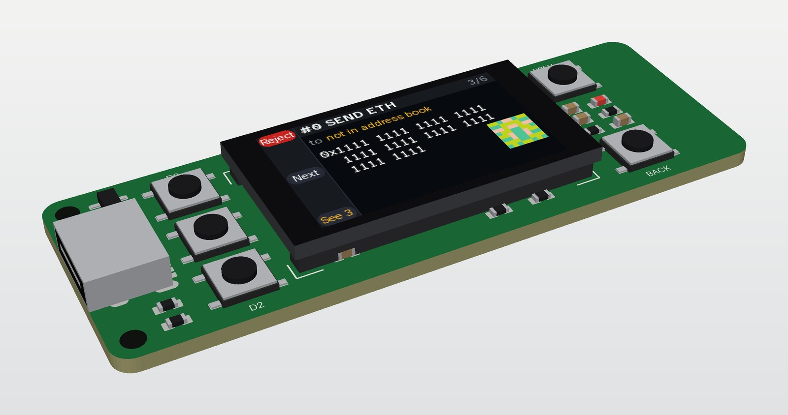

# The S3 console: one board, the chip on it

*Concept, 2026-10-23. The technical design followed on 2026-10-24: [DESIGN.md](DESIGN.md), a
generator, a schematic and a placed board. Where this page and DESIGN.md differ (the module on the
back, five buttons, the regulator, the backlight switch), DESIGN.md is the board.
[SPEC.md](SPEC.md) says what any S3 console must have, whatever its shape.*

*The board as placed, drawn from the generator ([how](DESIGN.md#files)).*

A small board like a Feather, and only that: an ESP32-S3 module, a 1.14″ screen, three buttons, the
ATECC608C soldered on, and a USB-C socket for power and the serial port. No battery, no key port,
no radio of our own. JLCPCB's Economic assembly places everything it can. The module and the panel
are joined in the workshop.

It runs today's console image through the `"feather-s3"` profile, because it copies the Feather's
pins. That is the whole idea: the Feather ESP32-S3 Reverse TFT already proved the console on this
chip, this screen size and three buttons ([FEATHER-S3.md](../wiring/FEATHER-S3.md)). This board is
that Feather with the key on it and the parts it doesn't need left off, at a price that works past
about 15 units.

## The facts that shape it

- **The console needs PSRAM.** It won't fit a WROOM-32's 520 KB ([ESP32.md](../wiring/ESP32.md));
  it runs in the Feather's 2 MB. So the part is an ESP32-S3 with PSRAM, and nothing smaller.
- **JLCPCB places no Espressif S3 module on Economic assembly.** The WROOM-1-N4R2 (C2913203),
  N8R2 (C2913204) and MINI-1-N4R2 (C3013941) are all "Standard Only", which adds about $55 of
  setup, stencil, handling and fixtures to every order. The bare ESP32-S3FH4R2 chip (C3013940, 4 MB
  flash and 2 MB PSRAM in the package) is Economic, but then the crystal, the matching network and
  a PCB antenna are ours, and nothing about the radio is certified. Checked 2026-10-23.
- **So the module goes on by hand.** The WROOM-1's 40 castellations solder with an iron, the way
  console-pocket puts the Pico on. Everything else is Economic. The footprint stays the module's,
  so a later order can let Standard assembly place it, or a respin can take the bare chip.
- **The ATECC608C UDFN is Economic** (C23291019, the part key-b uses). It goes on the board.
- **The screen is 1.14″, 240 × 135, ST7789,** the Feather's panel. The firmware drives it. The 0.96″
  80 × 160 panels LCSC stocks aren't driven and are too narrow for an address. JLCPCB doesn't stock
  the 1.14″ panel; it is about $2.50 with an 8-pin 0.5 mm FPC tail (MKTechnic, AliExpress). JLCPCB
  places a ZIF connector for it (HDGC 0.5K-HX-8PWB, C2919492), and the panel clips in.
- **The S3 has USB of its own.** Its USB-Serial-JTAG port is what esptool and `tools/fw` talked to
  on the Feather. No bridge chip, no auto-reset transistors.
- **Economic assembly is one side.** Module, panel connector, buttons and USB-C share one face.
  (The design puts the module on the back instead: the workshop solders it either way.)

## What is on it

By role, not yet by pin. Tiers and numbers from JLCPCB's parts search on 2026-10-23; check them
when the files go up.

| role | part | JLCPCB | tier | who fits it |
|---|---|---|---|---|
| the brain and the radio | ESP32-S3-WROOM-1-N4R2 (4 MB flash, 2 MB PSRAM), ~$3.50–4.70 | C2913203 | Standard only | the workshop |
| the key | ATECC608C-MAHDA-S, UDFN-8, ~$1.20, with its 100 nF | C23291019 | Extended, Economic | JLCPCB |
| the screen | 1.14″ 240 × 135 ST7789 panel, 8-pin 0.5 mm FPC, ~$2.50 | not stocked | | the workshop: clips in |
| its connector | HDGC 0.5K-HX-8PWB, 8P 0.5 mm ZIF | C2919492 | Extended, Economic | JLCPCB |
| backlight switch | S8050 and three 0603s, as console-pocket does it | C2150 | Basic | JLCPCB |
| buttons | 3 × TS-1187A-B-A-B tact, as console-a | C318884 | Basic | JLCPCB |
| power in | USB-C 16P receptacle, 2 × 5.1 kΩ on CC | C165948 (or key-c's HCTL part) | Extended, Economic | JLCPCB |
| 3.3 V | AMS1117-3.3 from the USB's 5 V, with its two caps. A low-dropout part only if a battery comes later | C6186 | Basic | JLCPCB |
| protection | a TVS on VBUS, 10 kΩ pull-up on EN, the strap pins' resistors | | Basic | JLCPCB |
| status LED | one LED and resistor on the Feather's LED pin | | Basic | JLCPCB |
| spare | 4 pads: GND, 3V3, SDA, SCL, for a key-c on wires or a second chip | copper | | |

What's left off, on purpose: the battery charger and gauge, the STEMMA QT socket, the key port's
load switch, CC sensing and ESD array (the key no longer unplugs), the second row of header pins.

## The pins, in principle

The board copies the Feather's GPIO assignments: the screen's SPI, DC, CS, RST and backlight, the
three buttons on GPIO 0, 1 and 2 (D0 low when pressed, D1 and D2 high), I2C on GPIO 3 and 4, the
LED on 13. Then nothing in `firmware/board.py` changes, and there is no new release fingerprint
(AGENTS.md rule 2). The actual pin table is the design's job, not this page's.

Two things differ from the Feather, and both are already harmless in the profile:
- **No battery gauge.** `NOT_KEYS` keeps 0x36 off the key list; with nothing there, the scan just
  finds the chip at 0x60.
- **GPIO 7 (the Feather's screen and QT power) drives nothing.** The screen and the chip are on
  3.3 V always. The pull-ups on SDA and SCL go to 3.3 V too.

A board that moves any pin becomes a new profile and a new release. Don't, unless the layout forces
it; then say so here.

## The chip on the board: what that changes

Today a console is a console and the key is key-c, a board that unplugs. Here the console *is* the
key. What follows from that:

- **The ceremony runs on the device**, as it did for chip 3 on the Feather. Nothing in the runbook
  changes except that there is no key to plug in ([KEY-RUNBOOK.md](../../docs/KEY-RUNBOOK.md)).
- **One chip per console, for life.** The locks are permanent ([LOCKING.md](../../docs/LOCKING.md)).
  A lost or broken console is a lost owner; the Safe's other owners replace it. That is the
  trade for a device with no connector to protect.
- **The key port circuit goes away.** No load switch, no CC pins, no detect line, no ESD array on a
  plug. The chip sits a few mm from the module on a bus nobody touches.
- **The spare pads keep the option open.** Four pads for a key-c on wires, with the chip on board
  either absent or at another address, if a swappable key is wanted later. Not fitted by default.
- **Nothing on the board signs anything new.** The firmware's rules hold (AGENTS.md rule 1): the
  same `quorum.sign_it`, the same hash, the same held Sign.

## Shape

- **About the Feather's size**, 51 × 23 mm or a little wider, so the wing's holes and a Feather
  case still make sense. The WROOM-1 is 18 × 25.5 mm with its antenna at one end; the MINI-1
  (15.4 × 20.5 mm, the Feather's own module) is the fallback if the panel and the module don't
  both fit, at about $1.50 more.
- **The antenna end is bare**: no copper under or beside it, no screw hole, the board edge free.
  The panel and the buttons sit at the other end, the USB-C on the short edge by them.
- **The panel's glass lies on the board face** over the ZIF, held with tape inside silkscreen
  corners, as console-pocket does it. Three buttons down one long edge, level with the screen's
  rails, so `RAIL_Y` means the same thing it means on the Feather.
- **Two layers, 1.6 mm, lead-free HASL,** 0.25 mm tracks, JLCPCB's limits with margin. Nothing
  here needs four layers.
- **Silkscreen:** the mark, the Source Location (`github.com/jmcpheron/pico-quorum`, CERN-OHL-W
  4.1) and the buttons' names.

## What JLCPCB does, what the workshop does

JLCPCB: the boards, the stencil, every surface-mount part above except the module, placed and
reflowed, on one side.

The workshop, per board:
1. Solder the module: tack two corner castellations, check it sits square and the antenna end is
   flush with the edge, then the rest. The belly pad stays unsoldered, as the Pico's does on
   console-pocket.
2. Meter 3.3 V to GND for a short, then USB in: the LED, and the S3's USB port appears.
3. Clip the panel into the ZIF, tape the glass down.
4. Flash MicroPython's `ESP32_GENERIC_S3` build, `tools/fw push console`, and the bench scan: 0x60
   answers, the screen draws, three buttons read.

About 15 minutes a board once the first one is done. Past 20 or so boards, Standard assembly places
the module for about $55 an order more, and the workshop keeps steps 2 to 4.

## Cost

Estimates from JLCPCB's fee table of 2026-10-22 ($8.18 setup, $1.53 stencil, $3.07 a feeder for each
Extended part type) and the part prices above. Shipping about $20. Not a quote: the quote is free
and comes from uploading the files.

| | 5 boards | 25 boards | 50 boards |
|---|---|---|---|
| fees, once | ~$25 | ~$25 | ~$25 |
| bare boards | ~$5 | ~$15 | ~$25 |
| placed parts, per board | ~$2.50 | ~$2.30 | ~$2.20 |
| the module, bought | ~$4.50 | ~$4.00 | ~$3.60 |
| the panel, bought | ~$2.50 | ~$2.30 | ~$2.20 |
| **per console, shipped** | **~$19** | **~$12** | **~$10** |

The Feather plus a key-c is about $31 and comes with a charger, a gauge and a case shape. This
board beats it only from about 15 units, and the first five are a learning order.

## Steps to a board

1. **Buy one panel and one module** and measure them: the FPC's pin order and which way it folds,
   the module's pad numbers against Espressif's drawing. Nothing goes to fab before this.
2. **Done 2026-10-24, placed but not routed ([DESIGN.md](DESIGN.md)). Write `gen_console_s3.py`** in the style of console-pocket: the parts, the Feather's pin map
   read from `firmware/board.py` (the generator stops if the profile and the table disagree, as the
   wing's does), the footprints, the schematic, the routed board and its self-check.
3. **On a machine with KiCad:** fill, ERC and DRC, the 3D view from both sides, then the fab files.
4. **Quote it** at JLCPCB: Economic, one side, qty 5, Confirm Parts Placement. Read the quote
   against the table above and write the real numbers here.
5. **Order, build one, bring it up** with the Feather's bench scripts, then the console image.
   Log it in the build log.

## Open

- [x] Three buttons like the Feather, or five? **Five** (2026-10-24). D0, D1 and D2 keep the Feather's
      pins and place, so today's image runs; PREV and BACK are on new pins for a later profile and
      release.
- [x] WROOM-1-N4R2 or MINI-1-N4R2? **WROOM-1-N4R2**, on the back, where it doesn't compete with the
      panel for room. The antenna end is flush with the board's edge, with no copper under it.
- [ ] A battery later? Then the regulator becomes a low-dropout part and a charger comes back.
      Nothing in this concept blocks it; nothing in it provides for it.
- [x] Is the AMS1117's 1.1 V dropout fine from USB? Yes from 5 V, but the design uses an ME6211 in
      SOT-23-5 instead: a SOT-223 doesn't fit at this width.
- [ ] Whether to fit the spare key pads at all.
- [ ] A case, and the Sign button's guard, from the kickoff's open decisions.
- [ ] If these are ever sold: a module keeps its radio certification; a bare-chip respin doesn't.
