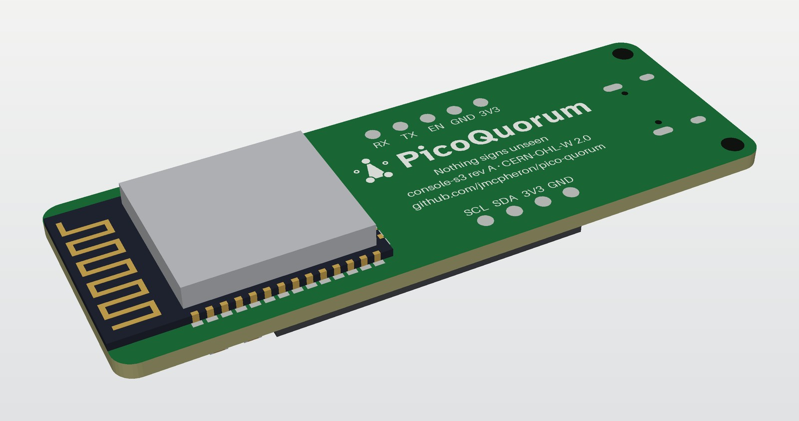
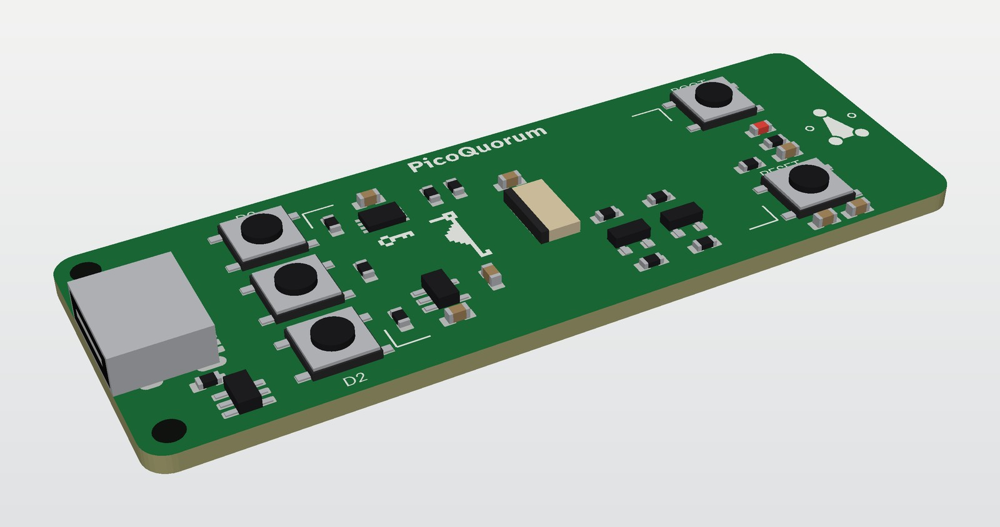
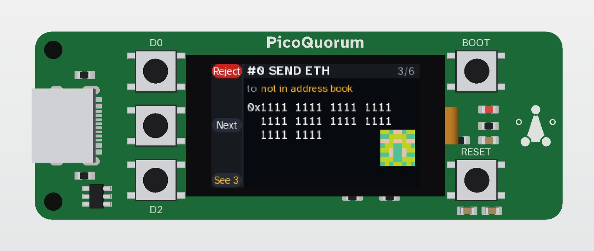

# console-s3, rev A: the technical design

*Drawn 2026-10-24. Written by a script, placed, routed, checked; ERC, DRC and parity clean in KiCad
10.0.6. Not ordered: no panel or module has been measured. The idea and the costs are in
[CONCEPT.md](CONCEPT.md); this page is the board.*

One board for the console: an ESP32-S3-WROOM-1 on the back, the Feather's 1.14″ 240 × 135 panel in
a ZIF on the front, five buttons, the ATECC608C soldered on, and USB-C for power and the serial port.
64 × 22.86 mm, 2 layers, 1.6 mm, lead-free HASL. What any S3 console must have, whatever its shape,
is in [SPEC.md](SPEC.md); this page is one layout that meets it.

| front | back |
|---|---|
|  |  |
|  |  |
| without the panel: what sits under the glass | from above |

These are mock-ups, not KiCad renders. `render.py` draws them from the generator's own positions,
turns, sides and pads, so they show the board as placed. The parts are plain blocks at their
datasheet sizes, not the makers' models. The screen shows the Feather's review page
([docs/quorum-ui/feather](../../docs/quorum-ui/feather/README.md)). The ribbon's fold shows at the
glass's right end in the view from above. They have no tracks. `render.py` needs numpy and
Pillow: `uv run --no-project --with numpy==2.5.3 --with pillow==12.3.0 python3
hardware/console-s3/render.py`. KiCad's own renders of the routed board are in `console-s3/fab/`.

```
  front                                                          the antenna end: no copper
  ┌──────────────────────────────────────────────────────────────┬──────┐
  │ H2  R10  [ D0 ]   ┌──── the panel's glass, on tape ────┐ [BOOT] │      │
  │         │        │  U2  R12 R13                C6     │     D1 │      │
  │ J1 ◄    [ D1 ]   │              J2 (ZIF)              │     R9 │      │
  │ USB-C   │        │  U3  C2          R2 R4             │  R8 C7 │      │
  │ H1 R11  [ D2 ]   │  C1             Q1 Q2              │ [RSET] │      │
  │    U4            └──────────────────── ribbon folds ──┘  C3 C4 │      │
  └──────────────────────────────────────────────────────────────┴──────┘
  back: the module from x 38.5 to the right edge, antenna flush with it; test pads at x 20-32
```

It runs today's console image unchanged: the screen, D0, D1, D2, the key's bus and the LED are on
the Feather ESP32-S3 Reverse TFT's GPIOs, so `firmware/board.py` picks `"feather-s3"` and nothing in
`firmware/` changes (AGENTS.md rule 2). BOOT and RESET are wired as on Espressif's own boards and
need no firmware: BOOT is GPIO0, as D0 is, and RESET pulls EN low.

## What changed from the concept

- **The module is on the back.** The workshop solders it either way, so it needn't share the side
  JLCPCB assembles. The panel, the buttons and the module stop competing for the same 51 mm.
- **Five buttons, not three.** D0, D1 and D2 keep the Feather's pins, polarity and place (level with
  the screen's rails); BOOT and RESET sit right of the panel.
- **The board is 64 mm long**, not the Feather's 50.8. The USB-C, the D column, the 31 mm glass, the
  BOOT/RESET column and the 6.5 mm antenna keep-out end to end. It keeps the Feather's 22.86 mm width.
- **The backlight is switched on the high side.** The 8-pin panel brings out LEDA only, so the
  concept's low-side S8050 can't switch it ([below](#the-backlight)).
- **The regulator is an ME6211 (SOT-23-5), not an AMS1117.** A SOT-223 doesn't fit beside the USB-C
  at this width; the ME6211 fits under the glass ([power](#power)).
- **No reset button.** EN comes out to a test pad on the back. Holding D0 while plugging in starts
  the ROM bootloader, and esptool resets the S3 over its own USB.

## What changed while routing

Checking the placed board in KiCad, before routing it, found three faults in the first draft:
- **Parts at ±90° were turned the wrong way.** The generator took console-pocket's `rotate()`, which
  turns clockwise; KiCad turns counter-clockwise. So in KiCad every part at 90° or −90° sat 180°
  from where the generator's own checks put it, the module and J1 among them. `rotate()` is fixed
  (here and in console-pocket's generator, which this one imports) and each ±90° in the tables is
  swapped, so every pad lands where the first draft meant: a scratch script compared all 203 pad
  positions, and pcbnew's read of the board agrees.
- **The module's exposed pad was 1.85 mm off.** The drawing's 7.5 and 10.29 mm had been read as
  distances to the pad's near sides; KiCad's own footprint for the WROOM-1 (RF_Module) has them to
  its centre, and so does this one now.
- **The module's silkscreen crossed the board edge** at the antenna end. It stops short of it now.

And to make room to route, the parts moved:
- **U4 went below J1, and R10 above it.** Above J1, U4 put the USB lines' way to the module round
  the top of the board. R11 stays below J1, by CC2's pad.
- **The D column moved from x 12.6 to 14.7**, and the glass and everything under it 1.5 mm right
  (the glass is now x 18.5 to 49.5). J1's pads had a 1 mm channel to the D column; they have
  3.1 mm now. The buttons are still level with their rails, and the glass still clears the
  right-hand buttons.
- **C3 and C4 went under SW5** (now RESET), against the bottom edge, over the module's 3V3 and
  ground pins (2 and 1). Beside D1 they had more than 10 mm of track to pin 2; now 3 to 6 mm. SW5's
  label went above its button.

Then a look at the routed board (KiCad, a copy held to JLCPCB's limits, and scratch scripts that
read the copper and the Gerbers) found four things, fixed and routed again:
- **C5 was 35 mm of track from U2's pin 8.** Freerouting joined it the long way round the 3V3 net.
  C5 is turned to face U2 now, with both its tracks drawn by hand: 2.0 mm to pin 8, 4.3 mm from its
  ground pad to the exposed pad.
- **The silkscreen was 0.8 mm tall**, with 0.12 mm strokes. JLCPCB doesn't promise text under
  1.0 mm tall or 0.15 mm a stroke, so all of it is 1.0 mm tall, 0.8 mm wide, 0.15 mm strokes. R8 and
  C7 moved up 0.25 mm so SW5's label fits between them and its button.
- **Tracks ran close to H1**, where a screw head or washer sits. U4 moved right, to (7.5, 2.85), and
  each hole has a 2.5 mm ring, on both sides, that no track or via enters (a rule area; the pour may).
- **U4 hung off the USB lines** on stubs. The lines run through it now ([USB](#usb)).

Then the silkscreen was redrawn to the brand guide ([how](#how-the-board-is-laid-out)), and a key
and a dragon went under the glass. That turned the back's mark the right way up: the generator had
flipped it top to bottom to put it on the back, so it read upside down there.

Last, the two right-hand buttons changed job. PREV and BACK were on GPIO5 and GPIO6 for a later
firmware profile; they are BOOT (SW4, on GPIO0 beside D0) and RESET (SW5, EN to ground) now, which
are handier on a board that is flashed over its own USB. GPIO5 and GPIO6 have no connection, and the
board was routed again ([how](#how-it-is-routed)).

## Pins

The module's pin numbers are Espressif's ([datasheet v1.8][wroom], Table 3-1). "Feather" is
`firmware/board.py`'s `"feather-s3"` profile; the generator reads it and stops if the two disagree.

| GPIO | module pin | net | goes to | firmware |
|---|---|---|---|---|
| 40, 42, 36, 35, 41 | 33, 35, 29, 28, 34 | LCD_DC, LCD_CS, LCD_SCK, LCD_MOSI, LCD_RST | the ZIF | Feather `DC, CS, SCK, MOSI, RST` |
| 45 | 26 | LCD_BL | R2 to Q1's base | Feather `BL`, high is on |
| 0 | 27 | BTN_D0 | SW1 (D0) and SW4 (BOOT) to GND, R5 10k up | Feather D0: Reject; BOOT at reset |
| 1 | 39 | BTN_D1 | SW2 to 3V3, R6 10k down | Feather D1, `HIGH` |
| 2 | 38 | BTN_D2 | SW3 to 3V3, R7 10k down | Feather D2, `HIGH` |
| 3, 4 | 15, 4 | SDA, SCL | U2, R12/R13 4.7k up, TP8/TP9 | Feather `SDA, SCL` |
| 13 | 21 | LED | R9, D1 | Feather `LED` |
| 19, 20 | 13, 14 | S3_DN, S3_DP | U4's pins 3 and 1; J1 on its other side | the S3's USB-Serial-JTAG |
| 43, 44 | 37, 36 | TXD0, RXD0 | TP4, TP5 | UART0, test pads only |
| — | 3 | EN | R8 10k up, C7 1 µF, SW5 (RESET) to GND, TP3 | |
| — | 2; 1, 40, 41 | +3V3; GND | | |

Every other GPIO has no connection. Three of them matter:
- **GPIO7** is `board.POWER`, which the image drives high as `board.py` is imported. Here it drives
  nothing; the screen and the chip are on 3.3 V always. The generator checks it stays unconnected.
- **GPIO35–37** are free only on a quad-PSRAM module. An R8 module (octal PSRAM) takes them
  (datasheet Table 3-1, note b), and the screen's MOSI and SCK are 35 and 36. So it is
  WROOM-1-**N4R2**, or N8R2, never R8; the generator stops on an R8 part number.
- **The straps** (Table 4-1): GPIO0 is D0 with its pull-up. GPIO45 must read low at reset (VDD_SPI at
  3.3 V); R3 holds Q1's base, and so GPIO45 through R2, at ground. GPIO3 has the I2C pull-up, which
  only matters to an eFuse this board never burns. GPIO46 is left to its internal pull-down.

## The circuit

### Power

USB-C VBUS → U3 (ME6211C33, 500 mA LDO, CE tied to VIN) → +3V3. C1 10 µF at its input, C2 10 µF at
its output, C3 10 µF and C4 100 nF at the module's 3V3, C5 at the chip, C6 at the ZIF.

What it has to carry, from Espressif's datasheet unless marked:
- the S3: up to 355 mA in 802.11b bursts at 20.5 dBm (Table 6-4), about 95 mA receiving
- the backlight: about 30 mA with R1 at 10 Ω (estimated, below)
- the chip and the LED: allow 20 mA together (not measured)

That is about 405 mA at the worst moment, against the ME6211's 500 mA and Espressif's "0.5 A or
more" from the supply (Table 6-2). It meets the minimum with little margin. What heats U3 is the
average: at an assumed 120 mA it drops 1.7 V × 0.12 A ≈ 0.2 W, which a SOT-23-5 on a ground pour
carries. Measure U3's temperature on the first board; a 1 A part in the same footprint is the
answer if it runs hot.

No battery, no charger: as the concept says, a battery is a later revision.

### USB

J1 is key-c's receptacle (HC-TYPE-C-16P-01A). CC1 and CC2 each have a 5.1k Rd to ground (R10, R11),
so a USB-C charger gives 5 V. D+ and D− go through U4 (USBLC6-2SC6) to GPIO20 and GPIO19, the S3's
USB-Serial-JTAG port, which is what esptool and `tools/fw` used on the Feather. No bridge chip. U4's
rail is on VBUS, so it clamps VBUS as well. The shell is on ground.

Each line runs through U4, not past it. J1's D+ and D− come in on pins 6 and 4 and go on to the S3
from pins 1 and 3; each pair of pins is joined inside U4 (ST's datasheet, Figures 16 and 18), so the
clamp sits on the line with no stub to it. That makes two nets a line: USB_DP and USB_DN on J1's
side, S3_DP and S3_DN on the S3's. So USB works only with U4 fitted, and a TVS array with separate
channels (an SRV05-4, say) is not a drop-in for it.

Under MicroPython's `ESP32_GENERIC_S3` build the port shows Espressif's USB IDs, not Adafruit's.
`tools/fw` takes the port by name, so that doesn't matter to it.

### EN and the bootloader

R8 10k and C7 1 µF: Espressif's RC delay on EN (datasheet section 9: "usually R = 10 kΩ and C =
1 µF"). EN is on TP3 for a reset by hand. To reach the ROM bootloader: hold D0, plug in USB.

### The buttons

TS-1187A-B-A-B, 5.1 × 5.1 × 1.5 mm, the part console-a uses. Its top pair of pads is pad 1, its
bottom pair pad 2.
- **D0**: pad 1 on GPIO0, pad 2 on ground, R5 10k to 3.3 V. Pressed reads low.
- **D1, D2**: pad 1 on GPIO1 and GPIO2, pad 2 on 3.3 V, R6 and R7 10k to ground. Pressed reads high,
  as `board.HIGH = (1, 2)` expects. The image also turns on the S3's internal pull-downs; the
  resistors keep the level right before it does.
- **BOOT**: pad 1 on GPIO0, pad 2 on ground: D0 again, at the other end. Held while RESET is
  pressed and let go, the S3 starts its ROM loader. Pressed at any other time it is D0, Reject.
- **RESET**: pad 1 on EN, pad 2 on ground, across C7, as on Espressif's DevKitC. Pressed, the S3
  stops; let go, R8 and C7 bring EN up again and it restarts.

### The key

U2 is the ATECC608C in UDFN-8 (ATECC608C-MAHDA-S), the part key-b uses, at 0x60 on GPIO3/4 with
R12/R13 4.7k pull-ups to 3.3 V. Its exposed pad is on ground. TP6–TP9 (GND, 3V3, SDA, SCL) on the
back are the same bus, for a key-c on wires if a swappable key is ever wanted; nothing is fitted
there.

The chip arrives fresh. The ceremony runs on the board's own buttons, as it did for chip 3 on the
Feather ([FEATHER-S3.md](../wiring/FEATHER-S3.md#the-ceremony-on-the-feather)). Locking is permanent
([LOCKING.md](../../docs/LOCKING.md)), so one board is one key for life.

### The backlight

The 8-pin panel's ribbon has LEDA and no LEDK: the LED's cathode is ground inside the panel. So it
is switched on the high side:
- Q2 (AO3401A, P-MOSFET) from 3.3 V through R1 10 Ω to LEDA. R4 10k holds its gate up: off.
- Q1 (S8050) pulls Q2's gate down when GPIO45 drives its base through R2 1k. R3 10k holds the base,
  and GPIO45, low at reset.
- GPIO45 high is on, as on the Feather, and the image's PWM works the same way.

R1 sets the current against the panel's own LED: about (3.3 − 3.0) V / 10 Ω ≈ 30 mA for a white
LED at 3.0 V. Change it when the panel's LED is measured.

### Test pads

On the back, bare 1.5 mm copper: TP1 3V3, TP2 GND, TP3 EN, TP4 TX, TP5 RX; TP6–TP9 the spare bus.

## The panel

**No drawing of this panel was found.** Every number below is a parameter in `PANEL` (or
`PANEL_PINS`) in the generator, with its source. Buy one panel and measure it before the boards go
in, as the concept's step 1 says.

| | value | source |
|---|---|---|
| part | NFP114H-03AF, printed on the ribbon | probots's listing, and the photo on Walfront's Amazon listing ("ST7789V LCD Display Module 1.14 Inch ... Inline Type 2Pcs"): the same part |
| glass | 31 × 17 mm | one seller's listing (probots.co.in, "1.14 inch SPI IPS LCD display module ST7789 FPC") |
| ribbon | 8 pins at 0.5 mm; 54 mm with the glass, so a 23 mm tail | the same listing |
| pins | 1 LEDA, 2 GND, 3 RESET, 4 RS (DC), 5 SDA, 6 SCL, 7 VDD, 8 CS | the same listing; it numbers only pins 1 and 4. The ribbon's own print marks 1 and 8: seen from the glass's front with the ribbon hanging down, 1 is at the left (Walfront's photo) |
| active area | 24.912 × 14.864 mm, 135 rows | Waveshare's 1.14″ module |
| controller | ST7789, 135 × 240 at column 40, row 53 of its RAM | the Feather's panel, as `board.py` drives it |

How it sits:
- **The glass lies on foam tape over the ZIF**, inside silkscreen corners, its right end at x 49.5. The
  tape is taken as 2.0 mm thick. Everything under the glass is lower than 1.7 mm: the ZIF (1.0 mm),
  the SOT-23s (1.25 mm at most) and 0603 parts. The generator checks every part under the glass
  against a height table.
- **The ribbon leaves the glass's right end, folds under it and comes back into J2** from the right.
  J2's position comes from the tail: 23 mm, less about 5.7 mm for the fold. If the measured tail
  differs, change `PANEL["tail"]` and run the generator again.
- **The fold turns the ribbon over but keeps its pins' order across the board.** With the glass face
  up and the ribbon leaving its right end, pin 1 is on the side nearer the bottom edge, and so is
  J2's pad 1 (y 9.68; pad 8 at 13.18). The contacts, on the ribbon's front face in Walfront's photo,
  face the board after the fold; J2 has contacts on both sides, so either face works.
  `PANEL["reversed"]` swaps the pin order if the measured panel needs it.
- **Which end the ribbon leaves matters to the picture.** The image draws with the Feather's
  `MADCTL = 0x60` and offsets. Mount the panel the way the Feather holds the same panel, relative to
  its buttons, or the picture comes out rotated, and fixing that is a firmware change. Check on a
  Feather which end its ribbon leaves before ordering.
- **The rails.** D0, D1 and D2 sit level with rows 7, 67 and 127 (`board.RAIL_Y`), at 0.1101 mm a
  row: y 18.036, 11.430 and 4.824. That assumes the active area is centred on the glass;
  `PANEL["active_dy"]` moves it if it isn't, and the buttons follow.

J2 is HDGC's 0.5K-HX-8PWB: front entry, rear flip actuator, contacts top and bottom. Its footprint is
the drawing's recommended pattern for 8 contacts (pads 0.30 × 0.80 at 0.5 mm, pegs 0.40 × 0.80 with
E = 5.10, F = 5.90, 3.30 mm across). The actuator flips up at the back, so lift the glass to open it.

## Parts

LCSC numbers and tiers from JLCPCB's part pages on 2026-10-24. The stock figures there didn't read
reliably, so check stock when you upload.

| ref | part | LCSC | JLCPCB tier | who fits it |
|---|---|---|---|---|
| U1 | ESP32-S3-WROOM-1-N4R2 (4 MB flash, 2 MB quad PSRAM) | C2913203 | Extended, Standard assembly only | the workshop, on the back |
| U2 | ATECC608C-MAHDA-S, UDFN-8 | C23291019 | Extended | JLCPCB |
| U3 | ME6211C33M5G-N, 3.3 V 500 mA LDO, SOT-23-5 | C82942 | Extended | JLCPCB |
| U4 | USBLC6-2SC6, SOT-23-6 | C7519 | Extended | JLCPCB |
| Q1 | SS8050, SOT-23 | C2150 | Basic | JLCPCB |
| Q2 | AO3401A, SOT-23 | C15127 | Basic | JLCPCB |
| J1 | HC-TYPE-C-16P-01A USB-C receptacle (key-c's) | C2894897 | Extended | JLCPCB |
| J2 | HDGC 0.5K-HX-8PWB, 8-pin 0.5 mm ZIF | C2919492 | Extended | JLCPCB |
| SW1–SW5 | TS-1187A-B-A-B tact | C318884 | Basic | JLCPCB |
| R1 | 10 Ω | C22859 | Basic | JLCPCB |
| R2, R9 | 1k | C21190 | Basic | JLCPCB |
| R3–R8 | 10k | C25804 | Basic | JLCPCB |
| R10, R11 | 5.1k | C23186 | Basic | JLCPCB |
| R12, R13 | 4.7k | C23162 | Basic | JLCPCB |
| C1–C3 | 10 µF | C19702 | Basic | JLCPCB |
| C4–C6 | 100 nF | C14663 | Basic | JLCPCB |
| C7 | 1 µF | C15849 | Basic | JLCPCB |
| D1 | red LED | C2286 | Basic | JLCPCB |
| — | the 1.14″ panel | not stocked; about $2.50 | | the workshop: clips in |

The resistors, capacitors and the LED are 0603. Five Extended types go on in JLCPCB's assembly (U2,
U3, U4, J1, J2; the module isn't in the BOM): at the concept's $3.07 a feeder that is about $15
once, so the fees stay near the concept's $25.

## How the board is laid out

The board frame has its origin at the bottom-left corner looking at the front, x along the board,
y up, in mm.

- **Front, left to right:** J1 at the left edge, its mouth flush with it (the receptacle's origin
  3.675 mm in, as on key-c), with R10 above it and R11 and U4 below; H1 and H2 (2.2 mm, M2) in the
  left corners, each in a 2.5 mm ring with no track or via. The D column at x 14.7. The glass from
  x 18.5 to 49.5. BOOT and RESET at x 53.5, level with D0 and D2, with EN's RC and the LED between
  them, and the module's decoupling (C3, C4) below RESET. Then the keep-out.
- **Under the glass:** U2 with C5 and R12/R13 at the top left, U3 with C1/C2 at the bottom left, J2
  in the middle at x 34.2, the backlight's Q1, Q2 and R1–R4 at the bottom right, C6 by J2, and
  R5–R7 down the glass's left edge.
- **Back:** U1, its centre at (51.25, 11.43), turned so the antenna end is flush with the right edge
  and pins 1–14 run along the bottom edge. Pin 1 is at (56.51, 2.68), pin 14 at (40.0, 2.68), the
  bottom row at x 38.75 and pins 27–40 along the top edge. The test pads, the mark, the name and
  the Source Location are at x 9–37.
- **The antenna keep-out** is x 57.5 to 64, the whole height, on both layers: a rule area that
  allows no copper, track, via or pour. That is the module's 18 × 6 mm antenna area (Figure 11-1)
  and 0.5 mm, with the board edge free beyond it, as the concept asks. Nothing on the front is
  there either. The holes are at the USB end only: a screw at the far end would be metal next to
  the antenna.
- **The module's exposed pad** is one 3.7 mm pad, bare, with no paste, centred where KiCad's own
  footprint has it. Espressif says soldering it "is not a must" and helps only with heat
  (section 9). It can't be reached with an iron under a module on the back; hot air can do it if a
  board runs warm.
- **J1's locating holes** are 0.165 mm from its VBUS pads, closer than JLCPCB's 0.25 mm hole rule.
  That is the maker's pattern as key-c's board has it; the check lets a part's own holes be.
- **Ground** is a pour on both layers up to the keep-out. Tracks are 0.25 mm, vias 0.6/0.3,
  clearance 0.2: JLCPCB's 2-layer limits with margin, set in the project's netclass.
- **Silkscreen**, after [docs/BRAND.md](../../docs/BRAND.md). On the front: D0, D2, BOOT and RESET by
  their buttons (D1 sits between D0 and D2 and needs none: the screen's rail names every button);
  the glass's corners; the name, PicoQuorum, centred above the glass on the labels' line; and the
  mark, 5 mm tall, on the antenna end, which takes ink but no copper. On the back: the lockup, the
  mark left of the name in the panel's proportions, and under it "Nothing signs unseen" (one of
  BRAND.md's draft taglines), "console-s3 rev A · CERN-OHL-W 2.0" and
  `github.com/jmcpheron/pico-quorum`; the test pads' names.
  - The name is Atkinson Hyperlegible Next Bold, as on the panel, 1.3 mm to the cap height on the
    front and 2.3 mm on the back. `wordmark.py` traces it into a footprint, spaced a little wider
    than the face's own spacing: at 1.3 mm its letters are 0.16 mm apart at the closest.
  - The name and the mark go on the board as plain silkscreen shapes, scaled from their footprints
    and, on the back, mirrored left to right, so they read the right way up when the board is
    turned over left to right, as the back's text does. The mark's two rings keep a 0.15 mm line at
    any size.
  - The text is KiCad's own font, 1.0 mm tall, 0.8 mm wide, 0.15 mm strokes; the glass's corners
    are 0.15 mm lines. References are on the fab layer only.
  - A nod to Adventure (Atari 2600, 1980), hidden under the glass: an 8-bit key just below U2,
    the key that signs, and a dragon standing guard by it, facing it. They are drawn in the game's
    manner, not copied from it. Nobody sees them once the panel is on its tape. A pixel is 0.3 mm,
    so the thinnest line and the narrowest gap are twice JLCPCB's 0.15 mm; the dragon is 2.4 by
    6.0 mm, the key 2.7 by 1.2. A rule area round each ("Art: no vias") keeps vias out from under
    them, so the stitching doesn't drill through the dragon; tracks may pass under, beneath the
    mask.

## How it is routed

Freerouting routes it (2.5.0, a Java autorouter; neither it nor Java is part of this repository):
`tools/keypcb route console-s3`.
- **The round trip.** pcbnew writes the board as a Specctra file with the pours left out, so ground
  is routed as a net like the others. Freerouting routes it from the command line, with 0.3 mm to
  the edge (its own default is 0.25 mm), and stops once ten passes haven't improved it. pcbnew
  reads its tracks back. With its analytics turned off, Freerouting still asks GitHub for a newer
  version each time it runs.
- **Then a tidy step.** It drops any via that joins fewer than two layers and any track end that
  touches nothing (none on this board). It puts a ground via on a 2.5 mm grid wherever one fits:
  1 mm inside the outline, out of the keep-outs, 1.5 mm from every other via, and 1 mm from every
  pad and from other nets' tracks. 17 went in. Then KiCad fills the pours and saves the board.
- **J1's pads and the chip's bus are drawn by hand** (`ESCAPE` in the generator), locked so
  Freerouting keeps them. J1's ten live pads run GND, VBUS, CC1, D−, D+, D−, D+, CC2, VBUS, GND down
  a 6.4 mm column, and the two USB pairs interleave: left to itself, Freerouting left A6 unrouted.
  So the D− pads join on the front in a loop round A6; A6 drops to the back inside the loop and
  meets B6 there; CC1 climbs to R10 and CC2 drops to R11; VBUS's two pads join on the back. D+
  goes on, down the back and up to U4's pin 6: Freerouting found no way for it between CC2, VBUS
  and D−. Freerouting goes on from that copper. U2's SDA and SCL, at 0.5 mm between 3V3 and the
  pull-ups, each go straight to a via of their own: left to itself, Freerouting walled pin 6 in.
  And C5's two tracks, to pin 8 and to the exposed pad.
- **Freerouting narrowed two of EN's tracks on the back to 0.125 mm**, under JLCPCB's 0.127. They
  were widened to 0.25 mm in the routed board, which DRC passes, and `--check` now stops on any
  track under 0.127 mm: check after routing again.
- **Nothing but J1's own pads on the front under its shell**: a rule area there allows no track and
  no via. The generator's check stops on any other net there too.
- **Every net is joined by tracks, ground included**, and the pours on both layers lie over that.
  So a pad needs only one thermal spoke to the pour, and the project's minimum is one
  (`min_resolved_spokes`); some pads, hemmed in by other nets, get no more. J1's ground pins connect
  solid to the front pour, not through a thermal.
- **Tracks are 0.25 mm, power included.** By IPC-2221 a 0.25 mm track of 1 oz outer copper carries
  about 0.9 A for a 10 °C rise; VBUS and 3V3 carry about 0.4 A at most ([power](#power)).
- **USB is two plain tracks**, not a 90 Ω pair. The S3's USB-Serial-JTAG runs at full speed,
  12 Mbit/s, where a few centimetres of track don't need a controlled impedance.
- **Some signal tracks run on the back under the module**, between its pads. Both faces there are
  solder mask. Look at them when the routing is looked over.

The routed board has 537 tracks, 1066 mm of them, and 70 vias, 19 of them the stitching. Routing
again may not give the same tracks.

## The firmware

Nothing changes for rev A. On this board today's console image:
- picks `"feather-s3"`, because it picks that on any ESP32-S3
- drives the screen, reads D0/D1/D2 and the chip at 0x60, and blinks GPIO13, all on the same pins
- drives GPIO7 high, which reaches nothing
- finds no battery gauge at 0x36; `NOT_KEYS` already keeps that address off the key list, and with
  nothing there the scan finds only the chip

BOOT and RESET need no firmware. BOOT shares GPIO0 with D0, so the image reads a press of BOOT as
D0, Reject, which is the safe one. RESET restarts the S3 whatever it is doing; a review in
progress is lost and the console starts again.

Nothing on the board signs anything new: the same `quorum.sign_it`, the same hash, the same held
Sign (AGENTS.md rule 1).

## Files

| path | what |
|---|---|
| `gen_console_s3.py` | writes everything below from Python, no KiCad needed, then checks it |
| `lib/pqs3.kicad_sym`, `lib/pqs3.pretty/` | the symbols and footprints, all written by the script. The UDFN, SOT-23s, 0603s, USB-C and switch are KiCad's own or key-c's and console-a's, as their boards hold them; the module's and the ZIF's are from their makers' drawings |
| `lib/picoquorum.pretty/PicoQuorum_Mark.kicad_mod` | the mark, a copy of the key library's |
| `console-s3/` | the KiCad project, routed by Freerouting, its pours filled and saved by KiCad 10 (`tools/keypcb route`): open `console-s3.kicad_pro` |
| `console-s3/fab/golden/` | each layer as `tools/keypcb jlc console-s3 --write-golden` drew it from the Gerbers, for the next run to compare |
| `console-s3/fab/` | what JLCPCB takes (`tools/keypcb fab console-s3`): `console-s3-gerbers.zip` (the Gerbers and both drill files), `bom.csv` (the parts JLCPCB fits: not the module) and `cpl.csv` (all on the front). And KiCad's renders of the routed board, top and bottom (`tools/keypcb render`) |
| `wordmark.py`, `lib/picoquorum.pretty/PicoQuorum_Name.kicad_mod` | the name as a silkscreen footprint, traced from Atkinson Hyperlegible Next Bold (`tools/fonts/src/next.ttf`, which `tools/fonts/gen.py` fetches and pins). `uv run --no-project --with numpy==2.5.3 --with pillow==12.3.0 python3 hardware/console-s3/wordmark.py` writes it, the same bytes each time; the generator scales it from there |
| `render.py`, `renders/` | the pictures at the top of this page, drawn from the generator's geometry with numpy and Pillow (numpy 2.5.3, Pillow 12.3.0 here). `python3 hardware/console-s3/render.py` remakes them, the same bytes each time; without numpy or Pillow, `uv run --with numpy --with pillow python3 hardware/console-s3/render.py` |

`gen_console_s3.py` reuses console-pocket's footprint and board-text helpers and the key boards'
schematic helpers, as the wing does. The generator writes the board placed, with only `ESCAPE`'s
tracks; `tools/keypcb route console-s3` routes it. So running the generator again
(`tools/keypcb gen-console-s3`) throws the routing away, and any edit made in KiCad: once the board
is edited there, the KiCad files are the source of truth.

## Checking it

Without KiCad: `python3 hardware/console-s3/gen_console_s3.py` writes the placed project and
checks it; `--check` checks what is there and writes nothing. On the routed board `--check` reports
clean. What they check:
- **The firmware:** the pin table against `firmware/board.py`'s `"feather-s3"` profile (the screen,
  the three buttons and their polarity, the bus, the LED), GPIO7 unconnected, and no R8 module. It stops before writing anything if these disagree.
- **The schematic, read back:** every symbol pin's net, worked out from its wires, labels, power
  symbols and no-connect flags, is the net in the script's one table (gen_wing.py's check).
- **The board, read back:**
  - 0.2 mm between copper of different nets (pads, tracks and vias), 0.25 mm from copper to plain
    holes, 0.5 mm from a via's hole to any other hole
  - no track under 0.127 mm, and no track or via within 2.5 mm of a hole's centre
  - every net in one piece by its tracks and vias, ground included, the pours not counted (on a
    board not yet routed, how many connections are left)
  - no track ending in another net's pad, no via in an SMD pad, nothing but ground on the front
    under J1's shell
  - 0.3 mm from copper to the edge, corners included
  - no pad, and no courtyard but the module's, in the antenna keep-out
  - every pad on the net the schematic gives it
  - no two courtyards on the same side overlap
  - everything in the BOM on the front, the module on the back
  - nothing under the glass taller than the tape allows
  - silkscreen text off the pads and on the board, at least 1.0 mm tall with 0.15 mm strokes, and
    the logos' shapes and the art's pixels off the pads and on the board
  - D0, D1 and D2 level with their rails, within 0.05 mm
  - module pins 1, 14, 15, 26, 27 and 40 where Espressif's drawing puts them, the antenna end on the
    board's edge

The placement checks were tried against broken boards (a scratch script, not in the repository),
and each caught its fault: D1 0.3 mm off its rail, the LED in the keep-out, a button on GPIO7, an N8R8
module, a resistor on Q1's pad, the chip on the back, D1 wired to ground, 1.0 mm tape under the
SOT-23s, a mark on TP1 and a name past the board's edge. The routing checks were not tried that
way; the hole check did find, on a board routed by an earlier router, the two vias KiCad found too
close. None of these is ERC or DRC.

In KiCad 10.0.6, `tools/keypcb check console-s3` on the routed board, pours filled: ERC 0 errors,
0 warnings; DRC 0 violations, 0 unconnected items, 0 schematic-parity issues.

`tools/keypcb jlc console-s3` runs the checks before a JLCPCB order ([tools/jlc](../../tools/jlc/README.md)),
against JLCPCB's limits as their capabilities page gave them on 2026-10-23 (0.10 mm tracks and gaps,
0.2 mm PTH ring, 0.2 mm copper to edge, 0.10 mm mask dam, 1.0 mm text). On 2026-10-23 every check
passed. What it found:
- **DRC at JLCPCB's limits**, every check an error: only J1's footprint, marked SMD as key-c's is,
  though its shell's four tabs go through plated slots. That changes nothing in the Gerbers or the
  CPL. It is allowed by name in `jlc_spec()`.
- **The fab files, read back** by gerbonara: 8 layers, the outline 64.000 x 22.860 mm, copper 0.3 mm
  from the edge at the least and none past x 57.5; 74 plated hits (70 vias, J1's 4 slots) and 4
  plain (J1's pegs, H1, H2), drills 0.3, 0.6, 0.65 and 2.2 mm, each the board's; 155 pads, each on
  its net; every layer, drawn again, the board's to 0.05 mm.
- **Netlist:** 29 nets in IPC-D-356 and the schematic, the same pads in each. **BOM and CPL:** 33
  parts in both, the module and test pads in neither, 21 BOM lines whose footprints match their
  LCSC parts' pad count, pitch and value.
- **Tightest spots:** via to other copper 0.202 mm, the narrowest track 0.150 (LCD_LEDA), J1's slot
  rings 0.200 (exactly JLCPCB's limit), mask webs 0.200 (J1), paste area ratio 0.89 (U2). 70 vias,
  all tented, none by an SMD pad's opening.
- **Heat (warning):** U3 has 348 mm² of its nets' copper within 10 mm. At 0.45 A it drops 0.77 W.
  At 250 °C/W that is about 190 °C over the air. 250 °C/W is a usual SOT-23-5 figure, not the
  ME6211's own, and a pour this size does much better than that, but the number says to measure
  U3's temperature with the radio busy before trusting it.
- **3D fit (warning):** no two solids meet but R8 and the ribbon's fold, which is a guess (a 1.2 mm
  box past the glass's end). Measure the panel's fold, then move R8 if it is real. The glass is
  1.00 mm over J2, the tallest part under it; the screw heads 1.3 mm from U4 and R10.
- **Golden pictures** of each layer are in `console-s3/fab/golden/`, so a later change shows as a
  picture.

`tools/keypcb jlc --selftest console-s3` broke a copy once for each check, and each copy was caught
(10 of 10).

## Open

- [ ] **Measure a panel**: glass, the tail's length, the pin order, which face its contacts are on
      after the fold, where the active area sits on the glass, the LED's forward voltage. Then set
      `PANEL` and `PANEL_PINS` and run the generator again.
- [ ] **Look at a Feather**: which end its panel's ribbon leaves, relative to its buttons. Mount
      this one the same way.
- [ ] **Measure a module** against Figure 11-1, and read the exposed pad's position off a real one:
      it is where KiCad's footprint puts it, the drawing's 7.5 and 10.29 mm to its centre.
- [x] **Route it** with Freerouting ([how](#how-it-is-routed)), then fill, ERC, DRC with parity and
      the renders from both sides in KiCad.
- [x] The fab files (`tools/keypcb fab console-s3`), in `console-s3/fab/`. Upload them only once
      the panel and the module are measured, and run the generator and `route` again first if
      that moves anything.
- [ ] Look the routing over in KiCad by eye before ordering, the tracks under the module most. It
      passes the checks; it isn't tidy.
- [ ] Measure the panel's fold, then look at R8 again: `tools/keypcb jlc` finds it under the guessed fold.
- [ ] Measure U3's temperature with the radio busy on the first board.
- [ ] The manual pass in [ORDERING.md](../key-pcb/ORDERING.md#9-console-s3-before-the-order).
- [ ] At upload, check every part's pin 1 and rotation in JLCPCB's placement preview
      ([ORDERING.md](../key-pcb/ORDERING.md)): the CPL has KiCad's rotations, with no correction.
- [ ] U2 (C23291019) may be short at JLCPCB: pre-order it if so ([ORDERING.md](../key-pcb/ORDERING.md)).
- [ ] U3's temperature on the first board; a 1 A regulator in the same footprint if it runs hot.
- [ ] A case: the two holes at the USB end, the glass about 3.6 mm proud of the board (tape and
      glass) against 1.5 mm buttons, and a guard over Sign (the kickoff's open decisions).
- [ ] Wi-Fi with the module on the back and the antenna at the edge, measured on the first board.

[wroom]: https://www.espressif.com/sites/default/files/documentation/esp32-s3-wroom-1_wroom-1u_datasheet_en.pdf
