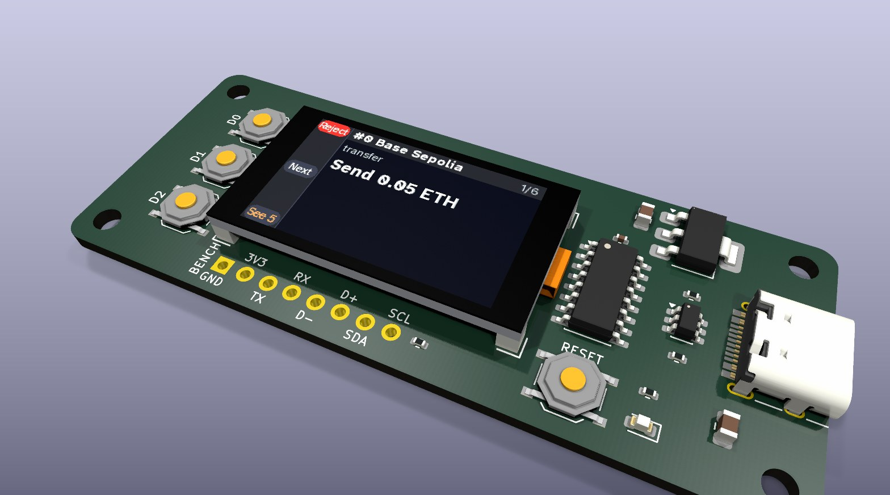
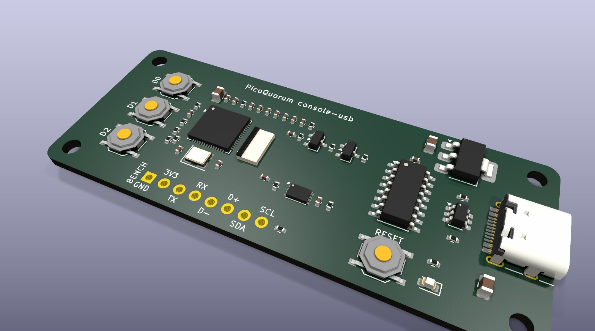
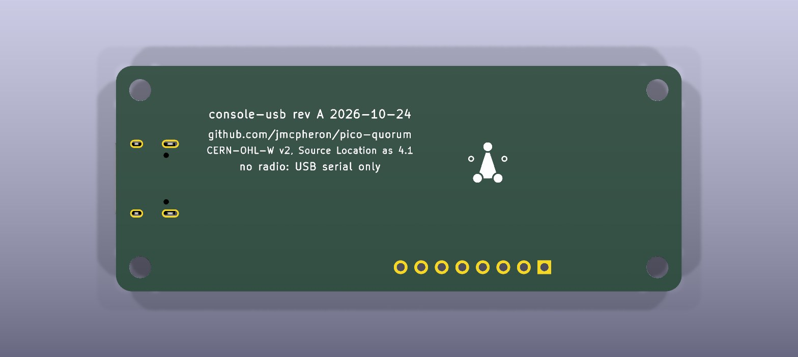
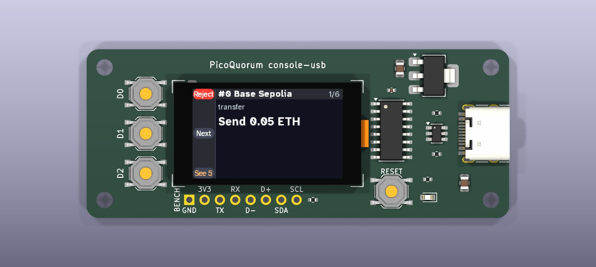

# console-usb: the console with no radio in use

*Design, 2026-10-24. Written by a script and read back by KiCad 9: the schematic (netlist and ERC)
and a board with every part placed (DRC), not routed. Not ordered. The firmware it needs is not
written.*



*KiCad's 3D render of the placed board. The screen shows the review page as the emulator draws it
on the Feather. More views, and what the render leaves out, are [below](#the-board-placed-not-routed).*

[console-s3](../console-s3/CONCEPT.md) put the console and its key on one board with an ESP32-S3
module and Wi-Fi. This is the same idea with the radio taken out of use. The console talks to the
world only through the USB-C cable it is powered by. A program on the computer (a page in the app,
or a small tool) fetches the Safe's queue for it and posts its signatures. The console still
rebuilds every hash itself, and the key still signs only that.

```
   Safe's service ── HTTPS ── computer (the relay) ── USB-C ── CH340C ── UART1 ── ESP32-S3 ── I2C ── ATECC608C
                              no key, no say in                              screen, 3 buttons
                              what gets signed
```

What dropping the radio buys:
- **No module.** The bare ESP32-S3FH4R2 chip (C3013940) is on JLCPCB's Economic assembly. Every
  Espressif S3 *module* is Standard-only, which is why console-s3 had the module soldered by hand.
  Here JLCPCB places everything but the screen.
- **No antenna.** No matching network, no keep-out, no tuning, nothing to certify as a radio.
  Espressif's checklist lets the RF pin float when the firmware never starts the radio.
- **No Wi-Fi password and no API key on the device.** No TLS stack, no certificate roots to keep
  current, no NTP. The image gets smaller.

What it costs: the computer is now in the data path. [The link](#the-link-what-the-computer-can-and-cant-do)
says what that changes.

## Why a serial bridge, not the S3's own USB

The S3 has USB of its own, and the Feather uses it. It would save one chip. It isn't used here
because of what else comes with it:
- **MicroPython's REPL is on it.** [SECURITY.md](../../docs/SECURITY.md) already says anyone with
  the board and a cable can have the chip sign any digest. That was about a person holding the
  board. On this console the cable goes to a computer and stays there, so it would be any program
  on that computer.
- **The computer can restart the S3 into its ROM flasher over that USB,** with no button pressed,
  and write a new image.

Closing both in firmware means a custom MicroPython build, Ctrl-C and raw-REPL handling that is right
on the first try, and eFuses that can't be undone. The bridge closes them with wiring instead:
- The USB-C's D+ and D− go to a **CH340C** (C84681, $0.46) and nowhere else.
- Its TXD and RXD go to **UART1** (GPIO18 and GPIO17). MicroPython never puts its REPL there.
- Its **DTR and RTS go nowhere.** The computer can't reset the S3 or hold GPIO0 low, so it
  can't start the flasher. (Most ESP32 boards wire these for esptool's auto-reset. This one must not.)

So the computer gets a byte pipe to code the console runs, and nothing else. The REPL (UART0) and
the S3's own USB go to J3, a header that isn't fitted. Flashing needs J3, D0 held and RESET pressed:
a person with the board in hand, as today. The generator checks the wiring for this: it stops if
the USB-C reaches the S3, or if DTR or RTS connects to anything.

## The circuit

All on the top side. Every symbol is stock KiCad 9, and every footprint but J2's, which is
console-s3's. Values for the S3's supplies come
from Espressif's own MINI-1 schematic (its datasheet v1.7, Figure 8-1), which is this same chip
with in-package 4 MB flash and 2 MB PSRAM. The rest follows Espressif's
[schematic checklist](https://docs.espressif.com/projects/esp-hardware-design-guidelines/en/latest/esp32s3/schematic-checklist.html).

| block | parts | notes |
|---|---|---|
| the chip | U1 ESP32-S3FH4R2, QFN-56 7 × 7 mm | the Feather's chip, without its module. 4 MB flash and 2 MB PSRAM in the package, so SPI* and GPIO26 stay unconnected. LNA_IN floats |
| its supplies | C1–C10, L1 | 10 µ, 1 µ and 100 n on 3V3, then L1 to VDD3P3 (100 n at the pins). 100 n each on VDD3P3_RTC and VDD3P3_CPU; 100 n and 1 µ on VDD_SPI (the flash's supply, an output); 1 µ and 10 n on VDDA |
| L1 | 0 Ω | Espressif's 2.0 nH filters RF harmonics. With the radio off it has nothing to filter. The footprint stays |
| reset | R1 10k, C11 1 µ, SW4 | the checklist's RC on CHIP_PU, and a RESET button |
| crystal | Y1 40 MHz ±10 ppm, 15 pF (C9010), C12/C13 22 p, R2 0 Ω | Espressif asks for 40 MHz within ±10 ppm. 22 pF is a start; tune at bring-up. R2 is the module's 0 Ω on XTAL_P |
| USB-C in | J1 HRO TYPE-C-31-M-12, R3/R4 5.1k on CC1/CC2 | a sink: C-to-C cables give 5 V |
| ESD | U2 USBLC6-2SC6 | on D+, D− and VBUS at the connector |
| 3.3 V | U3 AMS1117-3.3, C14 10 µ, C15 22 µ | from 5 V. The S3 with no radio draws far less than the regulator's 1 A |
| the link | U4 CH340C, C16 | runs at 3.3 V: V3 tied to VCC, as WCH's datasheet says for 3.3 V. UD+/UD− directly, no series resistors (also the datasheet). Its own oscillator, no crystal |
| the key | U5 ATECC608C-MAHDA-S (UDFN-8), C17, R5/R6 4.7k | on GPIO3/4, the Feather's I2C. Soldered on: this console is the key, as console-s3 |
| the screen | J2 HDGC 0.5K-HX-8PWB ZIF (C2919492), C18/C19 | the Feather's 1.14″ 240 × 135 ST7789, on an 8-pin 0.5 mm FPC. console-s3's ZIF and footprint: 1.0 mm tall, so it fits under the glass, with contacts on both faces |
| backlight | Q1 AO3401A, Q2 SS8050, R7 22 Ω, R8/R9/R10 | the panel's LED cathode is on its GND, so the switch is on the high side. GPIO45 high turns it on, as on the Feather. R10 holds GPIO45 low at reset |
| buttons | SW1–SW3 TS-1187A, R11–R13 | as the Feather's: D0 to GND with a pull-up (it is also BOOT), D1 and D2 to 3.3 V with pull-downs |
| LED | D1 red, R14 | GPIO13, as the Feather's |
| bench header | J3, 8 holes, not fitted; R15 510 Ω | GND, 3V3, UART0 TX/RX, the S3's own D−/D+, SDA, SCL. R15 is the checklist's 499 Ω on U0TXD |
| holes | H1–H4 | M2.5 |

**The S3's strapping pins at reset:** GPIO0 high (R11: boot from flash, unless D0 is held), GPIO45
low (R10: the 3.3 V flash; high would pick 1.8 V), GPIO46 left to its own pull-down, GPIO3 high
through SDA's pull-up, which only matters if a JTAG eFuse is burnt. The generator checks the first
three in KiCad's netlist.

**The screen's pin order** is from the seller's listing for the 8-pin 0.5 mm panel: 1 LEDA, 2 GND,
3 RESET, 4 RS, 5 SDA, 6 SCL, 7 VDD, 8 CS. The listing numbers only pins 1 and 4. Check it on a real
panel with a meter (the LED's diode between pins 1 and 2) before routing. J2 has contacts on both
faces, so the ribbon's fold under the glass can't put them on the wrong side; it can put pin 1 at
J2's other end, which the measured panel will show. Changing the order is one line in the
generator.

J2 was a Hirose FH12 (C597995) until the board was placed. At about 2 mm tall it didn't fit under the
glass on its 2 mm tape, so it became console-s3's HDGC part, which is also $0.31 cheaper.

## The pins

[PINS.md](PINS.md) has the table. In short: the screen, buttons, key bus and LED are on the Feather's
GPIOs, so `firmware/board.py`'s `"feather-s3"` profile drives them unchanged. The generator reads
that profile and stops if any of them differ. The new pins are UART1 on GPIO17 (TX) and GPIO18
(RX), which the profile doesn't use.

Two differences from the Feather, both harmless to the profile:
- GPIO7, the Feather's screen and I2C power, drives nothing here. The screen and the key are on
  3.3 V always.
- No battery gauge at 0x36. `board.NOT_KEYS` already keeps that address off the key list.

## The link: what the computer can and can't do

The console asks; the computer answers. The console is the only side that starts a request.

- **One JSON object per line** on UART1, 8N1 at 460800 baud, no flow control, at most 64 KiB a line.
- **Console to computer:** `{"t": "req", "id": 7, "m": "GET", "url": "https://api.safe.global/tx-service/base/api/v1/…"}`,
  with `"body"` on a POST. The URL is one of the services the console already pins in
  `quorum_cfg.py`; the relay refuses any other.
- **Computer to console:** `{"t": "res", "id": 7, "status": 200, "body": "…"}`. The relay adds the
  API key, if any, on its side.
- **Nothing else.** No message names the chip, a digest or a signature to make. Anything that
  isn't a well-formed answer to an open request is dropped.

What the computer can do: everything a lying transaction service can do today. It can show you
transactions that don't exist, hold back ones that do, misstate the owners, the threshold or who
has signed, and drop the signature on its way out. None of that gets a signature for anything other
than what the screen showed and you held Sign for, because the console still rebuilds the hash from
the fields it shows, for the chain and Safe it pinned (AGENTS.md rule 1).

What it loses against the Wi-Fi console: the README's "its own path". There, TLS to Safe's service
meant only that service could feed the queue. Here the computer can. The second check is still
yours to make: the verify code against the proposer's, and the Safe's other owners.

## The firmware it needs (not written)

This is a new console image and so a new release fingerprint (AGENTS.md rule 2). In outline:
1. `firmware/link.py`: UART1, the line protocol above, `request(method, url, body)` returning what
   `vhttp.request` returns.
2. `txservice.py` calls it where it calls `vhttp` today, when the board has a link.
3. A `console-link` image in `manifest.json` with no `net.py`, `wifisetup.py`, `wificfg.py`,
   `vhttp.py` or `ca_*.bin`, and a manifest check that nothing in it imports `network` or
   `bluetooth`. Espressif's checklist says an S3 with its radio started needs an antenna; this
   board has none, so the image must never start it. A MicroPython build without Wi-Fi and
   Bluetooth would make that impossible rather than checked; that is a later step.
4. The emulator gets a link shim, so `run-console.mjs` covers the same paths, plus a hostile relay:
   garbage, overlong lines, answers to no request, a forged queue. Each must end where a lying
   service ends today: a refusal, never a signature.
5. The relay on the computer. Web Serial in the app is the obvious one (Chromium browsers; nothing
   to install). That is a new network path and a new part of the app, so it needs a yes before
   it's built (AGENTS.md).

## Ordering at JLCPCB

Economic assembly, one side, two layers. JLCPCB places all 50 parts in `fab/bom.csv` (28 lines).
Not in the BOM: J3 (holes only), the four holes, and the panel, which is bought separately (about
$2.50, 8-pin 0.5 mm FPC) and clipped into J2 by hand.

**Extended parts, each a $3.07 feeder fee an order:** the S3, the CH340C, the ATECC608C, the ZIF,
the crystal, the USB-C and the USBLC6. The rest were shown as Basic on jlcpcb.com on 2026-10-24,
except that the pages for C45783 (22 µF), C318884 (the buttons) and C2150 (SS8050) didn't say. If
they're Extended, that is $3 each more.

**Stock.** On 2026-10-24 LCSC showed **no ATECC608C-MAHDA-S (C23291019)**, and none of three Basic
passives (C52923, C25744, C25092). LCSC's count isn't JLCPCB's; JLCPCB's own stock shows on the
quote. If the 608C UDFN has none there, the choices are JLCPCB's pre-order, sending our own, or the
SOIC-8 608C (C28975195, 140 at LCSC; key-a's part), which needs a different footprint.

**Cost,** an estimate, not a quote. Parts at LCSC's prices of 2026-10-24 at 10 pieces: S3 $3.04,
ATECC608C $2.27, CH340C $0.46, the ZIF $0.10, the rest about $1.30. Fees from the table console-s3
used: $8.18 setup, $1.53 stencil, 7 × $3.07 feeders. Shipping about $20.

| | 5 boards | 25 boards | 50 boards |
|---|---|---|---|
| fees, once | ~$31 | ~$31 | ~$31 |
| bare boards, 70 × 28 mm | ~$4 | ~$10 | ~$15 |
| placed parts, per board | ~$7.20 | ~$6.70 | ~$6.30 |
| the panel, bought | ~$2.50 | ~$2.30 | ~$2.20 |
| **per console, shipped** | **~$21** | **~$12** | **~$10** |

That is about console-s3's estimate ($19, $12, $10), not much under it. The saving is the
workshop's: no module to solder by hand (about 15 minutes a board there), and never the ~$55 an
order of Standard assembly. The Feather plus a key-c is about $31. The three biggest lines are the
S3, the 608C and the panel.

## What was checked, and how

`python3 hardware/console-usb/gen_console_usb.py` (KiCad 9.0.9) writes the schematic, the project,
the placed board, `fab/bom.csv` and `PINS.md`, then:
- has KiCad export the netlist, and compares every net, pin by pin, with the table: 37 nets, no
  difference;
- runs KiCad's ERC with KiCad's default libraries: one finding, the CH340C's V3 pin (a power
  output) tied to 3.3 V, which WCH's datasheet asks for at 3.3 V. No symbol differs from its
  library;
- loads every footprint and checks each symbol pin has a pad and each copper pad a pin;
- checks the strapping pins, and that the USB-C doesn't reach the S3 and DTR/RTS reach nothing;
- reads `firmware/board.py` and checks the screen, buttons, I2C and LED against `"feather-s3"`;
- runs KiCad's DRC on the placed board against JLCPCB's limits: no overlapping parts, nothing too
  close to the edge or a hole, no drill too small. Left over are the unrouted nets and two
  expected notes: J3 differs from its library footprint (its outline is taken off), and the USB-C
  footprint's own silkscreen reaches the edge;
- checks that every part under the glass is known to be lower than its tape, less 0.3 mm, and
  that none sits under a foam pad.

`python3 hardware/console-usb/gen_console_usb.py render` also writes the renders. KiCad's 3D view
draws them, raytraced.

Not checked: routing (there is none), the screen's pin order on a real panel, the crystal's load
capacitors, the backlight current, a board on a bench. Nothing here has been reviewed by anyone
but its author.

## The board: placed, not routed

`console-usb/console-usb.kicad_pcb`: 70 × 28 mm, two layers, every part on the top, JLCPCB's limits
as its rules. The footprints point back to the schematic's symbols, so KiCad's "Update PCB from
Schematic" keeps them.

| the panel lifted off | the back |
|---|---|
|  |  |



How it is placed:
- **The panel's glass lies on four 2 mm foam pads** at its corners, inside silkscreen corners.
  Under it go only parts lower than 1.7 mm: the S3 (0.9 mm), the crystal, the 0402s and 0805s, the
  SOT-23s, the 608C and the ZIF (1.0 mm). The generator checks each against a table of heights.
- **The ribbon leaves the glass's right end, folds under it and comes back into J2,** as on
  console-s3. J2's place comes from the tail: 23 mm, less about 5.7 mm for the fold. Nothing sits in
  the ribbon's path.
- **D0, D1 and D2 down the screen's left edge,** level with its rows 7, 67 and 127
  (`board.RAIL_Y`), 6.6 mm apart, so the screen's rail names the button beside it.
- **Right of the glass:** the CH340C, the USBLC6 and the USB-C in a short line, the AMS1117 above
  them, RESET and the LED below.
- **J3 along the bottom edge,** holes only, each named on the silkscreen.
- **M2.5 holes at the corners.** No antenna keep-out: there's no antenna.

What the render shows that isn't the real part:
- **The panel is a box:** glass, a frame, the foam pads and the ribbon, drawn by the generator
  (`lib/pqusb.3dshapes/`). The picture on it is the emulator's screenshot
  (`docs/quorum-ui/feather/03-review-head.png`), 240 × 135, in 24 colours.
- **J2 is a box** from its drawing's outline. KiCad has no model of it.
- **The buttons and the USB-C are stand-ins.** KiCad 9.0.9's library has footprints for the
  TS-1187A and the HRO TYPE-C-31-M-12 but no 3D models. The board names the E-Switch TL3342
  (5.2 mm, four pads) and the GCT USB4105 (its shell's pads within 0.03 mm of the HRO's) instead.
  Only the pictures use them; the BOM is unchanged.

What routing has to respect:
- **The crystal:** its capacitors at its pads, GND under it, nothing else routed under it.
- **Decoupling at the pins,** VDD3P3's first. The S3's centre pad to the GND pour through vias of
  0.3 mm or more: the stock footprint with thermal vias uses 0.2 mm, under JLCPCB's limit, so the
  board has the plain one and the vias go in at routing.
- **USB:** J1 → U2 → U4 is short and straight. Full speed only (12 Mbps), so no impedance control
  on two layers.
- **QFN-56 at 0.4 mm** should fan out on two layers; routing will show it.

## Steps to a board

1. **Buy two panels** and measure them: the glass, the tail's length, the pin order. Fix `PANEL` and
   the table in the generator if needed, and run it again: J2 and the buttons move with them.
2. **Route it** in KiCad from the placed board, fill, DRC, then the fab files.
3. **Quote it:** Economic, one side, qty 5. Check the 608C's stock and the three unlabelled tiers.
   Write the real numbers here.
4. **Bring one up:** 3.3 V before anything; esptool over J3 (D0 held, RESET); MicroPython; the
   Feather's bench scripts (`hardware/wiring/feather-s3/`) for the screen, buttons and key. Tune the
   crystal caps and the backlight resistor. Log it in the build log.
5. **The firmware and the relay**, above, once there's a yes for the relay.

## Open

- [ ] The relay: a Web Serial page in the app, a command-line tool, or both? Either is a new network
      path and needs a yes.
- [ ] A MicroPython build without Wi-Fi and Bluetooth, so the image can't start the radio, or the
      stock build and a manifest check?
- [ ] Three buttons, so today's `feather-s3` screens run? (Five would be a new profile.)
- [ ] The ATECC608C: UDFN if JLCPCB has it, else SOIC-8.
- [ ] Is any ESP32 a must? An RP2350 has no radio at all and costs about $1.30 plus $0.60 of flash,
      and the console already runs on one (the Pico 2 W). It is a different board and profile.
- [ ] A case, and the Sign button's guard (the kickoff's open decisions).
