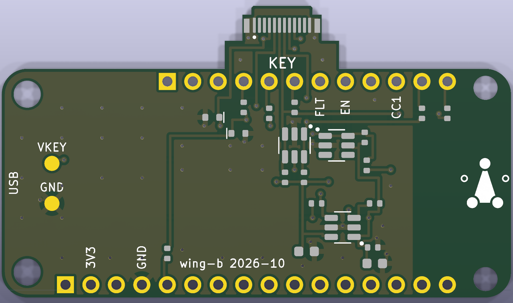

# The key wing: the key's port behind a Feather

*wing-a and wing-b, drawn 2026-10-23. Written by a script, routed, self-checked, then checked in
KiCad 10.0.6 the same day: both ERC 0, DRC 0, parity clean ([below](#checking-it)). Both carry
key-c P3's LED line. wing-b was redrawn the same day around a straddle-mount plug. Not ordered.*

A board the size of a Feather that sits behind Adafruit's
[Feather ESP32-S3 Reverse TFT](../wiring/FEATHER-S3.md) on its header pins. It carries one thing:
a USB-C plug that key-c slides onto, with the protection
[PROPOSALS.md](../key-pcb/PROPOSALS.md#the-console-end-of-key-c) asks for. It replaces the
soldered wire adapter from the Feather's STEMMA QT socket to a USB-C plug.

There are two, the same circuit with the plug turned two ways:
- **wing-a**, an upright plug: key-c stands out of the back of the stack.
- **wing-b**, a plug that straddles the edge of a tab: key-c lies level with the stack, beside it.
  [Below](#wing-b-the-plug-at-the-edge) is what that costs.

It is a FeatherWing-compatible board: the Feather's outline, holes and header rows, taken from
Adafruit's own board file. Adafruit asks that a board it hasn't approved say "FeatherWing-compatible",
not "FeatherWing" ([its trademark page](https://www.adafruit.com/trademarks)), so the silkscreen
says that.

```
  side view, not to scale

        screen and buttons (the Feather's front)
   ┌──────────────────────────────────────┐   Feather ESP32-S3 Reverse TFT
   └──┬────────────────────────────────┬──┘   its parts face down here
      │  header pins, socket or soldered │      the gap clears the Feather's parts
   ┌──┴────────────────────────────────┴──┐   wing-a: every part on its outer face
   └─────────────┬──┬─────────────────────┘
                 │  │   the USB-C plug, upright
              ┌──┴──┴──┐
              │ key-c  │  slides on, standing out of the back
              └────────┘
```

## Why this shape

- **The header pins, not STEMMA QT.** The QT socket has four wires: GND, 3V3, SDA and SCL. Its
  3V3 is switched by GPIO7, which also powers the screen, so the key's power can't be switched on
  its own. The header has spare pins for the key's own switch, its fault flag and the two CC
  lines.
- **The Feather's outline, so a case holds one shape.** The wing is 50.8 × 22.86 mm with the
  Feather's 2.54 mm corner arcs. Its holes line up with the Feather's.
- **Parts only on the outer face.** The other face is a few mm from the Feather's own parts
  (its USB-C, the battery socket, the ESP32 module), so it holds nothing but the header pins.
  JLCPCB assembles one side.
- **The plug left of centre, upright.** The Feather's far end is the ESP32 module's antenna. The
  USB end has the charge port and the battery socket, and the long edges have the header pins. An
  upright plug keeps the key and its metal away from all of them. It is the same plug console-a
  uses (918-118A2021Y40002), so its footprint and JLCPCB's turn for it are already worked out.
  Other directions are [below](#changing-the-port).
- **No copper behind the antenna.** No copper at all from x 45.6 mm, no pour from x 41 mm, and
  no tracks or vias from x 42.6 mm except the two bus links' short runs up to their header pins.
  Wi-Fi with the wing on hasn't been measured; see Open.

## The circuit

The key port is console-a's ([console-pcb/README.md](../console-pcb/README.md#the-key-port)),
with the Feather's pins:

| ref | part | LCSC | why |
|---|---|---|---|
| J1 | 918-118A2021Y40002 vertical USB-C plug | C399939, extended | key-c slides on. I2C on the USB 2.0 pair, no USB. wing-b: SHOU HAN TYPE-C 24P-GTJB 040, C3151751 ([below](#wing-b-the-plug-at-the-edge)) |
| U2 | AP22653W6-7 | C2158037, extended | the key's power (VKEY) from the Feather's 3V3: 80 mA limit (ILIM to GND), reverse blocking, output discharge. EN on D9, pulled up by R7 so the key is on by default; FAULT on D10, pulled up by R8 |
| U3 | USBLC6-2SC6 | C7519 | ESD on the key's SDA and SCL, at the plug. Its rail on 3V3, never VKEY |
| U4 | USBLC6-2SC6 | C7519 | ESD on CC1 and CC2 (wing-b: CC1 only) |
| D1 | ESD5Z5V0 | C502546 | TVS on VKEY, beside the plug |
| R1, R2 | 2.2k | C25879 | SDA and SCL pull-ups to VKEY: the key has none, and a key that's off isn't powered through them |
| R3, R4 | 10k | C25744 | CC1 and CC2 pull-ups: a key's 5.1k Rd reads about 1.1 V, nothing reads 3.3 V. wing-b has no R4 |
| R5, R6 | 1k | C11702 | CC1 into D5, CC2 into D6. wing-b has no R6 |
| R9, R10 | 0 Ω, fitted | C17168 | the key's SDA and SCL to the Feather's own SDA and SCL |
| R11, R12 | 0 Ω, **not fitted** | C17168 | or to D11 and D12 instead: a bus of its own (below) |
| C1 | 100 nF | C1525 | at U2's input, as its datasheet asks |
| C3 | 10 µF | C19702 | bulk on the Feather's 3V3 at the wing, so a key plugged in dips it less |
| C2 | 10 µF | C19702 | at U2's output, as console-a has it. Nothing bigger: U2 has to discharge it when the key's power goes off |
| D3 | ESD5Z5V0 | C502546 | TVS on KEY_LED, the plug's A8 and B8 (SBU), near the plug |
| R13 | 100 Ω, fitted | C25076 | KEY_LED from D13, the console's status LED pin. It limits what a wrong plug can push into the pin |
| R14 | 100 Ω, **not fitted** | C25076 | or from A0 (GPIO18), for a later image that drives the key's LED on its own |
| J2, J3 | the Feather's 16- and 12-pin rows | | through-hole, hand-soldered |
| TP1, TP2 | test pads | | VKEY and GND, bare copper |
| H1–H4 | holes | | 2.7 mm at the USB end (M2.5), 2.4 mm at the far end (M2) |

The far-end holes are smaller because the Feather's are: Adafruit's file has 2.5 mm plated holes
at the USB end and 2.2 mm plain ones at the far end, off the 0.1″ grid there. An M2.5 screw won't
go through the Feather's far end.

## Pins

From the 16-pin row: 3V3 (the Feather's second pin, its always-on regulator), GND and A0 for R14
if it is ever fitted. From the 12-pin row:

| Feather pin | ESP32-S3 | wing net | today's console image |
|---|---|---|---|
| SDA | GPIO3 | the key's SDA, through R9 | the key's bus, as on the bench (`board.SDA`) |
| SCL | GPIO4 | the key's SCL, through R10 | the same (`board.SCL`) |
| D5 | GPIO5, ADC1 | CC1, through R5 | not read |
| D6 | GPIO6, ADC1 | CC2, through R6 (wing-a only) | not read |
| D9 | GPIO9 | KEY_EN | not driven: R7 keeps the key on |
| D10 | GPIO10 | KEY_FAULT | not read |
| D11 | GPIO11 | the key's SDA, if R11 is fitted | |
| D12 | GPIO12 | the key's SCL, if R12 is fitted | |
| D13 | GPIO13 | the key's LED, through R13 | the status LED (`board.LED`): blinks while a transaction waits for this key |
| A0 | GPIO18 | the key's LED, if R14 is fitted instead | |

The ESP32-S3 GPIO behind each pin is the module pin less 4, read from the nets in Adafruit's board
file. D5 and D6 are on ADC1, which still works while Wi-Fi is on; ADC2 doesn't. The generator
reads `firmware/board.py` and stops if its `feather-s3` key bus isn't GPIO3/4, or if a pin the
wing uses is one the profile already takes.

**As built, it runs today's console image unchanged.** With R9 and R10 fitted, the key sits on the
Feather's bus at 0x60, as it does through the adapter now. `board.NOT_KEYS` already keeps the
battery gauge at 0x36 from being taken for a key. Nothing in `firmware/` changes, so there's no new
release.

**What a later image can do, and what it costs.** Reading CC1/CC2 (is a key in?), switching the
key off with D9, and reading FAULT all need new pins in the `feather-s3` profile. That is a
firmware change, and so a new release fingerprint (AGENTS.md rule 2).

**The key's LED (key-c P3).** key-c P3 has a green LED on its receptacle's SBU2 pin
([its README](../key-pcb/key-c-usbc/README.md#p3-the-led)). Each wing joins its plug's A8 and B8
as KEY_LED, so one of them meets the key's B8 whichever way up it goes in, and drives it from D13
through R13 (100 Ω), with D3 for ESD near the plug. D13 is the console's status LED: today's
image blinks it while a transaction waits for this key and keeps it on while Wi-Fi is up, so the
key's LED does the same with no firmware change. `check_firmware` stops if `board.py`'s
feather-s3 LED isn't GPIO13. A P2 key has nothing on SBU and ignores it. For a later image that
drives the key's LED on its own, fit R14 to A0 (GPIO18) instead of R13: that's a firmware change
and a new release.

**Switching the key off needs the bus of its own.** With R9/R10 fitted, the key shares the bus
with the battery gauge, and R1/R2 pull to VKEY. Turn VKEY off, and R1/R2 pull the shared bus
toward ground, so the gauge stops answering. So with R9/R10 fitted, leave D9 alone. A firmware
that switches the key's power wants R11/R12 fitted instead, with the key on GPIO11/12. Never fit
both pairs.

## How the board is laid out

- **The frame is the Feather's own**, as Adafruit's EagleCAD file draws it, looking at its parts
  side: the origin at the bottom-left corner, the Feather's USB-C at the left, mm. Looking at the
  wing's outer face is looking the same way, so a point on the wing sits right over the same point
  on the Feather.
- **The header rows**: the 16-pin row at y 1.27 from x 6.35 (RST) to 44.45, and the 12-pin row at
  y 21.59 from x 16.51 (BAT) to 44.45. Pads are 1.7 mm with 1.0 mm holes; pin 1, at the USB end,
  is square.
- **The plug** at (14.0, 11.4), its rows along x, its A row at the top. U3 is above it on the right, U4 below, and the
  switch at the bottom right under D9/D10. The links sit right under the four bus pins.
- **Routing.** A grid router written into `gen_wing.py`:
  - it checks every step against the copper already placed, by geometry, at a 0.2 mm grid
  - each of the plug's pins goes straight out to a via of its own first. The 0.8 mm pitch leaves
    no room later
  - no via in the plug's courtyard, and no front copper between its rows, where its shell sits
  - every front ground pad gets a via, the plug's four ground pins through its shell pads
  - each ESD array's flow-through pairs (pins 1/6, 3/4) are joined straight across under the chip
  - it tries the nets in 16 fixed orders and keeps the complete one with the least copper: on
    wing-a, 357 mm of track and 69 vias, 45 of them ground. Few orders finish, so a moved part may need the placement loosened
    before it routes again

  Tracks are 0.25 mm, vias 0.6/0.3 mm, clearance 0.2 mm, within JLCPCB's 2-layer limits.
- **Ground** is a pour on both layers up to x 41, stitched with vias.
- **Silkscreen.** On the front: KEY, the test pads' names, CC1, CC2, EN and FLT over their header
  pins, 3V3 and GND, USB at the Feather's USB end, and the mark. On the back, which faces the
  Feather: the name, "FeatherWing-compatible", which way it faces, the Source Location and the
  licence. Reference designators are on the fab layer only: the board is too dense for them.

## Files

| path | what |
|---|---|
| `gen_wing.py` | writes everything below from Python, no KiCad needed; its self-checks stand in for ERC and DRC here |
| `lib/pqwing.kicad_sym`, `lib/pqwing.pretty/` | the symbols and footprints, all written by the script. The plug's, SOT-23-6, SOD-523, 0402 and 0603 pads are KiCad's own, as console-a's board holds them |
| `lib/picoquorum.pretty/PicoQuorum_Mark.kicad_mod` | the mark, a copy of the key library's |
| `wing-a/`, `wing-b/` | KiCad 10 projects, filled and saved by KiCad 10.0.6 (KiCad 9 can't open them now): open `wing-a.kicad_pro` or `wing-b.kicad_pro`. `wing-b.kicad_dru` lets the plug's shell pads sit 0.15 mm from the tab's sides |
| `wing-*/fab/` | what you upload, once `tools/keypcb fab` has run on a machine with KiCad (not yet) |

`gen_wing.py` reuses console-pocket's footprint and board-text helpers and the key boards'
schematic helpers. Once the board is edited in KiCad, the KiCad files are the source of truth:
don't run the generator again, or the edits are lost (`tools/keypcb gen-feather-wing a`, or `b`,
reruns it).

## Checking it

Here, with no KiCad: `python3 hardware/feather-wing/gen_wing.py a` (or `b`) writes that project,
then checks what it wrote. Both report clean. Each takes a few minutes, most of it routing.
- **The schematic, read back:** every symbol pin's net, worked out from its wires, labels, power
  symbols and no-connect flags, is the net in the script's one table.
- **The board, read back:**
  - 0.2 mm between copper of different nets, and holes kept clear of copper
  - 0.3 mm from copper to the edge, corners included
  - nothing in the antenna keep-out but the header pads
  - no track ending in or via landing on another net's pad
  - every net in one piece
  - every pad on the net the schematic gives it
  - silkscreen text off the pads, by a rough box
  - no two parts' courtyards overlap
  - every header pin and hole where Adafruit's file has it

  These stand in for DRC; they are not DRC. `gen_wing.py a --check` reruns both checks without
  writing. The courtyard check was added with wing-b; it found five overlaps in wing-a as first
  pushed (the plug with U3 and U4, the switch with C2, R7 and R8), and those parts have moved.

**What KiCad found, 2026-10-23** (KiCad 10.0.6 on a Mac). The boards first pushed passed the
self-check but failed KiCad's DRC: wing-a with 70 violations, about 30 of them shorts, wing-b with 15
shorts. Three causes, all in the script, all fixed:
- **Parts turned the wrong way.** `rotate()` (shared with console-pocket) turned a footprint
  clockwise on the page; KiCad turns it counter-clockwise. Every part at 90° or 270° had its pads
  swapped against its tracks, and the plug's A and B rows changed places. The self-check used the
  same `rotate()`, so it agreed with itself. `rotate()` is KiCad's now, checked against pcbnew on a
  real 0402, and `ROT` has its 90s and 270s swapped so each pad lands where the placement expects.
- **Round pads taken as squares.** Tracks ended in a header pin's square box but outside its
  circle. A track or via now joins a round pad only inside the square within its circle, in the
  router and in the self-check.
- **Leftovers.** A plug pin's escape via whose route went on along the same layer joined nothing;
  the writer drops it and any track end left loose. A strip of back pour fenced in by the bus had no
  stitching via; a grid point that isn't free now tries spots up to 0.8 mm away. The header rows'
  footprints are out of the BOM, as their symbols are.

`tools/keypcb fill` then `check`, on each: **ERC 0, DRC 0, 0 unconnected, parity clean**, wing-a
and wing-b. wing-b also needed its plug's ground pads joined to the pour solid: at the tab's edge a
thermal got one spoke. `gen_wing.py a --check` now also reads a board KiCad has saved, which
writes its nets as `(net "GND")`.

wing-b as redrawn for the straddle plug, the same day: the self-check was clean, and KiCad found
one thing it can't see, as it checks no pour. The plug's tracks fenced in a patch of back pour
under U3, and U3's ground via landed in it, so U3's ground pin reached nothing else. The generator
now tries a stitching via either side of the tab. Then ERC 0, DRC 0, 0 unconnected, parity clean,
and `gen_wing.py b --check` clean on the saved board.

On a machine with KiCad 10, after rerunning the generator:
1. `tools/keypcb fill wing-a`: fills the pours and saves the board. The generator writes the zones
   unfilled, and `kicad-cli` doesn't fill them.
2. `tools/keypcb check wing-a`: ERC, then DRC with schematic parity. Expect 0 errors, 0
   violations, 0 unconnected, parity clean. The likely first complaints are a footprint KiCad
   reads differently from the script (`lib_footprint_mismatch`) and silkscreen too near a pad;
   fix those in the GUI and note them here.
3. Open the board in 3D: the plug on the front, the header pads square at the USB end, nothing on
   the back but the header pads and the back silkscreen.
4. `tools/keypcb fab wing-a` writes `fab/wing-a-gerbers.zip`, `bom.csv` and `cpl.csv`.
   `tools/keypcb render wing-a` draws both sides.

## Ordering and building

1. **Measure the Feather's back first.** The gap between the boards has to clear the tallest part
   on the Feather's back: its USB-C socket, the JST-PH battery socket or the ESP32 module. That
   sets the headers:
   - **Socketed, for the bench:** male pins on the Feather, a female socket row on the wing.
     Standard female headers are about 8.5 mm tall, so the boards end up about 11 mm apart.
   - **Soldered, for a finished unit:** long male pins through both boards, with M2.5 and M2
     standoffs of the measured height in the corner holes. It is rigid and can't work loose.
2. **Upload** `fab/wing-a-gerbers.zip` at JLCPCB: 2 layers, 50.8 × 22.86 mm, 1.6 mm, lead-free
   HASL, "Remove Mark".
3. **Economic PCBA, top side, qty 5, Confirm Parts Placement.** The plug and the switch are the
   extended parts. R11/R12 are marked not fitted and stay off the BOM; so do the headers, the test
   pads and the holes.
4. **In the placement preview:** U2, U3 and U4 with pin 1 at their dots (`JLCPCB Rotation
   Offset` is console-a's: −90 for the plug and the USBLC6s, 180 for the AP22653), the plug's
   rows along the board, and D1's band (its cathode) at the end nearer the 12-pin row.
5. **When the boards arrive:** solder the header rows from the back, fit the Feather, and before
   any key goes in, meter VKEY to GND (not a short), each CC pin's 10k to 3V3, and SDA/SCL to the
   Feather's SDA/SCL through R9/R10. Then a scan with key-c on the plug: 0x36 and 0x60.

## Changing the port

The circuit behind the plug (switch, ESD, pull-ups, CC sense, the bus links) is what any key port
needs. Only J1 and where it sits change between these:

| port | key | what changes here |
|---|---|---|
| **upright USB-C plug** (wing-a) | key-c | none: the key stands out of the back |
| **straddle-mount plug at an edge** (wing-b) | key-c | drawn: [below](#wing-b-the-plug-at-the-edge) |
| **USB-C socket and a short cable** | key-c | a socket for J1, the CC sensing as PROPOSALS.md has it for a cable (exactly one Rd, an e-marked cable's Ra on the other line), and 2.2k is the most the cable's capacitance allows |
| **pogo pins and magnets** | key-d | five spring pins on the outer face and two magnets; DETECT on a spare pin instead of CC, no CC parts. The key lies flat on the back of the stack |
| **card-edge socket** | rev A | a through-hole socket at an end (PBT: hand-soldered); DETECT on a spare pin |

To change a part or add one (an LED, a second sensor, a battery gauge of its own):
- add its pins to `NETS`, its part to `PARTS` and its place to `PLACE`, and a `part(...)` line in
  `write_schematic`
- rerun the generator; the router and both checks pick it up
- a part that needs a Feather pin goes in `FEATHER12`/`FEATHER16` and `GPIO`, and
  `check_firmware` checks it against `board.py`

## wing-b: the plug at the edge

The same circuit, with a plug at the edge so key-c lies level with the stack instead of standing
out of its back. The plug straddles the board: its two rows of contacts grip the tab from both
faces.

| wing-b, front |
|---|
|  |

KiCad has no 3D model of the plug, so only its pads show.

```
  seen from the wing's outer face, not to scale

                    key-c slides on here, about 36 mm more
                         ┌──────────┐
                         │  plug    │  about 9.6 mm past the tip
                         └──┬────┬──┘
                       ┌────┘nose└────┐  paddle, 7.9 mm wide
                    ┌──┘              └──┐  then 11.4 mm wide
   ┌────────────────┘   tab, 6.3 mm deep └─────────────────────┐
   │ USB       12-pin row ·  ·  ·  ·  ·  ·  ·  ·  ·  ·  ·  ·   │ antenna
   │                                                           │
   │           16-pin row ·  ·  ·  ·  ·  ·  ·  ·  ·  ·  ·  ·   │
   └───────────────────────────────────────────────────────────┘
```

**Why a tab.** A plug that lies level needs a board edge, and every edge of the Feather's outline
is taken:
- the header rows run along both long edges
- the stretch of the 12-pin edge with no pins, at the USB end, is where the battery socket's cable
  leaves the Feather
- the far end is the antenna, and the USB end the charge port

So wing-b grows a tab out of the 12-pin edge, mid-board, between the battery socket and the antenna.
From its tip:
- a **nose** 6.10 wide and 0.90 deep, which goes into the plug, with 0.2 mm chamfers at the tip
- the **paddle**, 7.90 wide, where the plug's pads are, to 3.5 mm from the tip
- then **11.4 mm wide** to the Feather's edge, 6.3 mm from the tip

The first two are the plug's drawing ("Cable Side PCB Layout"). The wide part lets five gaps in
the header row lead out of the tab, not three. A case has to allow for the tab.

**The plug** is SHOU HAN's TYPE-C 24P-GTJB 040 (LCSC
[C3151751](https://www.lcsc.com/datasheet/C3151751.pdf)), a USB-C plug that straddles a board's
edge. LCSC showed about 44,000 in stock at $0.14 on 2026-10-23. Its footprint is drawn from its
drawing:
- **Twelve pads on each face**, 0.30 × 1.50 mm at 0.5 mm, 1.20–2.70 mm from the tip. The A row is
  on the front and the B row on the back, B12 under A1. The plug has no B6 or B7 contact; their
  pads are there, wired to nothing.
- **The shell's legs** on both faces at ±3.60 mm, 1.30–2.70 mm from the tip, on ground. The drawing
  runs them to the paddle's sides; here they are 0.55 wide, not 0.70, and stop 0.15 mm short, so
  the router cuts no copper. `wing-b.kicad_dru` lets them, and only them, sit that near the edge.
- **A 0.8 mm board.** The drawing says T = 0.80 ± 0.05; wing-b's stackup says 0.8 mm. Order it so.
- **Pin 1.** Seen from the front with the plug pointing away, A1 is on the left (the silkscreen dot).
  That comes from how a USB-C plug meets a socket, not from the drawing, which shows no board
  side. Check it against a real plug before ordering: turned the other way, CC1 and KEY_LED change
  places, and so do SDA and SCL.

**What it wires.** As console-a wires a plug, with one difference:
- VKEY on A4, A9, B4 and B9; ground on A1, A12, B1, B12 and the shell.
- SDA on A6 and SCL on A7 (D+ and D−). key-c joins A6/B6 and A7/B7 itself.
- KEY_LED on A8 and B8 (SBU), joined, as on wing-a.
- **One CC line, A5.** key-c has a 5.1k Rd on both of its CC pins, so A5 meets one whichever way up:
  a key plugged straight in always shows on CC1. B5 (VCONN) stays open. On each face one CC pin
  and one LED pin sit either side of SDA and SCL, so a second CC line and the LED pins' join would
  cross in the tab; without B5, the back is free for the join. So, as before: U4's second pair is
  spare, R4 and R6 are gone, and D6 stays free.

**How it's routed.** The plug's escape is drawn by hand in `gen_wing.py` (`ESCAPE`), as key-c's
tracks are in `gen_cd.py`; the router does the rest.
- Each net leaves through a gap of its own in the 12-pin row: VKEY, CC1, SDA and SCL on the front;
  KEY_LED and VKEY again on the back. Only five gaps lead out of the tab, one track each per face.
- The outer pins turn first, so nothing crosses.
- VKEY's pins lie one over the other, A4 over B9 and A9 over B4; each pair meets at a via.
- A8 drops to the back at a via and meets B8 there.
- Below the row, the router takes over from where each path ends: 322 mm of track and 65 vias, 44
  of them ground.

A search for the escape (the first try) got nine of ten pins out at best, and left nets unrouted.

Below the row: U3 sits under SDA and SCL, turned so each comes straight into its pin, with R1/R2
under it. VKEY goes left past D1, KEY_LED to D3 and R13 under D13, and CC1 across on the back to U4
on the right. The switch, the bus links and the test pads are where wing-a has them.

**Its pins** are wing-a's less D6:

| Feather pin | ESP32-S3 | wing-b net |
|---|---|---|
| SDA, SCL | GPIO3, GPIO4 | the key's bus, through R9/R10 |
| D5 | GPIO5, ADC1 | CC1, through R5 |
| D9, D10 | GPIO9, GPIO10 | KEY_EN, KEY_FAULT |
| D11, D12 | GPIO11, GPIO12 | the key's bus, if R11/R12 are fitted |
| D13, A0 | GPIO13, GPIO18 | the key's LED, through R13 (or R14, not fitted) |

As built, it runs today's console image unchanged too.

**Ordering it** is as wing-a, plus:
- 0.8 mm thick, and the board is 50.8 × 29.16 mm with the tab.
- The plug comes in tubes, and its pads are on both faces, so it is likely a hand-soldered part:
  JLCPCB's top-side assembly can't reflow the back row. Ask, or solder it by hand (0.5 mm pitch,
  drag soldering with flux), the front row first.
- `JLCPCB Rotation Offset` for C3151751 isn't known. Its place in `cpl.csv` is the footprint's
  origin, the nose's tip, not the part's centre. Check both in the placement preview.

**Which one?** wing-a is the simpler board: a stocked, machine-placed plug, the Feather's outline,
1.6 mm. wing-b makes a flatter device with the key beside it, for a tab, a plug likely soldered
by hand, a 0.8 mm board and one CC line. Both need a case that takes a sideways push on the key off
the plug's joints. wing-b's plug grips the board from both faces.

## Rough cost

Not a quote, built on console-a's and key-c's numbers:
- the board: a few dollars for 5
- JLCPCB's setup, stencil and two extended-part feeders: about $15
- the parts: about $1.50 a wing

So about $5 a wing for 5, plus shipping, the headers (about $1) and the Feather (about $25).
wing-b's plug is cheaper (about $0.14), but likely soldered by hand.
Trust the quote.

## Open

- [ ] Measure the Feather's back (its tallest part) and choose the headers and standoffs.
- [x] `tools/keypcb fill`, `check`, `fab`, `render` on a machine with KiCad (2026-10-23): wing-a
      and wing-b clean after three fixes to the script ([Checking it](#checking-it)). Both `fab/`
      folders are written; wing-b's again after its redraw.
- [ ] Open both boards in KiCad's GUI once and look them over: the checks above are KiCad's, but
      no one has looked at the boards by eye yet beyond the renders.
- [ ] Check JLCPCB's stock for C25076 (R13) as well. In the placement preview, D3's band (its
      cathode) is on KEY_LED, as D1's is on VKEY.
- [ ] Check JLCPCB's stock for C399939 (the plug) and C2158037 (the switch).
- [ ] Wi-Fi with the wing on: `tools/fw measure tls` with and without it, the same place and time.
- [ ] The plug's grip on key-c, and a case that takes a sideways push off its solder joints, as
      console-a's notes ask.
- [ ] A firmware change for CC sense, D9 and FAULT, with the key on its own bus (R11/R12): a new
      release.
- [ ] wing-b: before ordering, check a real C3151751 against its footprint: A1's side (pin 1
      above), the shell's legs, and how its body sits at the nose. The nose's inside corners come
      out rounded (the mill's radius), not square as drawn. Then its grip on key-c, and the
      0.8 mm board against the headers chosen.
- [ ] wing-b: ask JLCPCB whether it can fit C3151751, or plan to solder it by hand.
- [ ] wing-b: the tab in a case, and whether the key beside the stack clears the battery cable.
