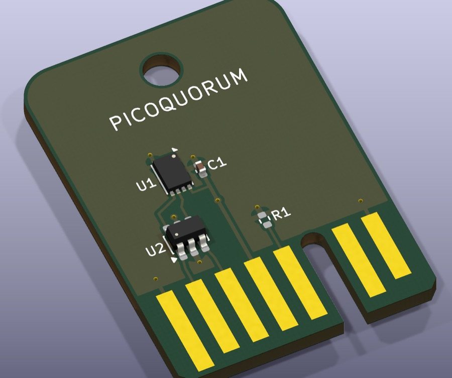
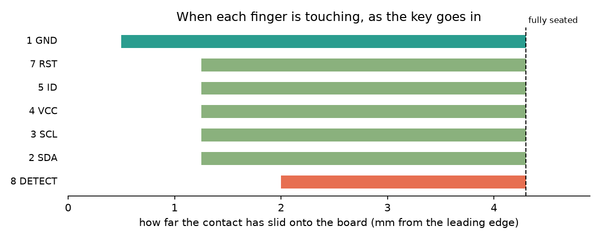
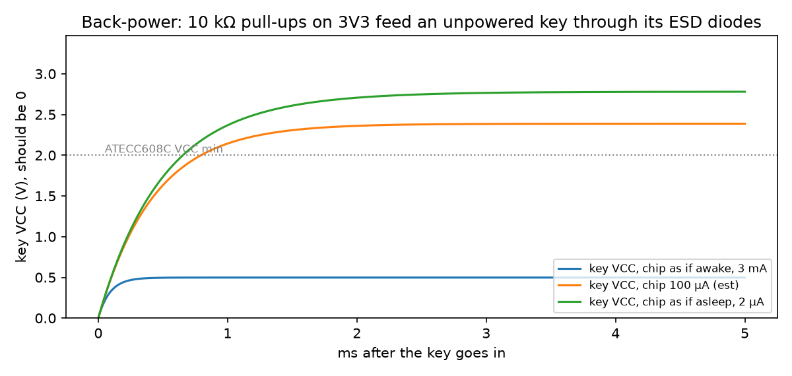
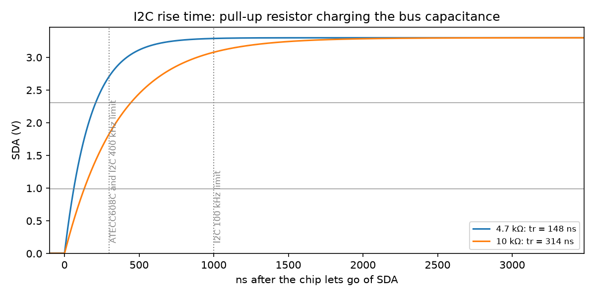

# Learning PCB design on the key

A guided tour of rev A for someone new to PCBs. It explains why each part of the board exists, and
the numbers behind it, worked out with `tools/keypcb calc` on your Mac. The design itself is in
[README.md](README.md). Opening, checking and ordering it is in [ORDERING.md](ORDERING.md).



## The tools

| command | what it does | needs |
|---|---|---|
| `tools/keypcb calc insert [--plot] [--contact 1.8]` | the order the fingers connect as the key goes in | uv |
| `tools/keypcb calc rise [--pullup 4.7k,10k] [--extra 20p]` | I2C rise time from the pull-ups and the bus capacitance | uv |
| `tools/keypcb calc power [--drive 12]` | how far key VCC sags when a GPIO powers the chip | uv |
| `tools/keypcb calc spice rise` / `spice backpower` | the same circuits simulated in ngspice, plotted to `out/` | `brew install ngspice` |
| `tools/keypcb check` | ERC and DRC on both boards | `brew install --cask kicad` |

The calculator is [keycalc.py](keycalc.py). Every number it uses sits in one table at the top,
`DATA`, with the datasheet and table it came from. Numbers that aren't in any datasheet are marked
"est". Change one, rerun, and see what moves. The finger geometry is imported from `gen.py`, so
the calculator always agrees with the board.

Plots and SPICE netlists go to `out/`, which git ignores. Open a `.cir` file to see a SPICE
netlist: it's plain text, one part per line.

## The board, part by part

A PCB is layers of copper on fibreglass (FR-4). Rev A has two copper layers, top and bottom, on a
1.6 mm board. Solder mask (the green) covers the copper except where parts solder down. The
silkscreen (the white text) goes on top of that. The outline is drawn on a layer of its own,
`Edge.Cuts`.

### J1, the fingers: the board edge is the connector

Seven gold-coloured pads run to the board's edge. There's no connector part: the socket on the
console grips the board itself. (The gold is ENIG, a thin gold plating JLCPCB puts on every
exposed pad.)

The fingers start at different distances from the edge. That sets the order they connect in:

```
$ tools/keypcb calc insert
Order going in:  GND at 0.5 mm, then SDA/SCL/VCC/ID/RST at 1.25 mm, then DETECT at 2.0 mm.
After DETECT touches there are 2.30 mm still to go
```



Why that order:
- **GND first.** Any static charge on you or the key drains to ground before a signal pin
  touches anything.
- **DETECT last.** The console only switches power on (GP6) once DETECT reads low, so the key is
  never powered half-inserted. On the way out DETECT lets go first, and the console cuts power
  before the other fingers break.

A real open question is where Sullins' socket contact actually lands, because Sullins doesn't
publish it. Try `--contact 1.8`. DETECT never touches, so the key is safely dead, and you'd move
the short finger closer to the edge.

### U1, the secure element

The ATECC608C holds the private key and signs with it. It has eight pins, and four of them do
anything: VCC (8), GND (4), SDA (5) and SCL (6). Pins 1, 2, 3 and 7 are marked no-connect.
key-b's UDFN package also has a pad on its belly that goes to GND.

Two packages of the same chip, two boards:
- **SOIC-8 (key-a)** has legs at 1.27 mm pitch. You can solder it with an iron.
- **UDFN-8 (key-b)** is 2 × 3 mm with its pads underneath. You need reflow, so JLCPCB assembles
  it.

### C1, the decoupling capacitor

When the chip computes a signature, its current jumps around in nanosecond bursts. The trace from
the console is long enough to have inductance, so it can't deliver those bursts instantly. C1
sits right next to pin 8 and supplies them locally. That's why "as close to the pin as it goes"
is the rule.

C1 is small, and it can't carry a whole signature:

```
$ tools/keypcb calc power
What C1 (100 nF) does: it can hold up a 14 mA draw for only C*dV/I = 2.14 µs per 0.3 V of sag.
```

A signature takes tens of milliseconds, so the console's supply carries it. That's the next
section.

### Key power: a GPIO is not a power supply

Build 1 powers the key straight from GP6, a GPIO pin. A pin's output transistor has resistance.
The RP2350 only promises VOH ≥ 2.62 V at the current its drive setting is rated for, which gives a
pin resistance of about 0.68 V ÷ I:

```
 drive    R_out            sleep 150 nA              awake 3 mA     signing (ECC) 14 mA
   4mA    170 Ω                  3.30 V                  2.79 V       0.92 V LOW >rated
  12mA   56.7 Ω                  3.30 V                  3.13 V           2.51 V >rated
```

The chip needs 2.0 V:
- **At the 4 mA setting it would brown out mid-signature.** That's why `bench1.py` sets
  `Pin.DRIVE_3`, the 12 mA setting.
- **Even at 12 mA, 14 mA is above the pin's rating.** The 2.51 V is a straight-line guess past
  the datasheet. It works on paper, but there's not much margin.

The ATECC608C's clock divider lowers that peak: 14 mA at divider 0x0, 6 mA at 0x5, 3 mA at 0x0D
(datasheet table 3-5). The cost is slower signing. A load switch on the console, as the parked C1
concept proposed, is the other fix.

### U2, the ESD array

People carry static, and they plug the key in by hand. A spark of a few kilovolts on a finger
would go straight into the chip. The USBLC6-2SC6 has diodes that steer a spike on SDA or SCL
into VCC or GND, where it can't do harm. Each line runs straight through it (pins 1 to 6 and 3 to
4), so the spike meets the diodes before it reaches U1. That's why U2 sits between the fingers
and the chip.

Those same diodes are why the pull-ups have to go to *switched* VCC. If they went to the Pico's
always-on 3V3, current would flow from SDA through U2's upper diode into the unpowered key's VCC:

```
$ tools/keypcb calc spice backpower
  chip draws            key VCC      SDA
  as if awake, 3 mA      0.50 V   1.01 V   low, mostly harmless
  100 µA (est)           2.39 V   2.83 V   running from its I/O pins
  as if asleep, 2 µA     2.78 V   3.17 V   running from its I/O pins
```



The key runs while the console thinks it's off. [BUILD1.md](../wiring/BUILD1.md) says "Don't take
them to 3V3", and this is the reason.

### The pull-ups (on the console, not the key)

I2C wires are open-drain: a chip can only pull a line low. A resistor pulls the line back up when
it lets go. Every pin, wire and diode on the line adds capacitance, and the resistor has to charge
it. That's an RC curve, so the rise time from 30 % to 70 % is 0.8473 × R × C:

```
$ tools/keypcb calc rise
  total                              37 pF
   pull-up   rise time        I2C 100 kHz 1 µs        ATECC608C 300 ns      I2C 400 kHz 300 ns
    4.7 kΩ      147 ns                ok (15%)                ok (49%)                ok (49%)
     10 kΩ      314 ns                ok (31%)         TOO SLOW (105%)         TOO SLOW (105%)
     50 kΩ     1.57 µs         TOO SLOW (157%)         TOO SLOW (523%)         TOO SLOW (523%)
```



The 37 pF total is mostly estimates: neither the RP2350 nor the ATECC608C datasheet gives a pin
capacitance. Still, it shows that BUILD1's 10 kΩ sits right at the ATECC608C's own 300 ns limit,
and that 4.7 kΩ leaves twice the margin. The Pico's internal pull-ups (32–86 kΩ) are far too
weak. Measuring the real edge with a scope on rev A would settle it.

### R1, KEY ID (not fitted)

R1 is an empty footprint that a later key type can fill. A resistor from ID to GND, read by the
console's ADC on GP27, would tell the console which chip a key carries before it says a word on
I2C.

### Ground pour and the rule area

Both copper layers are mostly a solid sheet of GND copper (a **pour**, or **zone**). The vias, the
small plated holes, stitch the top and bottom sheets together. A rule area keeps the pour off the
finger zone, so the socket's contacts only ever touch the fingers.

## What KiCad 10 says about rev A

Rev A was generated with KiCad 9 in the cloud. `tools/keypcb check` on this Mac's KiCad 10.0.6
finds 0 errors and 0 unconnected pads on both boards, plus two kinds of warning:

1. **Field mismatches (5 per board).** The board's footprints lack the Datasheet and Description
   text that the schematic carries. KiCad 10 checks for this and KiCad 9 didn't. It's cosmetic.
   **Tools → Update PCB from Schematic** fixes it.
2. **key-b: "footprint does not match copy in library".** KiCad 10's library redrew the 3 × 2 mm
   DFN land pattern:

   | | pads | rows (centre to centre) |
   |---|---|---|
   | rev A's copy (KiCad 9) | 0.75 × 0.30 mm rect | 2.90 mm |
   | KiCad 10's library | 0.825 × 0.25 mm rounded | 2.925 mm |

   A board keeps its own copy of every footprint, so rev A's Gerbers don't change. The lesson: a
   footprint (the copper pattern a part solders to, also called a **land pattern**) is only as
   right as its check against the manufacturer's drawing. Here that's Microchip's C04-23355.
   Check before choosing either version.

**Saving in KiCad 10 converts the files to its format for good**, and KiCad 9 can't open them
after that. `gen.py` and the README still say KiCad 9. Decide that before you save edits to the
boards.

## Hands-on in the KiCad GUI

ORDERING.md §2 has the first tour: the 3D view, the stackup, moving C1 and watching DRC complain.
Some more, all undone with Ctrl+Z, or close without saving:

1. In the PCB editor, press **`** on a GND pad. Every GND item lights up, and you can see how
   much of the board is ground.
2. Pick a track and press **U** to select the whole net. Press **Delete**, then route it again
   with **X** (the router). That's how every track on a board is drawn.
3. Press **B** to refill the zones after you move something. The pour flows around it.
4. Open **Inspect → Board Statistics** for pad counts, holes and board area. A fab quote is built
   from these numbers.
5. Open `U1` in the Footprint Editor (select it, then **Ctrl+E**) and measure the pads with the
   ruler (**Ctrl+Shift+M**). Compare them with the table above.

## Words

| word | meaning |
|---|---|
| schematic | the drawing of what connects to what, with no positions |
| net | one electrical connection: everything that's wired together (GND, SDA...) |
| symbol / footprint | a part's drawing in the schematic / its copper pads on the board |
| land pattern | another name for a footprint's pads, sized for good solder joints |
| ERC | electrical rules check, on the schematic: unconnected pins, missing power |
| DRC | design rules check, on the board: gaps too small to make, copper too near the edge |
| parity | the board and schematic agree, part for part and net for net |
| trace / track | a copper wire on the board |
| via | a small plated hole joining the top and bottom copper |
| pour / zone | a filled area of copper, usually GND |
| solder mask | the coloured coating over the copper; openings in it are where solder goes |
| paste | the solder-paste stencil layer, for reflow assembly |
| silkscreen | the printed text and outlines |
| ENIG | gold-over-nickel plating on exposed copper; hard gold is the tougher finger finish |
| Gerber | the file per layer that a fab makes the board from; drill files give the holes |
| BOM / CPL | bill of materials / component placement list, for assembly |
| decoupling cap | a small capacitor at a chip's power pin that supplies fast current bursts |
| pull-up | a resistor that holds a line high until something pulls it low |
| ESD | electrostatic discharge: the spark from a charged person or object |
| DNP | do not populate: a footprint left empty on purpose |
