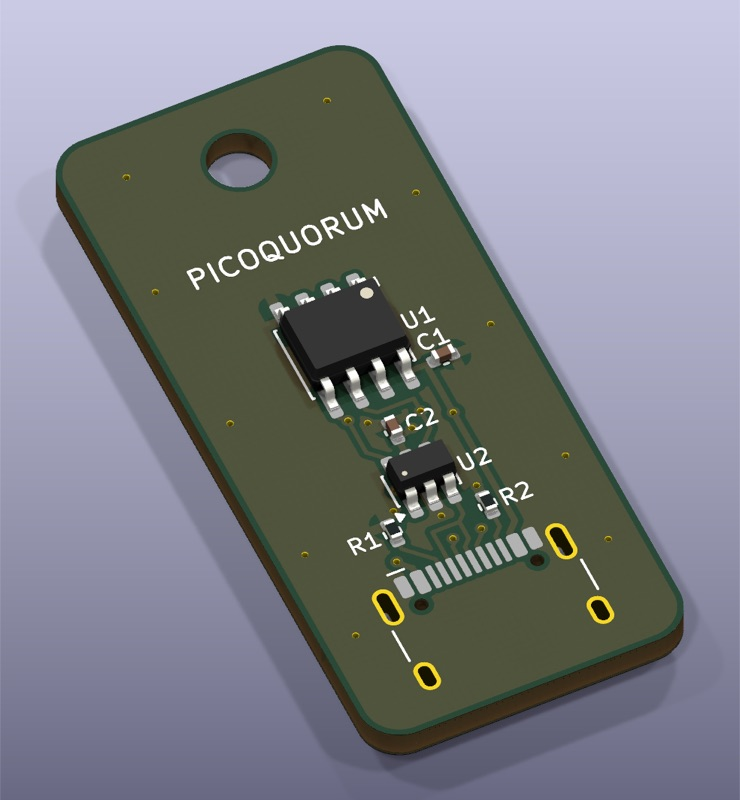
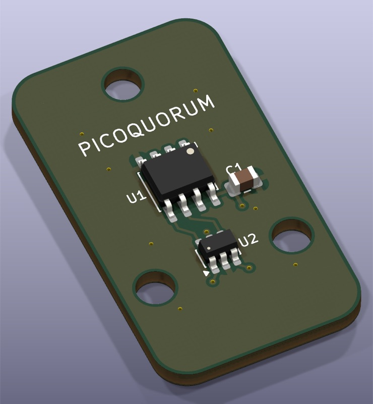
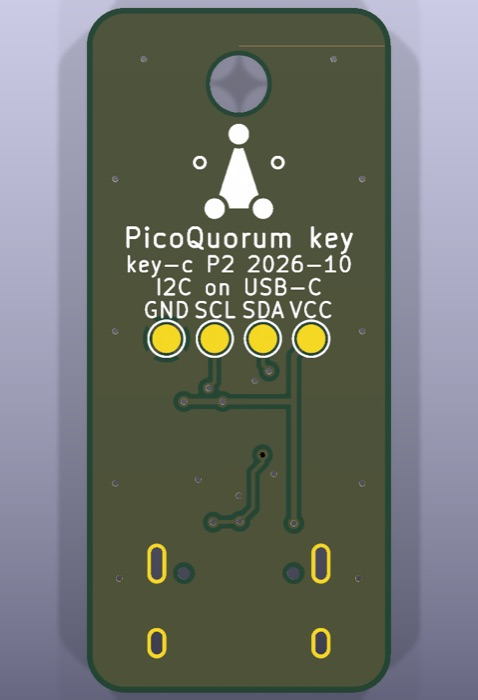
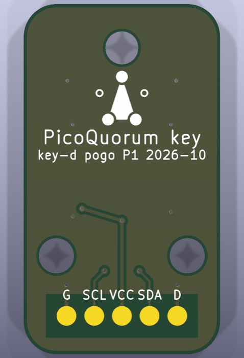

# Key proposals C and D: an off-the-shelf connector instead of gold fingers

*key-c is proposal P2, redesigned after review on 2026-10-02; key-d is P1. Both are ERC and DRC
clean, not ordered and not fit-tested.*

Rev A ([README.md](README.md)) makes the board itself the plug. That needs gold fingers, a
staggered-finger mating order and a card-edge socket. These two proposals keep rev A's circuit and
swap the connector for a part you can buy:

| | key-c (USB-C) | key-d (pogo) |
|---|---|---|
| top |  |  |
| bottom |  |  |

The USB-C receptacle body doesn't appear in the render because KiCad has no 3D model for it. Its
pads and shell legs do appear.

| | rev A (fingers) | key-c (USB-C) | key-d (pogo) |
|---|---|---|---|
| board | 22.35 × 32 mm | 16 × 36 mm | 18 × 32 mm |
| connector on the key | the board edge | USB-C receptacle (HCTL HC-TYPE-C-16P-01A) | 5 flat pads on the bottom |
| connector on the console | Sullins card-edge socket, ~$3–6 | USB-C receptacle plus any USB-C cable, or an upright plug as a dock | 5 pogo pins and 2 magnets |
| rated insertions | ~500 (socket) | ~10,000 (typical for USB-C) | 10,000+ (typical for pogo pins) |
| finish | ENIG (the fingers) | HASL is fine: nothing rubs on the board | ENIG: the pins rub on the pads |
| assembly | JLCPCB (key-b) or by hand (key-a) | JLCPCB: the receptacle's pads are at 0.5 mm pitch | by hand: SOIC, SOT-23-6 and an 0805 cap |
| how the console knows a key is in | the short DETECT finger | USB-C's own CC resistors | pad 5 tied to GND |

Both proposals use key-a's parts: the SOIC-8 ATECC608C-SSHDA (which you can solder by hand), the
USBLC6-2SC6 ESD array, and a 100 nF cap.

## key-c: USB-C used as plain wires

There's no USB chip on the key, and nothing is ever enumerated. The receptacle is just a sturdy,
reversible connector, and its pins carry rev A's signals:

| USB-C pin | key net | console |
|---|---|---|
| VBUS (A4 B4 A9 B9) | VCC | a protected, current-limited switch from 3V3, enabled by GP6. **Never GP6 itself**: see [the console end](#the-console-end-of-key-c) |
| D+ (A6 and B6, joined on the key) | SDA | GP4, pull-up to the switched VBUS: 2.2k over a cable |
| D− (A7 and B7, joined on the key) | SCL | GP5, the same pull-up |
| CC1 (A5), CC2 (B5) | each 5.1 kΩ to GND (R1, R2) | sensed **separately**, never joined: see [the console end](#the-console-end-of-key-c) |
| GND, shell | GND | GND |
| SBU1, SBU2 | not connected | |

**Why it works either way up.**
- A USB 2.0 cable has one D+/D− pair. Flipped over, it lands on the receptacle's B row instead of
  the A row.
- The key joins A6 to B6 and A7 to B7, so SDA and SCL come out the same in either orientation.
- That's how USB-C devices handle flipping too.

**Detection is USB-C's own.**
- A USB-C device tells a charger "I'm here" with a 5.1 kΩ resistor (Rd) on each CC pin. R1 and R2
  are those resistors.
- The cable's single CC wire connects the console to one of them.
- The key ties nothing else to CC, so the console sees exactly one Rd when a key is in. How the
  console reads it, without being fooled by a cable, is under [the console end](#the-console-end-of-key-c).

**The layout (P2).**
- **The A/B tie.** The receptacle's middle pads run B7 A6 A7 B6, which is SCL SDA SCL SDA, so the
  two pairs can't both join on one layer. SCL joins on the top, just behind the pads. SDA drops
  through two vias, joins on the bottom, and comes back up beside U2.
- **ESD.** U2 (the USBLC6) sits about 4 mm behind the pads, as close as that tie allows.
  - C2 bypasses its VBUS pin right at the part, as ST's layout shows.
  - Its ground pin, boxed in between SDA and SCL, has a short 0.4 mm trace to its own via and joins
    the pour solid.
  - C1 stays beside U1.
- **Power.** The left VBUS pad drops straight to the bottom layer. The right one is a rail to C1
  and U1. They meet on the bottom, where U2 and C2 join them.
- **Test pads.** Four 1.5 mm pads on the back, labelled GND, SCL, SDA and VCC, for a probe or a
  scope on the bench. They aren't assembled; they're just copper.
- **J1's footprint** is a project copy, `USB_C_Receptacle_HCTL_HC-TYPE-C-16P-01A_PQ`. Its four
  outer ground pads are 0.1 mm shorter at the end nearest the part's plastic peg holes:
  - In KiCad's original they reach to 0.18 mm from the holes, under JLCPCB's published 0.20 mm.
    The copy gives about 0.26 mm.
  - The board's normal 0.25 mm rule now passes with no exception file. P1 had one; it's gone.
  - The leads' end of the pads and the peg holes don't move, so the part fits the same way.

**The key on its own is safe to plug in anywhere.**
- A laptop or charger puts 5 V on VCC. That's inside the ATECC608C's 5.5 V maximum and the
  USBLC6's 5.25 V rating.
- Nothing enumerates, so the laptop sees nothing.
- Anyone who has the key can already talk to the chip, so this adds no new risk.

The risks are all at the console's port; see the next section.

**Parts** (`fab/bom.csv`, LCSC numbers; check stock before ordering):

| ref | part | LCSC |
|---|---|---|
| J1 | HCTL HC-TYPE-C-16P-01A | C2894897 |
| U1 | ATECC608C-SSHDA (SOIC-8) | C28975195 |
| U2 | USBLC6-2SC6 | C7519 |
| R1, R2 | 5.1 kΩ 0402 | C25905 |
| C1, C2 | 100 nF 0402 | C1525 |
| TP1–TP4 | test pads on the back (copper only, not assembled) | |

## The console end of key-c

This is a review finding, and it's required before the console's USB-C port is anything more than
a bench socket for this one key. A USB-C port invites other plugs.

1. **Never power VBUS from GP6 directly.** Feed it from 3V3 through a load switch:
   - **Current-limited.** The key needs under 20 mA: 14 mA while signing, plus the pull-ups. A
     phone or a shorted cable would draw far more, and the overload happens before any firmware
     check can run.
   - **Reverse-blocking.** A USB-A charger with an A-to-C cable puts 5 V on VBUS whatever CC says.
     That 5 V must never reach 3V3 or a GPIO. The RP2350's pins are rated to about 3.8 V.
   - **Enabled by GP6**, with output discharge, so VBUS really falls when the console cuts it.
2. **Sense CC1 and CC2 separately.** A key shows a 5.1 kΩ Rd on one of them.
   - An e-marked cable (most 5 A and USB 3 cables) also puts about 1 kΩ (Ra) on the *other* one,
     at the console's own end.
   - With CC1 and CC2 joined, that Ra keeps reading "key present" after the key is pulled out. The
     console then never cuts power or discards an unfinished approval.
   - Read both CC lines and require exactly one Rd: an ADC on each, a pair of comparators, or a
     USB-C source controller chip.
   - Build 1 already uses GP26 and GP27, so the ADC choice is a console decision.
3. **Pull-ups.** 2.2 kΩ from SDA and SCL to the *switched* VBUS. The key has none, so a console
   without them gets a key that never answers.
4. **ESD on the console's side too:** an array at its receptacle, like the key's U2.

For a first bench test with nothing but this key ever in the port, GP6 straight to VBUS works.
Label the port, and build the switch before it's a real one.

## key-d: pogo pads and magnets

The key is a bare board: five round pads on the bottom (1.8 mm at 2.54 mm pitch) and two 3.2 mm
holes for 3 mm neodymium disc magnets, glued in. On the console, five spring pins and two magnets
of the same spacing sit under a pocket the key drops into.

Pads, left to right, looking at the pad side:

| pad | 1 | 2 | 3 | 4 | 5 |
|---|---|---|---|---|---|
| signal | GND | SCL | VCC | SDA | DETECT (GND) |
| console | GND | GP5 | GP6, switched | GP4 | GP7, pull-up |

**Put on backwards, nothing is harmed.**
- VCC is in the middle, and both ends are ground.
- Turned around, GND and VCC still land on GND and VCC. Only SDA and SCL swap, and the I2C scan
  just finds nothing.
- Fit the console's two magnets with opposite poles facing up, and the key only snaps on the right
  way round anyway.

**Mating order.** Pogo pins all touch at about the same moment, so the staggered rev A fingers
have no equivalent here. Two things cover that:
- The firmware waits 200 ms after DETECT before powering the key.
- If you want hardware sequencing too, use a pogo pin about 0.5 mm shorter for DETECT on the
  console, so it touches last.

**Clearance.**
- The bottom ground pour stays clear of the pads, so a pin that lands off-centre meets bare board,
  never ground under thin solder mask.
- A 1.8 mm pad tolerates the key sitting about ±0.5 mm off-centre for a typical 0.8 mm pin tip.
  The magnets and a pocket in the console's case should hold it well inside that.

**Parts.** The same as key-a: an ATECC608C-SSHDA, a USBLC6-2SC6 and a 100 nF 0805 cap, plus two
3 × 1.5 mm magnets. The console side needs five 2.54 mm pogo pins, either as a single-row block or
as loose pins in the console's case, plus two more magnets.

## The mark

Both keys carry the PicoQuorum mark on the back, 5 mm tall, under the lanyard hole
(`lib/picoquorum.pretty/PicoQuorum_Mark`, drawn by `gen_cd.py` from
[docs/BRAND.md](../../docs/BRAND.md)'s geometry). Silkscreen has one colour, so the mark shows
"three of five" by shape:
- the three signed dots are solid
- the two waiting dots are hollow rings
- the filled triangle stops just short of each signed dot

It is symmetric left to right, so the back side's mirror changes nothing. It's never rotated.

## Ordering key-c at JLCPCB

1. **Upload** `key-c-usbc/fab/key-c-usbc-gerbers.zip`. It should read 2 layers, 16 × 36 mm. The
   back preview shows the mark and the four test pads.
2. **Board:** LeadFree HASL, 1.6 mm, any colour, tented vias, 0.3 mm via hole, "Remove Mark".
3. **PCB Assembly:**
   - **Economic, top side.** If it's greyed out, try green and HASL. Standard forces a 70 × 70 mm
     board.
   - **Qty 5.** You want spares, because locking a chip is permanent.
   - **Confirm Parts Placement: Yes.**
4. **Upload `fab/bom.csv` and `fab/cpl.csv`.** On the parts page, check that U1 is an **SSHDA**
   part. SSHDA is I2C; SSHCZ is single-wire and would never answer the console. Also check stock
   for J1 (C2894897) and U1 (C28975195).
5. **In the placement preview:**
   - U1's and U2's pin 1 sit at their silkscreen triangles. On P1, JLCPCB showed both turned 90°;
     expect to rotate them.
   - **J1's opening faces the board edge.**
   - Fix any part that's turned, in 90° steps.
6. **Shipping:** Global Standard if the order is under $59; otherwise express with DDP, so duties
   are paid up front.

## Ballpark cost

These are rough figures, built on ORDERING.md's 2026-10-02 lookups. Use JLCPCB's quote.
- **key-c, 5 assembled.**
  - Economic setup $8, stencil $1.50, and about $3 feeder loading for each extended part (the chip,
    U2, probably J1).
  - About $1.50 of parts per key, plus the boards (HASL, cheap) and shipping.
  - Total: about **$35–55**, or **~$7–11/key**. On a panel of 6 it drops to about $3–5/key.
- **key-d, 5 bare boards, ENIG.**
  - About $15–25 for the boards and shipping.
  - Parts about $1.50 per key from Digi-Key or LCSC, magnets a few cents.
  - Total: **~$5–8/key**, and less on a panel.
- **The console side** costs about the same for both: a $0.20 receptacle, or about $1–3 of pogo
  pins and magnets. Compare rev A's $3–6 socket.

## Files and checks

| path | what |
|---|---|
| `key-c-usbc/`, `key-d-pogo/` | the KiCad 10 projects; `fab/` has the Gerber zip, `bom.csv`, `cpl.csv` and the renders |
| `lib/picoquorum.kicad_sym` | adds `USB_C_16P` and `KeyPads_5P` beside rev A's symbols |
| `lib/picoquorum.pretty/KeyPads_5P_P2.54mm` | key-d's pads |
| `lib/picoquorum.pretty/USB_C_Receptacle_HCTL_HC-TYPE-C-16P-01A_PQ` | key-c's receptacle, outer ground pads pulled back from the peg holes |
| `lib/picoquorum.pretty/PicoQuorum_Mark` | the mark, one-colour, for silkscreen |
| `gen_cd.py` | wrote both projects; `tools/keypcb gen-cd` reruns it. It reuses `gen.py` and never touches rev A |

- `tools/keypcb check key-c-usbc` (and `key-d-pogo`) gives 0 ERC errors, 0 DRC violations,
  0 unconnected and parity clean on both.
- `tools/keypcb fab <board>` rewrites `fab/`.
- These two boards are **KiCad 10 files**, written by KiCad 10.0.6's pcbnew. Rev A stays in
  KiCad 9's format.

## Open

- [ ] Check JLCPCB stock for C2894897 (the receptacle) and C28975195 (the chip) before choosing
      key-c
- [ ] The console end of key-c: a protected switch on VBUS, separate CC sensing and 2.2k pull-ups
      ([above](#the-console-end-of-key-c)). Probably its own small adapter board
- [ ] key-d: choose the console's pogo pins (tip shape, travel, force), and print a pocket to test
      how well the magnets align
- [ ] Pull-ups for key-c over a cable. A 1 m USB-C cable adds roughly 50–100 pF.
      `tools/keypcb calc rise --extra 80p` puts 4.7k at 466 ns, too slow for the ATECC608C's
      300 ns, and 2.2k at 218 ns. Use 2.2k on the console, a short cable (≤ 30 cm), or the dock.
      Then measure it on the bench
- [ ] The enclosure for each: key-c needs an opening for the plug, and key-d a recess for the
      magnets
