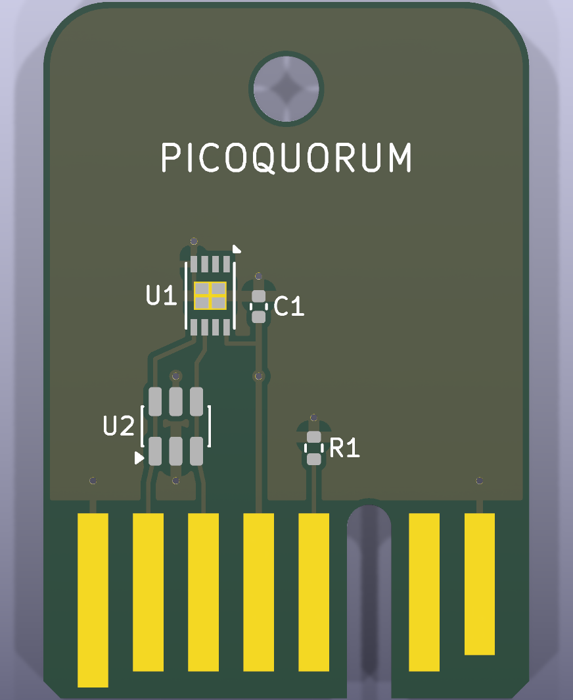
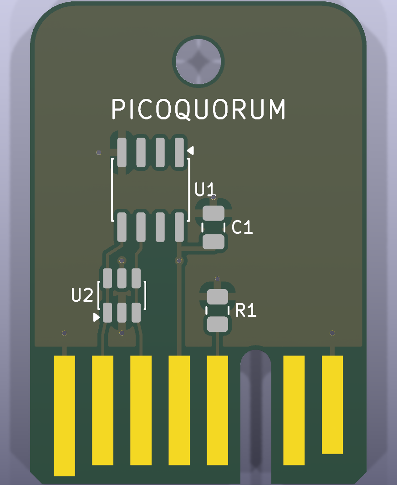
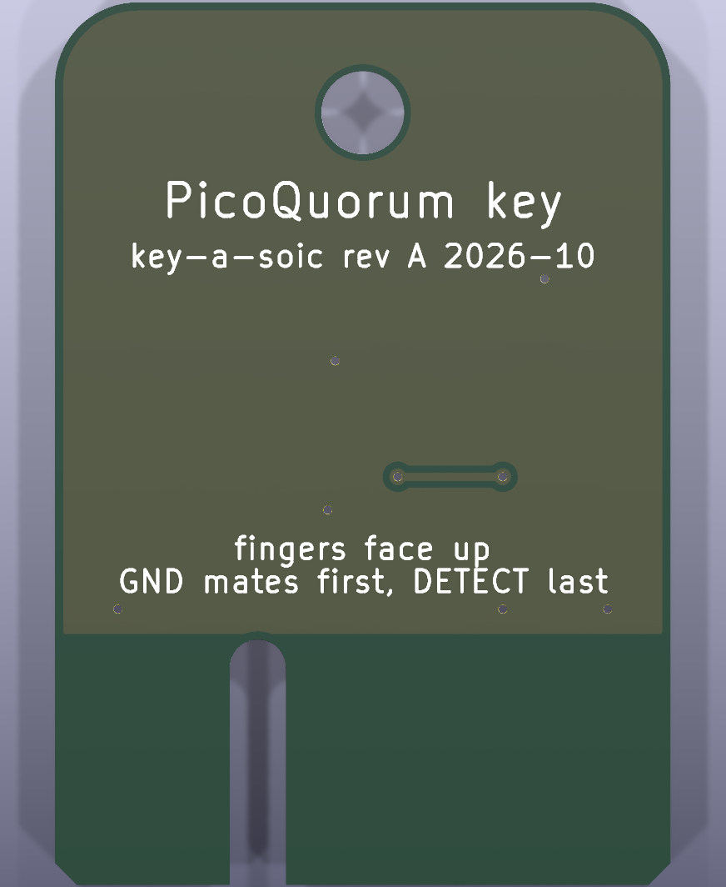

# Key PCB

*Rev A, designed 2026-10-02, not yet ordered.*

On rev A the PCB is the plug. The key is a small board with gold fingers on one edge, like a
YubiKey. Those fingers slide into a card-edge socket on the console, so there are no audio plugs,
no wires, and nothing to solder to plug lugs. The secure element sits on the same board.

| key-b (UDFN, assembled) | key-a (SOIC, hand-soldered) | back |
|---|---|---|
|  |  |  |

The renders come from `tools/keypcb render`. They show the pads, fingers and silkscreen but no
part bodies, because KiCad's 3D models aren't installed where they were made.

## The fingers

Fingers of different lengths sequence the contacts in copper, the way PCIe's presence pins do. A
finger that starts closer to the edge touches its contact sooner.

| position | signal | finger | console | why |
|---|---|---|---|---|
| 1 | GND | long: 0.5 mm from the edge | GND | mates first, breaks last |
| 2 | SDA | mid: 1.25 mm | GP4 | |
| 3 | SCL | mid | GP5 | |
| 4 | VCC | mid | GP6, switched key power | |
| 5 | KEY ID | mid | GP27 / ADC1 | R1 to GND, not fitted on rev A |
| 6 | *keying slot* | none | | the connector's key insert goes here |
| 7 | RST | mid | GP26 | Trust M only; open on an ATECC key |
| 8 | DETECT | short: 2.0 mm | GP7, pull-up | tied to GND on the key; mates last, breaks first |

These are **Build 1's GPIOs, so the firmware doesn't change.** The power sequence in
[BUILD1.md](../wiring/BUILD1.md#how-the-key-is-detected-and-powered) still applies:
- DETECT reads low only once the key is at full depth.
- The console then switches VCC on.
- DETECT breaks first on the way out, so VCC is already off before anything else lets go.

On the board:
- **Fingers are on the top side only.** A key put in upside down meets the console's unused contact
  row. DETECT never goes low, so it is never powered. The keying slot stops it going in that way at
  all, but even without the slot an upside-down key would be inert, not damaged.
- **Every finger ends 8.5 mm from the edge.** EDAC's drawing puts a seated card's contact point
  about 4.3 mm in, so it lands well inside every finger. Sullins doesn't publish its contact point.
  The short finger starts at 2.0 mm so a shallower contact still lands on it.
- **The fingers are 1.40 mm wide at 2.54 mm pitch.** The blade is 22.35 mm wide (an 8-position
  0.062″ card is 0.888″ +0/−0.015″), with 0.8 mm chamfers on the leading corners.
- **No I2C pull-ups on the key.** They stay on the console, to switched VCC, as in Build 1.

## The circuit

| ref | part | why |
|---|---|---|
| U1 | ATECC608C: SOIC-8 on key-a, UDFN-8 2×3 mm on key-b | the key's P-256 signing key |
| U2 | USBLC6-2SC6 (SOT-23-6) | ESD on SDA, SCL and VCC: people handle and hot-plug the key |
| C1 | 100 nF: 0805 on key-a, 0402 on key-b | decoupling, next to U1 pin 8 |
| R1 | not fitted | KEY ID code to GND, for later |
| J1 | the fingers | not a part: copper on the board edge |

Layout notes:
- **U2 sits between the fingers and the chip.** Each line runs straight through it, pins 1 to 6 and
  3 to 4, as ST's layout does.
- **U2's rail pin is VCC**, so with the key unpowered a voltage on SDA or SCL would leak into VCC
  through it. The console already avoids this: with the key out, SDA and SCL are plain inputs with
  no pull-ups.
- **Ground.** Both layers are a ground pour, kept off the finger zone by a rule area. The UDFN's
  centre pad goes to GND, as Microchip recommends.

**P-256 is fine.** The ATECC608 family signs P-256 only, never secp256k1, and PicoQuorum never
used k1:
- Each chip key owns the Safe through Safe's passkey signer
  ([webauthn.py](../../firmware/webauthn.py)).
- On Base it is verified by the P-256 precompile ([contracts](../../contracts/README.md)).

The ATECC608C's I2C address as shipped is 0x60, one of the addresses `signer.detect()` already
tries.

## Files

| path | what |
|---|---|
| `key-a-soic/`, `key-b-udfn/` | the two KiCad 9 projects: open the `.kicad_pro` |
| `*/fab/` | what you upload: `*-gerbers.zip` (Gerbers + drill), `bom.csv` and `cpl.csv` in JLCPCB's format, and the renders |
| `lib/` | the project's symbols (`picoquorum.kicad_sym`) and the blade footprint (`picoquorum.pretty`) |
| `gen.py` | wrote all of the above. Once you edit a board in KiCad, the KiCad files win: don't run it again |
| [`ORDERING.md`](ORDERING.md) | how to read the design in KiCad, check it, export it and order it |
| [`LEARN.md`](LEARN.md) | a guided tour of rev A for PCB beginners, with the numbers behind each part |
| `keycalc.py` | `tools/keypcb calc`: finger timing, I2C rise time, GPIO power and SPICE runs (plots in `out/`, ignored) |
| [`key-c-usbc/README.md`](key-c-usbc/README.md) | **ordered 2026-10-02**: key-c P2's status page, newest first, with renders |
| [`PROPOSALS.md`](PROPOSALS.md) | proposals C and D: the same circuit on a USB-C receptacle (`key-c-usbc/`) or pogo pads with magnets (`key-d-pogo/`), written by `gen_cd.py` |

`tools/keypcb check` runs ERC, then DRC with schematic parity, on both boards. `fab` rewrites
`fab/` and `render` redraws the images. Both boards check clean: 0 ERC errors, 0 DRC
violations, 0 unconnected, parity clean.

## The console side

Rev A uses a stock card-edge socket for 0.062″ cards at 0.100″ pitch, with 8 positions per row.
Wire only the top row to the Pico, with the GPIOs above.

| part | Digi-Key | notes |
|---|---|---|
| Sullins EBC08DRXN, 8/16 positions, dual readout, solder tails | check stock; the 5/10 size is S9641-ND | in stock in the family; PBT body, so hand- or wave-solder it, never reflow; 500 cycles |
| Sullins PLA-K1 key | PLA-K1-ND | Sullins' catalog says "between contacts", Digi-Key says "on contact": see below |
| EDAC 395 series (alternative) | 151-1420-ND (10-contact) | the drawing these numbers come from; low stock |

## Trust M later

A Trust M key (key-c) uses the same blade and finger map:
- RST on position 7.
- I2C address 0x30, which `signer.detect()` already polls.
- The chip comes in a 3×3 mm USON-10. KiCad's `Microchip_USON-10-1EP_3x3mm_P0.5mm_EP1.8x2.5mm` is a
  starting point, but check it against Infineon's land pattern first.

KEY ID (R1 on position 5) can then tell the console which chip a key carries before it says a
word on I2C.

## Open

- [ ] Order rev A and test-fit a bare board in the socket before trusting the 22.35 mm width, the
      finger depth and the key slot ([ORDERING.md](ORDERING.md))
- [ ] Which way the Sullins PLA-K1 sits. Position 6 has a 2.03 mm slot for an in-contact key, as
      EDAC draws it. A between-contacts key would need a slot next to a finger instead, or no key
      at all, since an upside-down key is inert anyway
- [ ] Sullins' contact point. If it sits shallower than 2 mm, move the finger starts closer to the
      edge
- [ ] ENIG is soft gold, good for a prototype. For keys that see daily use, rev B can move to
      JLCPCB's bevelled gold fingers, which need a board or panel of at least 50 × 50 mm
- [ ] Pull-ups: BUILD1's 10k is marginal for the ATECC608C's 300 ns rise time above 100 kHz.
      4.7k is safer
- [ ] KEY ID resistor codes per key type (HANDOFF §7)
- [ ] A socket breakout PCB for the console (rev B)
- [ ] The key's shell, if any
