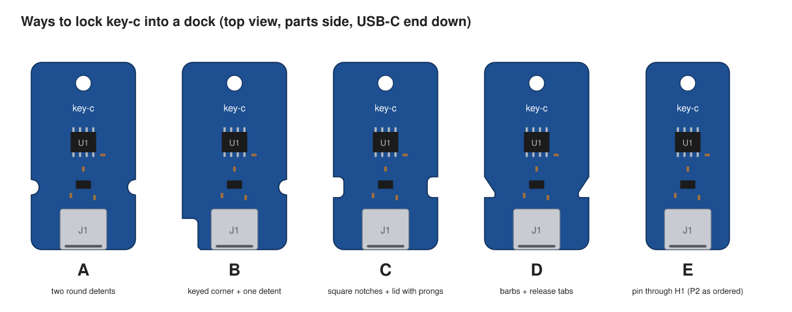
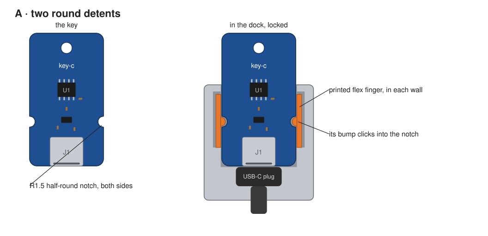
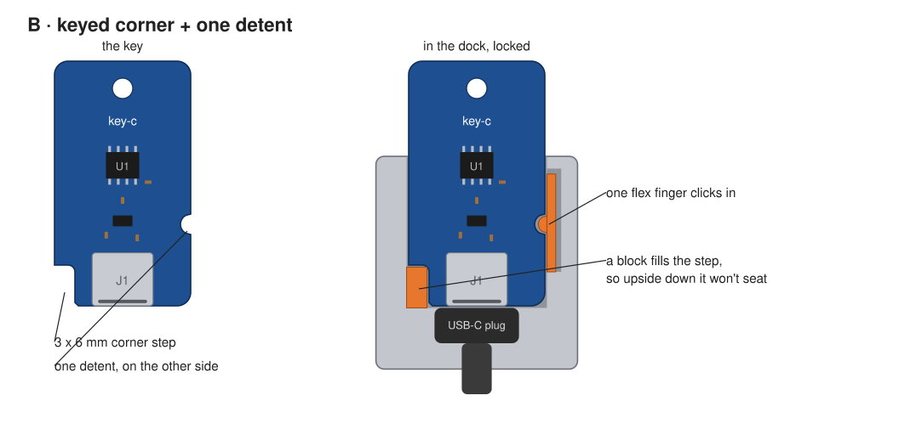
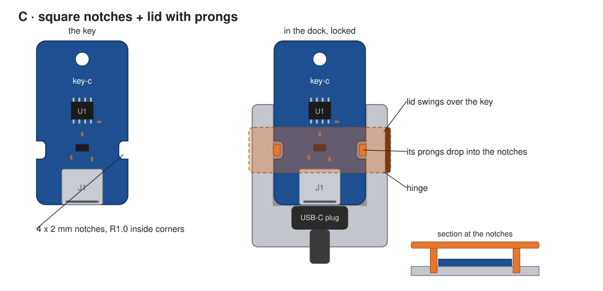
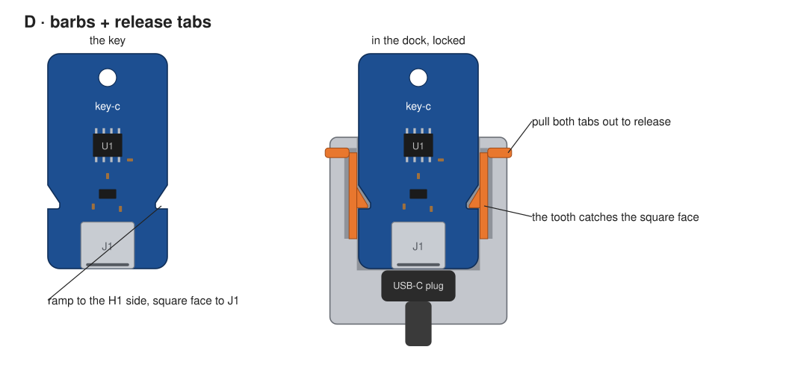
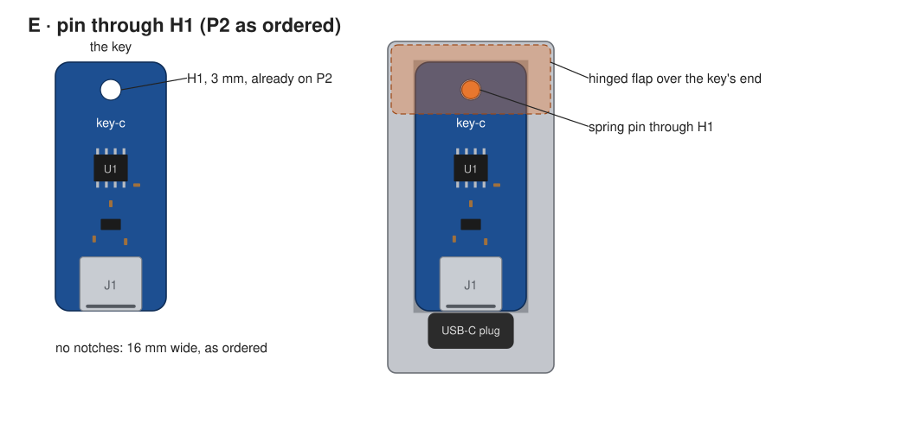

# key-c: ideas for locking the key into a dock

> **Status: ideas only.** Nothing here changes the board as ordered (P2). These are sketches for
> a possible P3, to choose from before anything is drawn in KiCad.

The idea: make key-c a little wider and cut notches into its long edges. In a dock on the console,
a latch drops into the notches, so the key is held in place. It's a physical way to show the key
is engaged.

How the dock works in every option:
- The console's USB-C plug sits fixed in the dock's back wall.
- The key slides in, USB-C end first, until the plug mates with J1.
- A latch holds the key at its notches (or at H1 in E).

The board goes from 16 to **20 mm** wide in A–D. J1's shell is 8.94 mm wide, so that leaves about
5.5 mm beside it on each side, room for a 2 mm notch with margin. The notches sit 12 mm back from
the USB-C edge, beside U2. Only 0402s are near them there, and those are within ±4 mm of the centre
line.

The sketches are top views, parts side up, to scale. Blue is the key, grey is a printed dock, and
orange is the part that locks. They come from [`lock/gen_lock.py`](lock/gen_lock.py)
(`python3 hardware/key-pcb/key-c-usbc/lock/gen_lock.py`). They are concept sketches, not drawings
to build from: the dock's walls, fingers and lid are drawn to show the idea, not sized or tested.

## A: two round detents

- A half-round notch, R1.5 mm, on each side.
- Each dock wall has a printed flex finger with a bump. The key clicks in, and a firm tug pulls it
  out.
- Round notches have no inside corners, so JLCPCB's router radius doesn't matter.
- The simplest one, and the one most like "it clicked, it's in".

## B: keyed corner + one detent

- A 3 × 6 mm step cut out of one corner at the USB-C end, and one round detent on the other side.
- A block in the dock fills the step. Upside down, the block meets the board and the plug doesn't
  mate, so the key only seats parts side up.
- Electrically, either way up is fine: each CC pin has its own 5.1 kΩ and USB-C is reversible. The
  keying is only physical.
- The step is 3 mm wide and J1 starts 5.5 mm in, so it clears J1.

## C: square notches + a lid with prongs

- A 4 × 2 mm notch on each side, with R1.0 inside corners (JLCPCB's standard bit).
- A lid hinged on the dock's side swings over the key. Two prongs on its underside drop down
  through the notches, past the board's edges, into the dock floor.
- The lid only closes when the key is fully home and the notches line up with the prongs. Closing
  it is the "armed" gesture.
- Later, the lid could press a microswitch that the console reads. That is a console hardware and
  firmware change, so it's a separate decision.

## D: barbs + release tabs

- Each notch has a ramp on the H1 side and a square catch face on the J1 side.
- Each dock finger has a tooth. Pushing the key in rides the finger out, the tooth drops into the
  notch, and pulling the key does nothing until both tabs are pulled out.
- This holds the hardest. The catch face's inside corner needs a small radius (R0.4 from a
  0.8 mm bit), which has to be asked for in the order.

## E: a pin through H1 (no new board)

- P2 already has H1, a 3 mm through hole at the far end.
- A dock that covers the whole key has a hinged flap at the H1 end with a spring pin through H1.
- This works with the 5 boards already ordered, so the dock can be printed and tried first.

## Side by side

| | Board change | Holds | Release | Inside corners |
|---|---|---|---|---|
| A | 20 mm wide, 2 round notches | light click | one tug | none |
| B | 20 mm, corner step + 1 round notch | light click, one way up | one tug | one, R1.0 |
| C | 20 mm, 2 square notches | firm while the lid is shut | open the lid | four, R1.0 |
| D | 20 mm, 2 barb notches | firmest | pull both tabs | two, R0.4 (small bit) |
| E | none | firm while the flap is shut | open the flap | none |

## What JLCPCB can make

- **Notches are part of the outline.** They're drawn on `Edge.Cuts` and milled with the rest of the
  outline, at no extra cost. A 20 × 36 mm board is still far under 100 × 100 mm, so the price and
  Economic PCBA stay the same.
- **Inside corners keep the router's radius.** JLCPCB's standard 2.0 mm bit leaves R1.0 mm. A
  smaller bit (1.6, 1.2 or 0.8 mm) can be asked for, for tighter corners. Or add "dog-bone"
  reliefs so a square latch still seats.
- **Internal slots**, if a pin should go through the board rather than its edge, are non-plated and
  at least 1.0 mm wide.
- **The outline is held to about ±0.1–0.2 mm.** Give the latch about 0.3 mm of play along the key,
  so the USB-C plug sets how deep the key sits and the lock never pushes on J1.
- **Keep copper at least 0.5 mm from a notch**, the ground pour included.
- **Order deburring this time.** It didn't make it into the P2 order. A notch that rubs a printed
  finger will feel rough and shed glass fibre without it.

Sources: JLCPCB's [board outline guide](https://jlcpcb.com/blog/pcb-board-outline),
[slot guide](https://jlcpcb.com/blog/reliable-pcb-slot-holes-design) and
[capabilities](https://api.jlcpcb.com/capabilities/Capabilities). Check them again before
ordering: these numbers come from those pages as read on 2026-10-07, not from a quote.

## Two things to weigh

- **Pulling the key out is an abort.** In the planned console end
  ([PROPOSALS.md](../PROPOSALS.md#the-console-end-of-key-c)), pulling the key cuts its power and
  throws away an unfinished approval. A lock shouldn't make that hard. A and C release in one
  move. D needs both hands.
- **Print before ordering.** E can be tried now on the P2 boards. For A–D,
  [`3d/print_mockup.py`](3d/print_mockup.py) already makes the key as a printable solid; adding
  the notches there lets each dock be tried in plastic against a real plug first.
