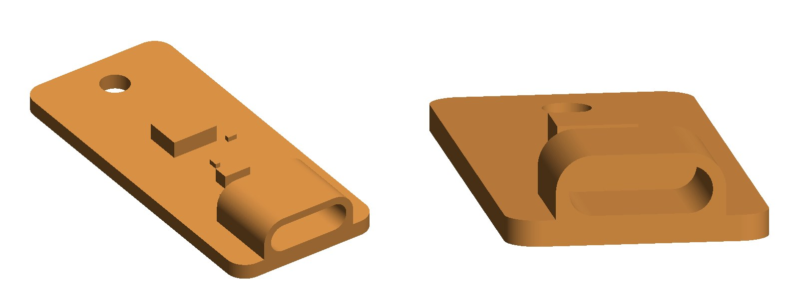

# key-c P2: the USB-C key

> **Status: ordered, in production.** 5 boards, all assembled by JLCPCB. The production file is
> checked and confirmed, and so is the parts placement (2026-10-04). JLCPCB estimates production
> will finish 2026-10-07 05:00; then 8–13 business days by Global Standard.
> JLCPCB order **W…1209** · PCBA **SMT…3772** · $38.96

| parts side | back |
|---|---|
|  |  |

These are KiCad renders of the ordered board, in the colours ordered: blue mask, white
silkscreen and silver lead-free HASL pads. KiCad has no 3D model of the HCTL receptacle, so the
connector shown is a GCT USB4105, a 16-pin receptacle of the same size and pad layout. The
renders come from a scratch copy of the board; the files below are untouched.

**3D models for CAD:** [`3d/key-c-P2.step`](3d/key-c-P2.step) is the assembled board, and
[`3d/key-c-P2-board-only.step`](3d/key-c-P2-board-only.step) is the bare board. They import
into Onshape as-is. Both come from the same scratch copy, with the same GCT stand-in connector at
J1's origin. The origin is the board centre, Z = 0 is the back face, and the USB-C end is at −Y.
The bare board is 1.51 mm thick (mask and copper not modelled). Units are mm.
To remake them: `kicad-cli pcb export step --user-origin 108x118mm`.

**Print mock-up:** [`3d/key-c-P2-print.step`](3d/key-c-P2-print.step) is a simplified version for
a 3D printer: one solid, same frame. The board, the chip bodies and the small parts are plain
blocks fused together. The USB-C receptacle is just its outer shell, with no tongue or contacts.
- The socket is 8.70 × 2.90 mm and 7.0 mm deep, so a real plug (8.25 × 2.40 mm) slides in with
  print clearance. A real-size plug was checked against it and doesn't touch.
- The shell walls are 0.8 mm (two perimeters), so the shell is 10.3 × 4.5 mm. The real one is
  8.94 × 3.26 mm, so the mock-up's shell is a little bigger.
- The board is 1.6 mm, as ordered. H1 is a 3 mm through hole.
- It prints flat, back face down, with no supports. The socket's round top bridges.
- The 0402 parts are 0.35–0.5 mm nubs and may not show on a coarse print.
- To remake it, or change the clearance or walls: `pip install cadquery`, then
  `python3 3d/print_mockup.py`.

**What it is:** an ATECC608C secure element (I2C, SOIC-8) behind a USB-C receptacle. The
receptacle is used as plain wires, not USB:
- D+ carries SDA, D− carries SCL and VBUS is key power.
- A 5.1 kΩ resistor on each CC pin tells the console a key is in.
- A USBLC6 ESD array sits between the connector and the chip.
- Four test pads on the back, and the PicoQuorum mark.

The design is in [../PROPOSALS.md](../PROPOSALS.md), and the full order record is
[buildlog/2026-10-02-key-c-order.md](../../../buildlog/2026-10-02-key-c-order.md).

| | |
|---|---|
| Board | 16 × 36 mm, 2 layers, 1.6 mm, blue mask, white silkscreen, LeadFree HASL |
| Parts | U1 ATECC608C-SSHDA-T, U2 USBLC6-2SC6, J1 HCTL HC-TYPE-C-16P-01A, C1/C2 100 nF, R1/R2 5.1 kΩ |
| Files as ordered | commit `ac34fc55` on `key-pcb-learn`; Gerber zip SHA-256 `99a6dbb5…`, in `fab/` |
| Checks | ERC 0 · DRC 0 · unconnected 0 · parity clean (`tools/keypcb check key-c-usbc`) |

## Next

1. **Before plugging anything in:** build the console's end of the cable
   ([PROPOSALS.md](../PROPOSALS.md#the-console-end-of-key-c)):
   - a current-limited, reverse-blocking VBUS switch, enabled by GP6 and never GP6 directly
   - CC1 and CC2 sensed separately
   - 2.2 kΩ pull-ups to switched VBUS
2. **When the boards arrive:**
   - Look at each one under a loupe, and lightly sand the edges (they weren't deburred).
   - Meter it:
     - VCC to GND is not a short.
     - Each CC pin reads 5.1 kΩ to GND.
     - SDA and SCL aren't shorted to anything.
   - Check that the test pads read the same.
3. **First power-up on the bench:**
   - Only this key in the port.
   - Look for `0x60` in an I2C scan.
   - Read the chip's serial and configuration.
   - Lock nothing yet.
4. **Practise provisioning on a spare** before any key becomes a Safe owner.

## Log (newest first)

- **2026-10-04:** **placement confirmed**, and the order is in production.
  - "Yes, please proceed to production."
  - The PCBA is at 13% (Data Finished) and fabrication at 0%.
  - Estimated finish: 2026-10-07 05:00.
- **2026-10-04:** STEP files of the ordered board added in `3d/`, for Onshape.
- **2026-10-04:** JLCPCB's parts-placement review arrived and was checked.
  - U1 and U2 have pin 1 at their triangles.
  - J1 faces the edge.
  - The 0402 parts aren't polarized.
  - It needs confirming in Order History within 72 hours.
- **2026-10-02:** status page and renders made.
- **2026-10-02:** checked the PCBA line's final parts list and the saved placement view.
  - All 5 parts are selected. C1 and C2 share the C1525 line, with 10 bought.
  - U1/U2 pin 1 sit at their triangles.
  - J1's pegs measure exactly on the peg holes.
- **2026-10-02:** the `cpl.csv` downloadable from the order is byte-identical to the upload. The
  placement edits live only in JLCPCB's system.
- **2026-10-02 17:14:** JLCPCB's production file arrived, was compared with the design, and was
  **confirmed**.
  - The input is byte-identical.
  - All 29 drills are at 0.000 mm offset.
  - Two 1.152 mm tooling holes were added, in plain ground pour.
  - Copper, silkscreen and mask show only normal fab changes.
  - Also checked by hand in GerbView.
- **2026-10-02 16:10:** **ordered**, W…1209, $38.96.
  - Economic PCBA, LeadFree HASL, Confirm Production file and Confirm Parts Placement.
  - Deburring didn't make it into the final order.
- **2026-10-02:** in JLCPCB's placement preview, U1 and U2 were rotated 90° (each pin-1 dot to its
  triangle) and J1 was nudged onto its pads.
- **2026-10-02:** **P2.** Redesigned after an outside review.
  - J1's footprint copy: outer ground pads pulled back to clear the peg holes, which removed the
    DRC exception.
  - U2 moved closer to J1, with C2 at its VBUS pin.
  - Four test pads on the back.
  - The board grew to 16 × 36 mm.
  - The review's console-side points went into PROPOSALS.md.
- **2026-10-02:** first upload, P1, 14 × 32 mm.
  - J1's yellow flag was only a $0.03 special-handling fee.
  - Economic assembly wasn't offered with ENIG but was with HASL. Standard would have forced a
    70 × 70 mm board.
- **2026-10-02:** the PicoQuorum mark added to the back.
- **2026-10-02:** **P1** drawn, with key-d (pogo) beside it. The receptacle goes on the key rather
  than a plug: 16 pins on one side, cheap, assembled at JLCPCB.
- **2026-10-02:** rev A (the PCB is the plug) arrived on `main`. The spring-contact C1 concept was
  parked on `key-c1-concept`.
