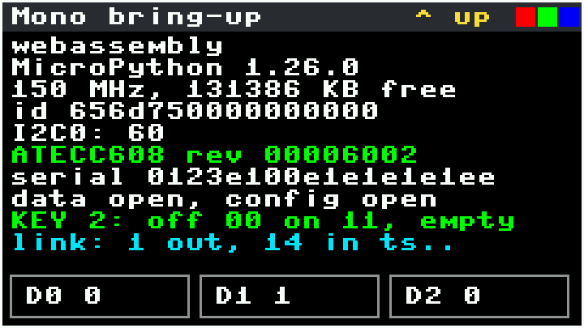

# Mono: bringing up the first boards

*Written 2026-11-17, before the first boards came. Nothing here has run on a Mono. The two scripts
were run on the emulator and against a made-up board ([What was checked](#what-was-checked)). The
way in is console-rp's, which four console-rp boards have been through: its
[bring-up](../../console-rp/bench/BRINGUP.md) and its [set-up](../../console-rp/SETUP.md).*

Mono has console-rp's pins, so it takes console-rp's loader and console-rp's images unchanged. What
is new on Mono, and so what this plan looks at hardest:
- the nine pads on the back in place of J3, RESET and BOOTSEL;
- the LDL1117 regulator;
- the backlight fed from 5 V;
- KEY 2's switch and bus;
- four parts JLCPCB may have placed turned: U9, U2, U10 and D1 ([README.md](../README.md#parts-at-jlcpcb)).

## A new board does nothing, and that is right

A board from the assembler has a blank flash and no screen. Plugged in by its USB-C:
- **The computer sees one serial port**, the CH343P: `/dev/cu.usbmodem…` on a Mac. The end of the
  name is that chip's serial number, so it tells boards apart. Nothing comes down it.
- **The screen stays dark** once it is fitted. Nothing has started the panel, and R11 holds the
  backlight off. The LED is off, and the buttons do nothing.
- **The RP2350 waits in its boot ROM**, on its own USB. That USB goes to two pads on the back, not
  to the USB-C. On console-rp it never showed up on the Mac, and the cause isn't known.
- **The USB-C can't load the board**, now or ever. It reaches only the CH343P, by wiring. Everything
  goes in over SWD, through the pads.

So a board that looks dead is as it should be. It is a fault only if no port appears, if a part gets
warm, or if it draws more than the 0.2 A printed on its back.

## What you need

- **A debug probe.** console-rp's: a Pico 2 W with `debugprobe_on_pico2.uf2`, GP2 for SWCLK, GP3 for
  SWDIO ([its BRINGUP.md](../../console-rp/bench/BRINGUP.md#how-it-was-loaded), steps 1 to 4, has
  the probe, `probe-rs`, and MicroPython's UF2 with its hash).
- **Pogo pins on three pads:** SWDIO, GND and SWCLK, side by side at 2.54 mm. A jig is drawn, not
  built ([JIG.md](JIG.md)). A load takes about 3.5 minutes with MicroPython and about 3 without, since `swdload.py` writes the
  whole filesystem. That is long to hold pins by hand. For the first board, which gets the most
  loads, three thin wires soldered to the pads are steadier. `swdload.py` tries a piece again when
  contact drops, and says so.
- **A panel**, and for the first board one of a kind already seen working in a console-rp's J2.
  No ER-TFT1.14-2 from the 100 has been in any J2 yet, as far as the notes say
  ([the order](../../../buildlog/2026-11-03-panels-order.md)). Try one of those on a board that
  is known good, so a dark screen has one cause.
- **A meter.** A USB power meter too, if there is one: the board's back says what to expect.
- `uv` for `swdload.py`. `check.py` needs only Python 3.

## The pads

On the back, in one row 21.5 mm up from the USB-C's edge, each named in the silkscreen. With the
back facing you and the USB-C down:

```
   left group                     right group
   GND   D−   D+   BOOT           3V3   RUN   SWDIO   GND   SWCLK
   TP9   TP8  TP7  TP6            TP5   TP4   TP3     TP2   TP1
```

- **The probe:** GP2 to SWCLK, GP3 to SWDIO, GND to the GND between them. No power between the
  boards: Mono has its own USB-C cable. With CLK and DIO swapped, probe-rs says "No target responded
  to the debug port" (console-rp's board #3).
- **3V3 is to measure only.** Feeding it with no 5 V on the USB-C puts the regulator's output above
  its input, past its limit.
- **To restart the board:** `probe-rs reset --chip RP235x --protocol swd`, or RUN to GND for a
  moment, or the USB-C out and in. There is no button.

## Each board, in order

Steps 1 to 4 read the key chip and change nothing on it. Do them on every board before step 6 on
any.

### 1. Before power

- **Look,** beside [the render](../renders/mono-top.jpg): U9 (under D0, by KEY 2's holes), U2 (above
  the USB-C), U10 and D1, each the way the render has it; L1's dot; no bridge across the RP2350's
  pins or the USB-C's.
- **Meter, no power:** 3V3 to GND on the pads is not a short.

### 2. Power, nothing loaded, no panel

Plug the USB-C in, through the USB meter if there is one.
- A serial port appears: `ls /dev/cu.usbmodem*`. Write down its end.
- With a C-to-C cable, try the plug both ways up: each way has its own 5.1k (R4, R5), and a missing
  one shows as no power that way up.
- 3V3 on its pad reads 3.3 V.
- The current is small and steady, well under 0.2 A. Nothing is warm: the regulator (bottom right
  of the front) above all.

No port: U2, the CH343P or the USB-C's joints. Stop there with that board.

### 3. SWD answers

Pins on SWDIO, GND and SWCLK, the board still powered by its USB-C.

```sh
probe-rs info --protocol swd                                      # DPv3, two Cortex-M33
probe-rs read --chip RP235x --protocol swd b32 0x40048004 1       # XOSC_STATUS: 0x81001000, the crystal running
probe-rs read --chip RP235x --protocol swd b32 0x40000000 1       # CHIP_ID: console-rp's read 0x30004927
```

The crystal runs on a blank board because the boot ROM starts it for its USB. Write the CHIP_ID
down: its first digit is the chip's revision, which the README's open question on RP2350-E24 asks
for. Its address is from Raspberry Pi's datasheet; console-rp's notes give the value and not the
address.

### 4. The panel, then stage0

1. **Unplug the USB-C.** Fit the panel as on console-rp: the glass face up, its ribbon folded under
   into J2. Lift J2's latch gently: console-rp's board #5 has a damaged one.
2. **Load MicroPython and [`stage0.py`](stage0.py),** from the repository's root:
   ```sh
   uv run --no-project --with littlefs-python==0.19.0 python hardware/console-rp/bench/swdload.py \
       RPI_PICO2-20250911-v1.26.1.uf2 main.py=hardware/mono/bench/stage0.py
   ```
   Where its messages say J3, read the pads.
3. **Read the screen.** The LED blinks three times, then:

   

   *Drawn on the emulator by `stage0_test.mjs`. A board says `Pico2, RP2350` on the first line, and
   its own free RAM, id and serial.*

   | line | what it should say | if not |
   |---|---|---|
   | the frame | a white line on all four edges | one missing: the panel's window isn't at column 40, row 53; another kind of panel |
   | the squares | red, green, blue | another order: a BGR panel |
   | `^ up` | upright, D0's box over the left button | hold all three buttons 1 s: if it is right then, the panel or its fold is the other way, and the firmware's `MADCTL` is wrong for it |
   | `I2C0: 60` | the key answers | `nothing`: U5, R6 or R7 |
   | `ATECC608 rev …` | green; console-rp's read `00006005` | red `no ATECC608 at 60` or `60 doesn't wake` |
   | `data open, config open` | a fresh chip | `locked`: this chip was prepared before |
   | `KEY 2: off 00 on 11, empty` | green | below |
   | `link: … out, … in` | `out` counts up every 2 s | |
   | the boxes | each green while held, its count up by one, the LED lit | a box that never lights: that button |

   **KEY 2's line** is its supply read through its bus's two pull-ups, off and then on. `off 11`:
   VKEY is on when it should be off, so U9 or R20. `on 00`: U9 doesn't switch, which is what a part
   turned at placement would do. `on 10` or `on 01`: R17, R18 or U10. Any address in place of
   `empty`: something is fitted there.

   **Nothing on the screen** has three cases. Dark with no backlight, but the LED blinked: the
   backlight's switch (Q1, Q2, R8 to R11) or the ribbon, and `check.py` below still gets its facts. Backlight but no picture: the ribbon's seating, then the screen's five lines. No
   blink at all: MicroPython isn't running, so load again and watch for a failed verify.
4. **Log it.**
   ```sh
   python3 hardware/mono/bench/check.py /dev/cu.usbmodem… --board 1 --log hardware/mono/bench/BOARDS.md
   ```
   [`check.py`](check.py) asks stage0 for its facts over the USB-C, so an answer is the link working
   both ways. It waits for a press of each button, asks four things only eyes can check, and adds
   the board's row to [BOARDS.md](BOARDS.md). Write the board's number on its back.

### 5. Measure, on the first board

Still open from the README, and quick while stage0 runs with the backlight on:
- the current at the USB-C: the back says under 0.2 A;
- the regulator after ten minutes, by touch or a thermometer: about 30 °C over the air is the
  estimate at 0.15 A;
- 1.1 V on the via beside L1. console-rp's first board read 1.4 V once and it was never read again.

### 6. The console's image, on the first board

This changes nothing on the chip either.

```sh
tools/fw build console-rp
uv run --no-project --with littlefs-python==0.19.0 python hardware/console-rp/bench/swdload.py \
    --no-micropython --image build/console-rp-<sha>
```

- The boot mark plays, then a red **Not prepared**: the chip's config is open, so the image won't
  make a key in it.
- **Look at the footer.** Its three caps, ■ ● ▲, should sit over D0, D1 and D2. Mono's D0 and D2 are
  about 1.8 mm further out than the slots' middles, inside the slots by the drawing.
- **The link at the console's own rate, 460800:** `python3 tools/relay/relay.py /dev/cu.usbmodem…`
  prints the console's status, with the chip's serial.

### 7. Prepare the chip, on one board first

**This is the first permanent step.** `prepare-rp` writes the chip's config and locks it, and that
lock can't be undone ([docs/LOCKING.md](../../../docs/LOCKING.md)). It is
[SETUP.md](../../console-rp/SETUP.md)'s "At the bench", steps 1 to 3, as written there: prepare,
dump, then the console's image again, which now comes up on "Your key: No key yet".

Take one board through it, then make a key on it and replace it, without sealing, as console-rp's
boards #1 and #3 did. That is the first time a Mono's chip makes a key. Prepare the rest after that.
Sealing a key is the owner's step and is not part of bring-up.

## The batch

1. Every board through steps 1 to 4, each with its row in [BOARDS.md](BOARDS.md). A board that
   fails stays out, with its row saying why.
2. The first good board through steps 5, 6 and 7.
3. Then the others through 6 and 7, when the first has made a key.

## The RP2350's own USB, if there is time

The README's open question, and best asked of a blank board, which already waits on that USB: a USB
cable's D+, D− and GND on those pads, the board powered by its USB-C. If "RP2350 Boot" shows up on
the Mac, `picotool` could load boards with no probe. If not, it is as on console-rp, and SWD loads
them. Give it ten minutes and no more: nothing above needs it.

## Other bench scripts

console-rp's work on Mono as they are, since the pins are the same:
[`main_repl.py` and `rawrepl.py`](../../console-rp/bench/BRINGUP.md#on-the-bench-the-repl-on-the-usb-c)
put a REPL on the USB-C for a bench board. Take it off before the board holds a key.

## What was checked

- **`stage0.py`** ran whole on the emulator's MicroPython 1.26, against a model of Mono: VKEY
  following GPIO7, KEY 2's bus following VKEY, an empty I2C1, a scripted press and link. 10 checks
  pass, a dead VKEY switch and a missing key among them, and the frame came through the emulator's
  ST7789 at column 40, row 53. `(cd emu && npm ci) && node hardware/mono/bench/stage0_test.mjs`
- **`check.py`** ran against a made-up board on a pty: 6 checks pass.
  `python3 hardware/mono/bench/check_test.py`
- CI doesn't run either: it skips `hardware/`.

Not checked:
- anything on a board;
- KEY 2's read on the real parts: that its lines read low through 5.3k with VKEY off;
- an ER-TFT1.14-2 in J2;
- `swdload.py` through pogo pins on Mono's pads;
- the CHIP_ID address in step 3.
