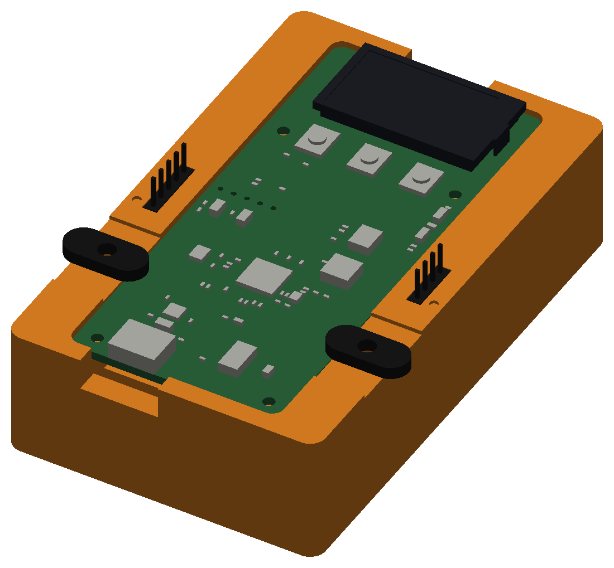

# Mono: the jig

*Drawn 2026-11-18. Not printed, and no probe has been in it. The sizes of the probes and their
receptacles are sellers' figures, not measured.*

A printed block that a Mono drops into, face up, onto nine spring probes (pogo pins), one under each
pad. Two latches hold the board down. Two headers in the rim bring the pads out: one for the debug
probe, one for the rest. [`cad/mono/jig.py`](../../../cad/mono/jig.py) draws it from the routed board;
[`cad/mono/README.md`](../../../cad/mono/README.md#a-jig-for-the-nine-pads) says how to print and
build it.

Board 1 was loaded through soldered wires ([BOARDS.md](BOARDS.md)). On a second board, a header
held on the three pads by hand answers single reads, but a load has not got through it. The jig is meant to give what the wires gave: every pin pressed by its own
spring, with the board held still for the three minutes a load takes.

## What it does

- **The board lies face up** on a flat deck, so the screen and D0 to D2 are in reach for `stage0.py`
  and `check.py`. Nothing is fitted on the back; the script checks that.
- **The board's own USB-C powers it,** as BRINGUP.md says it must. The bottom rim is open for the plug.
- **Each probe is pushed in 1.7 mm** when the board is on the deck: two thirds of a P75's stroke.
  The deck sets that, not the hand.
- **The latches sit either end of the pads' row,** where the springs push. Nine P75s push with 7 to
  16 N in all, by sellers' figures (0.75 to 1.8 N a probe).
- **The pocket locates the board** by its outline, 0.25 mm a side. The pads are 1.5 mm across. The
  README's idea of pegs in the M2 holes isn't used: two ways to locate one board can fight.

## The headers

Each header's first pin is the one nearest the USB-C's end, marked by a dot in the rim.

| left header | pad | | right header | pad |
|---|---|---|---|---|
| 1 | TP1 SWCLK | | 1 | TP9 GND |
| 2 | TP2 GND | | 2 | TP8 D− |
| 3 | TP3 SWDIO | | 3 | TP7 D+ |
| 4 | TP4 RUN | | 4 | TP6 BOOT |
| 5 | TP5 3V3 | | | |

- **The probe** goes on the left header's pins 1 to 3: SWCLK, GND, SWDIO. A Raspberry Pi Debug
  Probe's cable ends in three single sockets, so it fits as it is. With the Pico that is the probe
  now: GP2 to pin 1, GND to pin 2, GP3 to pin 3.
- **Pin 5 is 3V3, to measure only.** Never feed it ([README.md](../README.md#the-jigs-pads)). Leave
  it bare, or pull that pin from the strip before it goes in.
- **Pin 4, RUN:** to GND for a moment restarts the board.
- **The right header** is for the RP2350's own USB, the README's open question: a USB cable's D+,
  D− and GND on pins 3, 2 and 1, and BOOT. Nothing in the bring-up needs it.

## Loading a batch

A load is about 3.5 minutes with MicroPython and 3 without. A board's bring-up and set-up is three
loads and a dump: `stage0.py`, then `prepare-rp`, the dump, then `console-rp`. That is ten minutes
or more on the probe for each board, and the person waits through most of it.

**So: several stations, not a faster one.** A station is one jig, one probe and one USB-C cable. Print
three or four, and put them on one powered hub. While one board loads, the next is seated and the
one before is checked. Each board still gets its own eyes, its own button presses and its own row
in BOARDS.md.

What that needs, and isn't done:
- **`swdload.py` takes whichever probe it finds.** With several plugged in, probe-rs wants
  `--probe VID:PID:serial` on each call. `swdload.py` needs an option that passes it on. Not
  written.
- **Which board is on which station.** The board's serial port carries the CH343P's serial number,
  and the probe has its own. A label on each jig with its probe's serial is enough to start.
- **One Mac driving four loads at once** is untried.

What stays one board at a time, on purpose: **`prepare-rp`**. It locks the chip's config for good.
Run it for one board, read its screen, then the next.

Two ways a load could get shorter, both unproven:
- **The RP2350's own USB,** on the right header. If "RP2350 Boot" shows up, `picotool` could load a
  board with no probe. It never showed up on console-rp.
- **A faster SWD clock.** The 100 Ω in each line and the jig's short wires may allow more than
  probe-rs's default. Not tried.

## Shopping list

For four stations and spares. The first three lines are the ones that can't be had from a drawer.

| what | how many | notes |
|---|---|---|
| P75-B1 spring probes | 100 (9 a jig) | the 1.02 mm barrel, a sharp point for flat pads. They come in packs of 50 or 100 and wear, so spares are right. P75-Q2, a four-point crown, also suits flat pads |
| R75 receptacles | 50 | the receptacle a P75 plugs into, about 1.32 mm across. R75-2W has a wire-wrap tail, R75-2S a solder cup: either. Check the listing's length and hole against `POGO` in `jig.py` |
| Drill bits, 1.3, 1.35 and 1.4 mm, and a pin vise | a set | to open the printed bores to a push fit. A set from 1.0 to 1.5 mm covers it |
| M3 heat-set inserts, about 5 mm long | 8 (2 a jig) | `INSERT` in `jig.py` is a 4.0 mm hole, 6.5 mm deep: set it to your insert's |
| M3 × 8 screws, pan or button head, and M3 washers | 8 each | one a latch. A nylon-patch screw, or a drop of threadlocker, keeps it from backing out as the latch turns |
| 2.54 mm pin header, one row | a 40-pin strip | 5 and 4 pins a jig. You have this |
| Silicone wire, 30 AWG | a few metres, two or more colours | from the receptacles to the headers. 28 AWG is tight in the 2 mm slot |
| Jumper wires, socket to socket, 10 to 20 cm | 20 | probe to header, if the probe is a Pico |
| A debug probe a station | 3 more | a Raspberry Pi Debug Probe, with its case and cables; or a Pico or Pico 2 with the debugprobe firmware, as now |
| A powered USB hub, 7 ports or more | 1 | two ports a station: the probe and the board |
| USB-C cables, short | 4 | one a station. BRINGUP.md's step 2 tries the plug both ways up, so C-to-C for at least one |
| Cyanoacrylate glue, thin | 1 | fixes each receptacle once the gauge has set it |
| Stick-on rubber feet | 16 | the base is open underneath, where the wires are |
| Filament | about 100 g a jig | PETG for choice: the latches and the bores last longer than in PLA |
| A USB-A breakout, or a cable to cut | 1 | only for the try of the RP2350's own USB |

Not needed: a second jig PCB, a toggle clamp, or anything for the M2 holes.

## Not checked

- Anything printed or built.
- The P75's and R75's sizes, and so how deep a receptacle sits. The gauge sets the height whatever
  they are, as long as the receptacle is longer than about 12 mm.
- That a plug's moulding fits the gap in the bottom rim: 15 mm wide, drawn for a 12.5 × 6.5 mm one.
- That the latches hold against nine springs, and how the board lies with them shut.
- A load through it.
