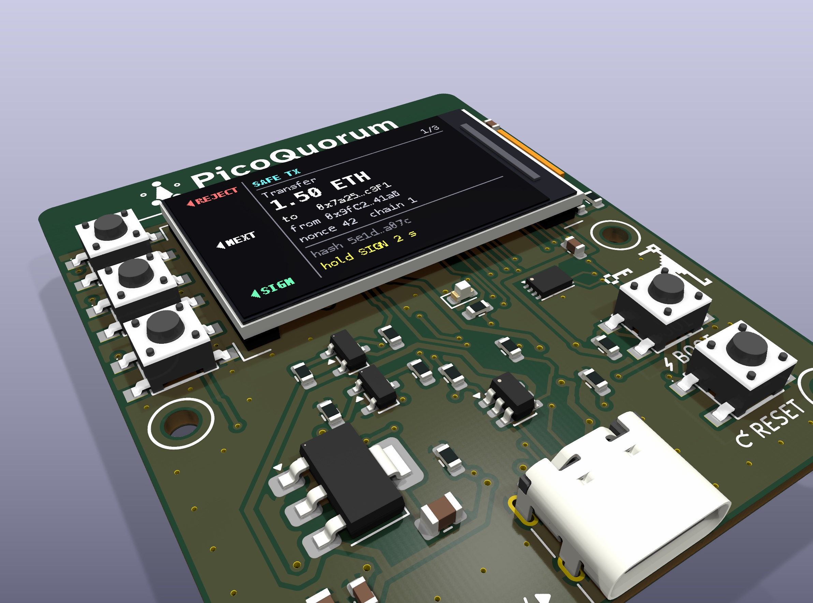

# PicoQuorumKey: a one-owner signing device

A small board that is one owner of a Safe multisig. It fetches a pending transaction over its
own Wi-Fi, shows what it does on a 1.14" screen, rebuilds the Safe transaction hash from the
fields on its screen, and has an ATECC608C sign that hash and nothing else, after every page is
seen and Sign is held.

Rev A is designed to be made by JLCPCB: 2-layer PCB, Economic SMT assembly of the front face, and
three things done by hand per board: solder the ESP32-S3 module on the back, clip the panel into
its connector, flash the firmware.

| doc | what it answers |
|---|---|
| [docs/SPEC.md](docs/SPEC.md) | what any board of this kind must have and do |
| [docs/DESIGN.md](docs/DESIGN.md) | rev A: the shape, the zones, the circuits, and every place it departs from the spec |
| [docs/PINS.md](docs/PINS.md) | the `picoquorum-key` pin profile the firmware carries |
| [docs/BOM.md](docs/BOM.md) | every part, where it comes from, and its JLCPCB tier |
| [docs/ORDERING.md](docs/ORDERING.md) | from KiCad to a JLCPCB order |
| [docs/BRINGUP.md](docs/BRINGUP.md) | hand assembly, flashing, the smoke test |

Layout of the repo:

```
docs/                  the documents above
hardware/picoquorum-key/   KiCad 10 project (schematic, board)
hardware/lib/          footprints pulled from LCSC, project footprint copies, PicoQuorum's logos
                       (the 3D models are not committed: see below)
hardware/out/<rev>/    Gerbers, BOM and CPL as uploaded, per tagged release
firmware/smoke/        MicroPython smoke test: screen, buttons, LED, key bus
firmware/profile/      the pin profile, in the shape the console firmware expects
tools/gen/             the generators: circuit.py is the source of the schematic and board
tools/                 build, autoroute, export and BOM/CPL conversion scripts
```

Status (2026-10-24): rev A is designed, routed and exported. ERC, DRC and schematic parity are
clean, and `hardware/out/rev-a/` holds the JLCPCB Gerber zip, BOM and placement file. Before
ordering: review the routing in KiCad, fit-check one real ER-TFT1.14-2 panel on a 1:1 print, and
check part rotations in JLCPCB's preview ([docs/ORDERING.md](docs/ORDERING.md)).



Renders of the finished device, with the panel showing a mock transaction screen: `tools/render/render_with_panel.sh`. Bare board: [docs/img/rev-a-iso.png](docs/img/rev-a-iso.png).

## Decisions taken

- JLCPCB **Economic** assembly, front face only. The ESP32-S3 module is hand-soldered on the back
  because every Espressif S3 module is "Standard only" at JLCPCB.
- **ESP32-S3-WROOM-1-N8R2** (8 MB flash, 2 MB quad PSRAM), from LCSC. The N4R2 the spec names
  first is not stocked at LCSC, DigiKey or Mouser as the plain PCB-antenna part; N8R2 is on the
  spec's known-good list.
- **ATECC608C-MAHDA-S** (UDFN-8), placed by JLCPCB: LCSC C23291019, an extended part, the key chip
  PicoQuorum's console-s3 uses (the SOIC-8 C28975195 until 2026-10-24).
- A **new pin profile**, `picoquorum-key`: every button active-low on a non-strap GPIO, the screen on
  the S3's IO_MUX SPI pins, the buttons on GPIO42–40, the key on GPIO16/17. This is a firmware change and a new release
  fingerprint, chosen on purpose.
- Backlight switched on the high side from the 5 V rail, so the LED current is set by a resistor
  and does not load the 3.3 V regulator.

## In PicoQuorum

PicoQuorumKey was designed on its own, apart from this repository, as a second answer to the same
spec as `hardware/console-s3`; the two are ordered side by side to compare. It came in on
2026-10-24 with these changes, and no others:

- The name: `console-s3` became `picoquorum-key` in every file, path and test (it clashed with
  `hardware/console-s3`). The firmware profile's name is now `picoquorum-key` too.
- The silkscreen (`tools/gen/silk_art.py`): PicoQuorum's mark and name and `PicoQuorum.app` on
  both faces, and the 8-bit key and dragon by U2 in place of the padlock.
- U2 is the UDFN-8 ATECC608C-MAHDA-S that console-s3 uses, not the SOIC-8. The board kept its
  routing; only U2's own tracks were redrawn ([docs/DESIGN.md](docs/DESIGN.md#key)).
- J1's shell slots got 0.25 mm rings, not 0.20 (JLCPCB's least), as console-s3's did.
- Tests: paste-only window panes on an exposed pad count as that pad's paste, and filled silk shapes
  aren't held to the line-width minimum.

`tools/test.sh` passes, 125 tests, after the changes (2026-10-24). PicoQuorum's own
`tools/keypcb jlc` was run on it once, not wired in: its strict DRC passes but for J2's footprint
filter check, which this project turns off on purpose.

**The console image has a `picoquorum-key` profile since 2026-10-24** (`firmware/board.py`). It finds
this board by the pull-ups on GPIO16/17 ([PINS.md](docs/PINS.md#in-the-console-image)). It reaches a
board with the next release, made with `tools/release`. Until then, run only
`firmware/smoke/smoke.py`: the released image (2026.10.12 and earlier) knows only the Feather's
profile, which drives GPIO40–42 as outputs, and on this board those are the buttons, pulled to
ground when pressed. The profile has run only on the laptop so far, not on a board.

The 3D models aren't committed: LCSC's (from EasyEDA) don't say they may be passed on. Make them
locally with `tools/fetch_parts.sh` (it downloads from LCSC through `easyeda2kicad`), then
`tools/gen/fix_models.py`; the renders and `test_3d` need them.

