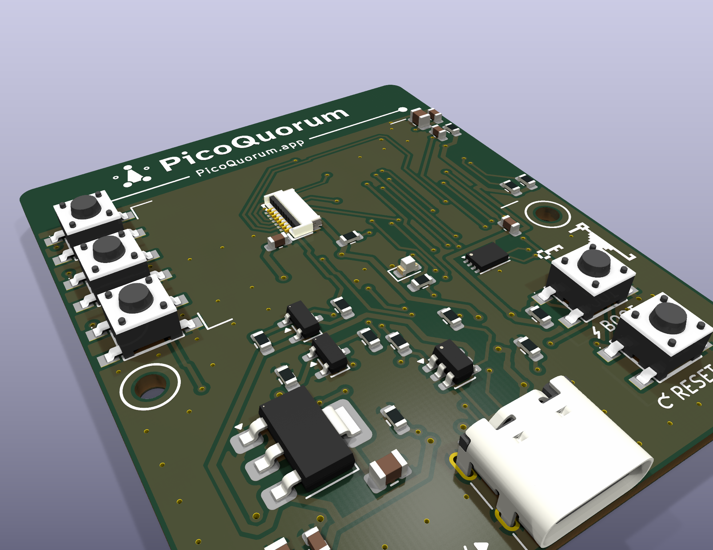

# picoquorum-key rev B: the design

*2026-10-25. How rev B meets [SPEC.md](SPEC.md). The schematic and board are generated from
`tools/gen/` (see "How the files are made"), so the numbers here are the generator's numbers. If
this file and the board disagree, the board is right and this file is stale.*

*Rev B is rev A with a key port. Rev A is ordered as planned from `hardware/out/rev-a/`, which
stays as it was uploaded; its source (schematic, board, generators, this file) is commit `143276a`.
The pictures in `img/` are rev A's until rev B's renders are made (they need the 3D models,
`tools/fetch_parts.sh`).*



## In one paragraph

A 50 × 53 mm two-layer board, **0.8 mm** thick. The ESP32-S3-WROOM-1-N8R2 is hand-soldered on the
**back**, its antenna at the top edge. Everything else JLCPCB places on the **front**: the 1.14″
panel's ZIF connector (under the glass), five tactile switches, the 3.3 V regulator, USB-C at the
bottom edge with ESD, the backlight switch, the ATECC608C key chip, a status LED and the passives.
The panel sits landscape on foam tape. Its ribbon folds under the glass into the ZIF. Reject, Next
and Sign sit in a column on its left, level with the three rail rows. Debug pads are on the back.

At the top-left corner is the **key port**: a USB-C plug that straddles a paddle cut into the top
edge, pointing up, for a key-c to slide onto. The parts on its lines sit in the top band between the
plug and the module, its power switch by the regulator, and it has an I2C bus of its own. The port is copper on every board; its parts are assembled only on
the boards ordered with it (`bom-port.csv`), and the plug is soldered by hand.

## Decisions and departures from the spec

| topic | rev A does | because |
|---|---|---|
| module | WROOM-1-**N8R2**, hand-soldered, back face | plain N4R2 isn't stocked at LCSC, DigiKey or Mouser (2026-10-23); N8R2 is on the known-good list |
| pins | new profile `picoquorum-key` ([PINS.md](PINS.md)) | no button on a strap, one button polarity, IO_MUX SPI, R8-tolerant, short button tracks |
| key | ATECC608C-MAHDA-S (UDFN-8, 2 x 3 mm), placed by JLCPCB | LCSC C23291019, an extended part; the same chip and package as PicoQuorum's console-s3 (it was SOIC-8, C28975195, until 2026-10-24) |
| backlight | high-side P-FET from **5 V**, NPN level shift from GPIO21, 150 Ω series | the current is (5 − Vf)/R, independent of the LDO; keeps ~13 mA off the 3.3 V rail |
| USB data | 0 Ω links R12, R13 in D+ and D− | removable: the board becomes power-only, closing the REPL path the spec records |
| polyfuse | **none** | JLCPCB has no Basic-tier PPTC; a USB port limits current itself; one fewer extended line |
| PREV, BACK | not fitted | the image reads three buttons; dropping the other two freed the band they sat in and took 5 mm off the board's height. GPIO39 and 38 are left unconnected |
| BOOT, RESET | 4.5 mm tacts on the front, right of centre | placed by JLCPCB; recovery without a tweezer short |
| panel ribbon | folds under the glass into a ZIF under the panel | keeps the board 44 mm wide; the ZIF is 1.0 mm tall and fits under the glass on foam tape |
| debug pads | 12 pads on the back | keeps the front for the screen and buttons; a pogo jig can reach them |
| regulator | AMS1117-3.3 in SOT-223, 1 A | the margin the spec asks for; a JLCPCB basic part |
| key port (rev B) | a straddle USB-C plug at the top-left corner, for a key-c; its own I2C bus on GPIO38/39; power switched, off at reset | the soldered chip and a key-c both answer at 0x60, so they can't share a bus; a key on a board whose image doesn't know the port gets no power |
| the plug | SHOU HAN TYPE-C 24P-GTJB 040 (C3151751), wing-b's, fitted by hand | no stocked horizontal SMT male USB-C plug was found at LCSC (2026-10-25). Its pads are on both faces, so it can't go through front-only assembly |
| thickness (rev B) | **0.8 mm** | the straddle plug's drawing: T = 0.80 ± 0.05. Thinner than rev A's 1.6: the board flexes more under the buttons and the glass, so the case should back it |
| board size (rev B) | 50 × 53, 6 mm added on the left | the plug needs the top-left corner, and a key-c on it (16 mm wide) lies over X 0–16; the strip carries the port's lines down and holds D3. Everything of rev A's keeps its place against the glass (X + 6). A case made for rev A doesn't fit |
| antenna keep-out (rev B) | the module's antenna end, X 29.5 to the right edge, Y 0–7, not the full width | so copper can reach the plug at the other end of the top edge; the rest of Y 0–7 still has no pour |
| port ESD | U6 on SDA/SCL, U7 on CC, D3 on VKEY; U7's second channel open | the plan also had a TVS on the LED line. Until 2026-10-26 U7's second channel was on SBU: 5 V on the plug's VBUS then reached 3V3 through R21 (100 Ω) and U7's diode, around U5. SBU is now R21 from VKEY and nothing else, so D3 clamps it through 100 Ω |
| port LED, FAULT (rev B) | the LEDs run off VKEY; FAULT is left open. No GPIO for either | the plan gave them GPIO13 and 47 (module pins 21 and 24). Rev A's locked routing closes those pins in on both faces, and opening it up broke the USB and screen runs, so rev B leaves them unconnected. D4 then shows the key is powered, with no blinking, and an overload looks like a key that doesn't answer |

Nothing here adds a way to sign or to read a key (rule 3). The 0 Ω links only close an existing
path. The key port adds wires, a power switch and protection, no way to sign. The console image
doesn't use it yet; when a release does, a plugged key is to sign the same hash, through the same
code, as the soldered chip (rule 1).

## Geometry

Origin top-left of the board, X right, Y down (KiCad's convention). All mm. The KiCad page has the
board's top-left at (100, 60); the drill/place origin is the bottom-left, (100, 113). Rev B added
6 mm on the left, so every rev A X is X + 6 here; Y is unchanged.

```
 X:  0  4  8  12 14                             29.5        50
 Y 0 ╭──┐▓▓▓▓┌─╮──◂ KEY PORT ──────────────────┬───────────╮
     │  │▓J3▓│ │  U6   U7  R18 R17             │░ antenna ░│  plug on the paddle, X 4.05–11.95;
     │D3└┐▓▓┌┘─╯                               │░PicoQuorum│  cut away to Y 4.5 either side
   7 ├─────────────────────────────────────────┴───────────┤
     │R21                                                  │   R21, R22, D4: the port's LEDs, by the plug
     │R22    [D0]  ┌──────────────────────────┐ C3 C5      │ ← rows 7 / 67 / 127 at Y 10.70 / 17.30 / 23.90
     │D4                                                   │
     │             │ glass 31.0 × 17.6     ┌──┐╮ R3 C4     │
     │R23 D5 [D1]  │                      │J2│ )fold       │   ribbon exits at X 46, folds back to J2
     │             │                      └──┘╯            │
     │       [D2]  └──────────────────────────┘ R6 R7      │
  26 ├─────────────────────────────────────────────────────┤
     │(o)          Q1 Q2 cluster   LED   U2 UDFN       (o) │  H1, H2 at Y 29.5
     │C9     U3 LDO      R12 U4 R13      R4 [BOOT]         │  Y 35–41
     │U5 R15 C1 C8 C2    R1     R2         [RESET]         │  Y 41–46; U5, the key's power, by the LDO
     │C10  R19 R20                                         │  R19, R20: the port bus's pull-ups
     │(o)                   ┌──USB-C──┐                (o) │  H3, H4 at Y 50
  53 ╰──────────────────────┴─────────┴────────────────────╯
 back: WROOM-1 at X 30–48, Y 0–25.5, antenna end on the top edge; the plug's B row at the paddle;
       test pads X 15–41, Y 35 and 39; TP13, TP14 at Y 43
```

| item | position / size | note |
|---|---|---|
| board | 50 × 53, corners R1.5, 2 layers, **0.8 mm** | the bounding box; the top-left corner is the key port's notch |
| key port notch | the paddle X 4.05–11.95 (7.90 wide) with its tip on the top edge; the board cut away left of it (X 0–4.05) and in a slot right of it (X 11.95–14.0), both to Y 4.5 | the plug's drawing wants the 7.90 mm paddle for 3.5 mm; the notch's inside corners are drawn at the mill's 0.5 mm radius, so it is straight for 4.0 mm. The corner below the notch, (0, 4.5), is rounded at 1 mm |
| plug J3 | origin at the tip, (8, 0), rotation 0, front; the plug points up, out of the top edge | A row on the front, B row on the back, 1.2–2.7 mm in from the tip; the body stands 9.6 mm past the tip. A key-c (16 mm wide) on it lies over X 0–16 |
| antenna keep-out | X 29.5 to past the right edge, Y 0–7, both faces | rule area over the module's antenna end (X 30–48) plus 0.5 mm: no tracks, vias, pads or pours. Ground pours start at Y 7.5 from X 14 on, so the band between the slot and the keep-out has no pour, only the port's parts and tracks. Left of X 14, the plug's corner, the pours run up to the tip, 15 mm and more from the keep-out: the plug's ground pads and shell join them there. A step to X 16.2 from Y 4.6 reaches U6's ground pin |
| module U1 (back) | 18 × 25.5, centre (39, 12.75) | antenna end flush with the top edge; castellation pads 1.0 mm longer than stock for the iron |
| glass | (15.0, 8.5) to (46.0, 26.1), 31.0 × 17.6 | drawn on `User.1` |
| active area | (17.0, 9.87) to (41.9, 24.73), 24.9 × 14.86 | offset away from the ribbon end; 0.110 mm per row |
| rail rows | Y 10.70, 17.30, 23.90 | centre of rows 7, 67 and 127 |
| D0, D1, D2 | SW1–SW3 at X 10.5, on the rail rows | 6.6 mm pitch; 4.5 mm switches leave 2.1 mm between caps; their left pads start at X 6.55 |
| key port's line parts | the band right of the slot, front: U6 (16.6, 4.6), U7 (20.8, 4.6); R18 (23.6, 3.4), R17 (25.4, 3.4), both upright | between the plug and the module, which the lines go to; in the order they arrive. Nothing here is copper in the antenna keep-out (X 29.5 on) |
| port pull-ups | R19 (6.4, 43.4), R20 (6.4, 45.2), front | anywhere on the bus works for a pull-up; in the band they blocked the lines' way through, so they went by U5, near VKEY |
| D3 | (2.2, 5.6), front | VKEY's TVS beside the plug's left VBUS pins, in the strip left of D0–D2 |
| key power | U5 (4, 38), C9 (4, 35.4), C10 (4, 40.8), R15 (7.6, 37) | along the left edge between H1 and H3, by the regulator that feeds it; VKEY runs up the strip to the plug |
| D5, R23 | D5 (4, 19.5), R23 (2.2, 19.5), front, both upright, D5's cathode up | in VKEY's run up the strip, left of D1: the track was cut and D5 put in it (2026-10-26). Four of the strip's ground stitching vias made room; R23's ground pad has a via of its own |
| why there | two layouts were tried first, both with every port part in the 6 mm strip left of D0–D2 | the router never finished either: the lines go from the plug to the module on the right, so with their parts on the left they doubled back past each other under the plug, and a SOT-23-6 0.6 mm from the edge leaves room for one 0.25 mm track and no via. The strip now holds D3 and the lines' way down |
| port LEDs | R21 (2.2, 7.4), R22 (2.2, 9.2), D4 (2.2, 11.0), front | in the strip below D3, on VKEY: D4 lights beside the plug while the key is powered |
| J2 ZIF | centre (26.5, 17.3), rotation 90 | under the glass; entry side faces +X, toward the fold |
| under-glass parts | J2, C6 (23.85, 20.2), R5 (29.5, 23) | all ≤ 1.0 mm tall; C6 sits on the 3V3 and GND runs 4.7 mm from the panel VDD pad |
| right strip | C3, C5 at Y 9.6; R3, C4 at Y 12.8; R6, R7 at Y 24.6; X 46.85 and 48.85 (C4 at X 47.0 so its pad clears the fold, which stands up to X 46.5) | beside the module's pins 2, 3, 9 and 10. Y 13.9–23.0 is left clear for the ribbon fold |
| backlight switch | Q1 (21, 30), Q2 (21, 34) and R9–R11, R14 around them | |
| LED | D1 (31.5, 29), R8 below it | visible below the screen's lower edge |
| key U2 | UDFN-8 at (38, 31.5), C7 up and right of pin 8 | about 15 mm in a straight line to module pins 9 and 10; ground through the exposed pad's via (below) |
| BOOT, RESET | SW6 (42, 39), SW7 (42, 46) | R4 pull-up at (37, 39) |
| regulator | U3 SOT-223 at (16, 39.5); C1, C8 at (11–13.2, 46); C2 at (19.27, 44.2), 4.8 mm from the tab | |
| USB | J1 centred X 28, mouth flush with Y 53; U4 at (28, 39.5); R12 (26.1, 35.5), R13 (31, 35.5); R1, R2 at Y 41 | ESD array between the connector and the links |
| M2 holes | (3, 29.5), (47, 29.5), (3, 50), (47, 50) | none in the top 29 mm; the left two stay 3 mm from the (new) left edge |
| test pads (back) | TP1–TP12, 1.5 mm square, X 15 + 5.2·i, Y 35 and 39; TP13, TP14 at (8.4, 43), (15, 43) | +3V3, GND, EN, TX, RX, SDA / SCL, BOOT, KCC, KEN, +5V, GND; KSDA, KSCL (the port's bus) |

Height on the front: tacts 3.8 mm, ZIF 1.0 mm (actuator closed), USB-C 3.2 mm, glass 1.6 mm. The
plug J3 stands past the top edge, not over the board.
Reference designators are on `F.Fab` only; the silkscreen carries what a person needs, all drawn by
`tools/gen/silk_art.py` (text at least 1.0 mm high with a 0.15 mm stroke, lines at least 0.15 mm,
JLCPCB's legibility minimums):

| side | what is printed |
|---|---|
| front, antenna band | the PicoQuorum mark and name (filled shapes from `hardware/lib/picoquorum.pretty`) over the module's antenna end, centred at X 39.5, the name 1.7 mm to the cap (rev A: 2.4, across the band, which now holds the port's parts), and `PicoQuorum.app` on a rule; `KEY PORT` with an arrow at the plug |
| front, around the glass | corner ticks 0.4 mm outside the glass (X 15–46, Y 8.5–26.1) for placing the panel; the glass hides anything under it, and the screen labels the rail three |
| front, buttons | BOOT and RESET, each under its switch with a small glyph (bolt, circular arrow) |
| front, elsewhere | an 8-bit key right of U2 and a dragon guarding it, above BOOT (a nod to Atari's Adventure, as on console-s3; 0.3 mm squares of silk); `USB-C 5V` and an arrow beside J1; a ring round each M2 hole for the screw head |
| back | title block (the mark, the name, `KEY, REV B`, `PicoQuorum.app`), the legend `R12+R13 = USB DATA / remove: power-only` and `BOOT+RESET = FLASH`, a key outline with `ONE OWNER` beside its tip (rev A also said `ONE KEY`; with the port a board can hold two), the fourteen test pads each named for its net (`KEY_CC` as `KCC`, `KEY2_SDA` as `KSDA`), `TEST PADS` beside them |

Back text is mirrored so it reads with the board turned over. `tests/test_silk.py` checks the size
limits, that each button label sits under its own switch, and that every test-pad label, and the R12/R13
and flash legends, match the nets on the board.

## The panel and its ribbon

The 1.14″ bare panel's ribbon leaves the glass at its right-hand short edge. It folds 180° around
that edge and runs back under the glass into J2. J2 is an HDGC 0.5K-HX-8PWB (C2919492): front
insert, back flip. Its hold-down tabs and entry slot face +X (the fold), and its actuator and
contact tails face −X. Its contacts are double-sided, so the ribbon's face can't be wrong.

Rev A is drawn for the **EastRising ER-TFT1.14-2** (BuyDisplay), using its datasheet (rev 1.0,
2022-02-22, pages 5–8). Its English drawing gives every number the layout needs:

| item | datasheet | on the board |
|---|---|---|
| outline | 31.0 × 17.6 × 1.6 mm "with FPC folded" | glass rectangle (9.0, 8.5)–(40.0, 26.1) |
| active area | 24.91 × 14.86 mm, 135 × 240 | (11.0, 9.87)–(35.9, 24.73) |
| ribbon | 8 pins, 0.5 mm pitch, 0.30 mm thick with stiffener, tail 4.5 mm wide, centred on the short edge | tail centred on Y 17.3 |
| folded tail end | 21.0 ± 0.5 mm in from the glass edge; the fold stands ≤ 0.5 mm proud | tail end at X 19.0; J2 at `ZIF_X = 20.5` |
| fold width | ribbon 9.1 mm wide where it bends, 5.4–14.5 mm from the panel's top | Y 13.9–23.0 kept free of parts beside the glass edge |
| pins, from 1 | LEDA, GND, RESET, RS (DC), SDA (MOSI), SCL, VDD, CS | see below |
| VDD | 2.5–3.3 V, typical 2.8 V, 8 mA | +3V3 (the top of its range, well inside its 4.6 V maximum) |
| backlight | one LED, Vf 2.9–3.1 V at 15 mA, 20 mA maximum | R11 150 Ω: about 13 mA |

**Pin 1 lands on J2 pad 8.** Seen from the front with the ribbon leaving to the right, the
ribbon's pin 1 is at the bottom. The fold keeps that order along Y. J2's pad 1 is at the top
(Y 15.55, the antenna end), so J2 pad n carries panel pin 9 − n: pad 8 is LEDA and pad 1 is CS.
`tools/gen/circuit.py` is wired that way.

**The tail's reach.** J2's entry face is at about X 22.3, and the ribbon goes in about 1.5–2 mm.
The tail needs about 19.5 mm from the glass edge and has 20.5–21.5 mm, so it lies with a slight
bow. Check it with the first real panel before ordering: fold the ribbon, lay the panel on a 1:1
print, and see where the tail's end falls against J2's outline.

Another panel will do if it has the same 8-pin order, but its drawing has to be read the same way.
The other common 8-pin order is GND, VCC, SCL, SDA, RES, DC, CS, BLK, and it would need J2
re-wired.

Under the glass is J2's 1.0 mm plus the folded ribbon (~0.15 mm). Use **1.5 mm** foam tape at the
glass's left and right ends, so the glass clears the connector. The right-hand strip goes in two
pieces, above and below the ribbon's fold (Y 13.9–23.0), since the ribbon runs under the glass there.
`tests/test_3d.py` checks this in 3D: the glass on the tape, the ribbon's path, the fold, the
tape strips (2 mm each) and the M2 heads and nuts against every part's model. J2 is the tallest
part under the glass, 0.5 mm below it. The tact switches stand 0.70 mm above the glass's top, and
the board with parts is 8.6 mm thick (3.8 above, the module's 3.1 below).

## Circuits

### Power

```
USB-C VBUS ─────────────┬─ U3 AMS1117-3.3 ─┬─ +3V3
  CC1 ─ R1 5.1k ─ GND   C1 10 µF, C8 100 nF   C2 10 µF at U3; C3 22 µF + C5 100 nF at module pin 2
  CC2 ─ R2 5.1k ─ GND   │                     C7 100 nF at the key, C6 100 nF at the panel
  shell ─ GND           └─ +5V: U4's VBUS pin and the backlight switch only
```

- **The output capacitors are not the datasheet's.** The AMS1117 datasheet (Advanced Monolithic
  Systems, C6186's maker) says 22 µF of solid tantalum on the output "will ensure stability for all
  operating conditions", and that without a capacitor on ADJ (the fixed 3.3 V part has none)
  "smaller capacitors can be used with equally good results". It says nothing about ceramics or
  ESR. Here the output is all ceramic: C2 10 µF at U3, C3 22 µF + C5 100 nF at the module. Many
  boards run an AMS1117 so, but the datasheet doesn't cover it: scope 3V3 on the first boards
  (BRINGUP.md). If it rings, C2 becomes a 22 µF tantalum, or U3 a regulator specified for ceramics.
- Heat: θJA 90 °C/W (SOT-223, datasheet). 5 V to 3.3 V at 300 mA is 0.51 W, about 46 °C over
  ambient; the module averages less than that, with Wi-Fi bursts to 355 mA.
- Dropout 1.1 V: a sagged 4.5 V USB rail still gives 3.3 V with margin.
- EN: R3 10k to 3V3, C4 1 µF to GND, RESET tact to GND, pad TP3.

### Backlight (high side, 5 V)

```
+5V ──┬────────────── Q1 AO3401A source
      R10 100k        gate = BL_GATE
      │               drain ── R11 150 Ω ── J2 pad 8 (panel pin 1, LEDA)
 BL_GATE ── Q2 MMBT3904 collector; emitter GND
 GPIO21 ── R9 1k ── Q2 base ── R14 4.7k ── GND
```

- At reset GPIO21 floats. R14 (4.7k) holds Q2 off even if the pin has a pull-up of 20k or more (a ~45k internal one included), R10 holds Q1's gate at 5 V, and the backlight is off.
- GPIO21 high: Q2 saturates, Q1's gate falls to ~0 V, and the backlight is on. PWM at 1 kHz dims.
- R11 sets the current: (5 − 3.0 V) / 150 Ω ≈ 13 mA. Worst case, 5.25 V and Vf 2.9 V, is 16 mA,
  under the panel's 20 mA maximum. 120 Ω gives the datasheet's typical 15–17 mA if it looks dim.

### Screen

ZIF pins per "The panel and its ribbon" above. R5 10k pulls LCD_RST up, so the panel stays out of
reset while the S3 itself resets. C6 100 nF decouples the panel's VDD at the connector.

### Buttons

Five identical 4.5 × 4.5 × 3.8 mm tacts. The footprint uses the two diagonal pads as the switch's
terminals, which is correct whichever way the part pairs its pins inside. Three are UI buttons, each
from its GPIO to GND, with the S3's internal pull-ups (~45 kΩ) enabled in firmware. Sign (D2) is
the bottom of the rail column, farthest from Reject. BOOT pulls GPIO0 low against R4. RESET pulls
EN low.

### Key

ATECC608C-MAHDA-S, UDFN-8 2 x 3 mm: pin 4 GND, 5 SDA, 6 SCL, 8 VCC, 1–3 and 7 NC, the exposed pad
(9) to GND. The exposed pad joins pin 4 on the front and drops to both ground pours through one via
just below the chip. C7 100 nF at pin 8. R6
and R7 4.7k pull SDA and SCL to 3V3. SDA, SCL, 3V3 and GND are on test pads TP6, TP7, TP1 and TP2,
so a key on wires can stand in for the soldered chip. It is alone on its bus, GPIO16/17: the key
port has a bus of its own. Keep the pull-ups on 16 and 17: they are how the console image tells
this board from a Feather ([PINS.md](PINS.md#in-the-console-image)).

### The key port (rev B)

The circuit is the one console-a's key port and wing-a use ([feather-wing](../../feather-wing/README.md#the-circuit)),
on a bus of its own and with the key's power off by default.

```
+3V3 ──┬── U5 AP22653W6-7 ── VKEY_SW ── D5 1N5819WS ──┬── VKEY ── J3 A4, A9, B4, B9 (VBUS)
       │   EN ── KEY_EN (GPIO2) ── R15 100k ── GND     │    R23 10k VKEY to GND
       │   ILIM ── GND (80 mA)   FAULT open             │    D3 ESD5Z5V0 VKEY to GND at the plug
       │   C9 100n at IN, C10 10 µF at OUT (VKEY_SW)    └── R19, R20 (below)
       │
       ├── R17 47k ── KEY_CC (GPIO1) ── R18 1k ── J3 A5 (CC)     a key-c's 5.1k reads 0.38 V; none, 3.3 V
       │
 KEY2_SDA (GPIO38) ── R19 2.2k ── VKEY_SW    J3 A6 (D+)  ┐ U6 USBLC6-2SC6 at the plug, its rail on +3V3,
 KEY2_SCL (GPIO39) ── R20 2.2k ── VKEY_SW    J3 A7 (D−)  ┘ never on VKEY
 VKEY ── R21 100 Ω ── J3 A8 + B8 (SBU)                 U7 USBLC6-2SC6 on CC only, rail on +3V3
 VKEY ── R22 470 Ω ── D4 green ── GND, beside the plug
 J3 A1, A12, B1, B12, shell ── GND;  B5, B6, B7 and the SuperSpeed pins open
```

- **Its own bus.** U2 and a key-c are both ATECC608Cs at 0x60. On one bus both answer and neither
  reads. GPIO38/39 are I2C(1); everything at the plug (hot-plug bounce, ESD, a shorted key, the
  pull-ups going away when VKEY is off) stays off U2's lines. Re-addressing U2 at the ceremony was
  the other way, and was not taken: the chips would still share a bus.
- **U5, the power switch** (C2158037, extended): 80 mA limit, output discharge, from 3V3, and
  reverse blocking **only while off**: on, it only limits reverse current, to 0.32 A. D5 does the
  blocking (below). The key needs under 20 mA. EN is pulled **down**: a key on a board running an
  image that doesn't know the port, or on a board at reset, gets no power. C10, at U5's output,
  stays at 10 µF, since U5 has to discharge it.
- **D5, between U5 and the plug** (1N5819WS, C191023, basic; Hottech's datasheet): a Schottky,
  anode on U5's output (VKEY_SW), cathode on the plug's VBUS (VKEY). It blocks 5 V on the plug
  whether U5 is on or off: about 7 µA back at 5 V and 25 °C, 0.15 mA at 100 °C (its typical
  curves). The cost is its drop, about 0.2 V at 10 mA and 0.3 V at U5's 80 mA limit, so the key
  sees about 3.1 V; the ATECC608C runs from 2.0 V. U5's discharge can't reach VKEY through D5,
  so **R23** (10k) drains it: the key's 200 nF in about 2 ms, 0.3 mA while on.
- **CC, one line.** A key-c shows a 5.1k Rd on both its CC pins, so A5 meets one either way up;
  B5 (VCONN) stays open. R17 47k (to 3V3) over R18 1k plus the key's 5.1k reads 0.38 V with a key and
  3.3 V without: a plain GPIO with an interrupt, no ADC needed. Leave the S3's own pull-up off: with
  it (about 45k beside R17) a key reads about 0.7 V, close to the 0.83 V input-low limit
  (`test_spice`). GPIO1 is ADC1_CH0, so a later image can read a key ID resistor. **R17 is fitted on
  every board**: on a board without the port it is what makes GPIO1 read "no key" rather than float.
- **Pull-ups to U5's output (VKEY_SW), 2.2k.** The key has none. On the switched rail, a key that
  is off isn't powered through its I2C pins; before D5, 5 V on the plug can't reach them. The bus
  idles at 3.3 V while the key runs at about 3.1 V: SDA and SCL sit about 0.2 V above the key's
  supply. The ATECC608C's absolute maximum for a pin wasn't found in its own datasheet (2026-10-26);
  check it before ordering. If it is VCC + 0.3 V or less, the pull-ups move after D5, and 5 V on
  the plug reaches GPIO38/39's clamps through them again, 0.5 mA a line. 2.2k for the plug's and the key's capacitance; `test_spice` puts the rise at about 0.1 µs
  with a guessed 30 pF for the key.
- **ESD at the plug.** U6 on SDA/SCL and U7 on CC, both with their rail on 3V3, never VKEY, so
  nothing feeds the key through them; D3 on VKEY. SBU has no array: it meets only R21, so a strike
  there goes through 100 Ω to D3.
- **5 V on the plug's VBUS** (a wrong cable or adapter; key-c never does this). It meets D5
  reverse-biased, with KEY_EN low or high, and stops there. What it can still light is on VKEY's
  side: D4 through R22, a key-c P3's LED through R21, R23, D3 (5 V is its standoff), all to ground.
  Nothing on VKEY leads to 3V3; `test_key_port` holds the board to that.
  How we got here (2026-10-26): U7's second channel on SBU let 5 V reach 3V3 through R21 (100 Ω),
  about 11 mA; then the pull-ups on VKEY, about 0.5 mA a line. Both are gone. And U5 alone was no
  answer: from the AP22653 datasheet (Diodes DS41186 rev 5-2, pages 5, 6 and 10), it blocks
  reverse current only while off (1 µA at most); on, it limits it to 0.32 A typical, which would
  push 3V3 past the S3's 3.6 V. The latch-off AP22653A takes 2–20 ms to turn off, too slow. The
  TPS22917's "always-on" blocking needs 0.5 A of reverse current before it acts. A Schottky blocks
  by being one.
- **The LEDs.** VKEY lights D4 beside the plug through 470 Ω, and the plug's SBU pins through 100 Ω
  for a key-c P3's own LED: both are on while the key is powered. A8 and B8 are joined, so one
  meets the key's either way up. A P2 key has nothing on SBU. The plan drove them from GPIO13 so
  the firmware could blink them; module pin 21 is closed in by rev A's routing (above), so rev B
  has no LED pin. D4 is a green KT-0603G (C12624; the plan's C72043 was out of stock on
  2026-10-26). A green LED of this kind drops about 2.7 V or more even at 1 mA, so through 1k it
  would get under 1 mA; R22 is 470 Ω for about 1 mA.
- **FAULT** is left open, and so is GPIO47, the plan's pin for it (module pin 24, closed in like
  21). An overload shows as a key that doesn't answer on I2C(1).
- **Pads.** KEY_CC and KEY_EN are on TP9 and TP10 (rev A's IO1 and IO2), the port's bus on TP13 and
  TP14, so a key on wires can stand on it too.

Nothing here adds a way to sign or reads a key out (rule 3). Hot-swap on the wire works for key-c:
two keys plugged and unplugged 11 times on an ESP32, each read right
([key-c's log, 2026-10-16](../../key-pcb/key-c-usbc/README.md)). What this board adds is the power sequencing: the key gets
VKEY only once CC says it is in, and loses it before anything else lets go. That is firmware's job,
and the console image doesn't do it yet (PINS.md).

### USB

Connector D+ and D− → U4 USBLC6-2SC6 (its VBUS pin on +5V) → R12, R13 0 Ω → module pins 14 (IO20,
D+) and 13 (IO19, D−). Keep the pair short and together. At this length a controlled 90 Ω pair is
not needed.

## Routing

Rev A was autorouted with Freerouting 2.5.0 (2026-10-23) and tidied by script. Rev B keeps rev A's
routing: every rev A part moved 6 mm right and nothing else, so rev A's tracks and vias, moved 6 mm
too, are still right. `tools/gen/seed_route.py` copies them from rev A's board (commit `143276a`)
onto the new one, locked, and the router then routes only the key port's connections around them
(2026-10-25). Two of rev A's nets stay behind: IO1 and IO2, its spare module pins' runs to TP9 and
TP10. They are the port's KEY_CC and KEY_EN now, and rev A's runs lay along the top band's lower
edge on both faces, walling in the port's parts; they are routed again with the port. Routing rev B from nothing was tried three times and never finished: the router
swung between 21 and 96 open connections for as long as it ran, where rev A from nothing settles to
one within ten passes. Keeping rev A's routing also keeps what rev A's checks established: the USB
pair's skew, the decoupling distances, the 3.3 V feed.

| item | count |
|---|---|
| track segments | 972: 577 of rev A's, locked, and 395 for the port and IO1/IO2's nets |
| vias with tracks | 120: 76 of rev A's and 44 new |
| GND stitching vias | 51, on a 3 mm grid from Y 3 wherever both pours are solid and no pad is near |

Rules in the project (Board Setup, plus `hardware/picoquorum-key/picoquorum-key.kicad_dru` for the JLCPCB limits
the board minimums don't already cover: plated-hole ring 0.18 mm, plated hole to other copper 0.28 mm,
NPTH at least 0.5 mm, no drill over 6.3 mm; DRC, in the editor and in `tools/export.sh`, reads it):

- Net classes: Power (+5V, +3V3, GND) 0.5 mm, Signal (USB, I2C, LCD) 0.25 mm, everything else
  0.3 mm. Clearance 0.2 mm. Minimum track 0.2 mm. Vias 0.6 / 0.3 mm, tented on both faces.
- Nothing in the antenna band: the rule area keeps tracks, vias and pours out, and the router
  respects it.
- A 2.5 mm keep-out round each M2 hole on both faces: no track or via under a screw head or
  washer. The GND pour may run under it, so a head that bites through the mask lands on ground.
- Ground pours on both faces from Y 7.5 down, pads joined by thermal spokes (0.4 mm spokes,
  0.3 mm gap). On the front the spokes keep 0603 parts with one end on GND from tombstoning in
  reflow. On the back they let the hand-soldered module's pads heat up. Two exceptions are solid:
  module pad 41 (not soldered), and J1's four GND contacts at the board edge, where a relief only
  had room for one spoke.
- Silk rules at JLCPCB's numbers: text at least 1.0 mm high and 0.15 mm thick, 0.15 mm from pads.
- No stitching via in or beside any pad: a via in an SMD pad wicks solder out of the joint.

How to redo it, for example after moving a part:

```sh
tools/build_board.sh --force          # regenerates the unrouted board (throws the routing away)
git show 143276a:hardware/picoquorum-key/hardware/picoquorum-key/picoquorum-key.kicad_pcb > /tmp/rev-a.kicad_pcb
$KICAD_PYTHON tools/gen/seed_route.py /tmp/rev-a.kicad_pcb    # rev A's routing, moved 6 mm, locked
FREEROUTING_JAR=~/.local/share/freerouting/freerouting-2.5.0.jar tools/autoroute.sh
```

A part moved on top of rev A's copper shows up as a clearance error after `seed_route.py`; that is
how R19, R20 and TP13 found their places.

Freerouting stops when its score stops improving, and on rev B it left a few long port runs open.
`tools/gen/finish_route.py <board> <drc.json>` routes what DRC still lists as unconnected (GND
aside), one connection at a time, on a 0.1 mm grid with the board's clearances. One thing was done
by hand: U6's ground pin sat on a sliver of pour that the slot and KEY2_SCL cut off, so a GND via
at (14.35, 4.8) and a short track join it to the back pour. Redo that if the band is re-routed;
DRC shows it as an unconnected zone pair if it is missing.

`tools/autoroute.sh` exports a Specctra DSN with the pours removed and runs Freerouting headless.
The DSN asks for 0.01 mm more clearance than the board's rule (`ROUTER_MARGIN` in
`tools/gen/specctra.py`): without it Freerouting's rounding left tracks a few microns inside the
0.2 mm rule. With 0.02 mm the board would not route completely. Freerouting doesn't always give
the same route: one run put D+ 13 mm longer than D−, which `test_geometry`'s USB skew check failed.
So run `tools/test.sh` after every route, and keep the last good route if a new one fails.
It needs Java 25+ (`brew install openjdk`) and the jar from Freerouting's GitHub releases. It then
imports the tracks and runs the tidy steps:

1. `tools/gen/post_route.py` re-drills vias with a thin copper ring, widens the router's
   neck-downs to 0.2 mm, adds the stitching vias (and one in any piece of pour that has none) and
   refills the pours.
2. `tools/gen/drc_prune.py` removes any stitching via that DRC objects to, and the router's GND
   tracks that DRC finds at the board edge or dangling: the router can't see the pours, so it routes
   GND as tracks too. It runs three times.

The router's result is a starting point, not a final word. Worth a look in KiCad's PCB editor:
the USB pair from J1 through U4 and the links to module pins 13 and 14, and the 3.3 V feed into
module pin 2 and C3/C5. `tools/build_board.sh` refuses to overwrite a routed board unless given
`--force`.

## How the files are made

```
tools/gen/circuit.py        every part: symbol, footprint, value, LCSC, MPN, fit, nets  (the source)
tools/gen/make_footprints.py  project footprint copies → hardware/lib/console.pretty
hardware/lib/console.kicad_sym  the two symbols KiCad lacks: the straddle plug and the AP22653 (wing-b's)
tools/gen/gen_sch.py        circuit.py → picoquorum-key.kicad_sch (global labels, no wires)
tools/gen/check_netlist.py  exported netlist == circuit.py
tools/gen/gen_pcb.py        netlist + placement table → picoquorum-key.kicad_pcb (outline, keep-out, pours)
tools/autoroute.sh          Freerouting round trip, then post_route.py and drc_prune.py
tools/build_board.sh        all of the above, then ERC and DRC
tools/export.sh <rev>       Gerbers, drill, position, BOM → JLCPCB bom.csv / cpl.csv (base) and
                            bom-port.csv / cpl-port.csv (with the key port)
tools/gen/silk_art.py       the silkscreen: wordmark, labels, glyphs, lock and key, back title block
tools/render/render_with_panel.sh  device renders: ER-TFT1.14-2 model + mock screen, module fitted
```

`tools/build_board.sh --force` rebuilds everything. ERC must be clean, the netlist must match, and
DRC must show no violations apart from unrouted connections and no schematic-parity issues. The
generators refuse to overwrite a hand-edited schematic or a routed board unless `--force` is given.

**Which boards get the port.** Every board has the port's copper; only some have its parts. Each
part has a `fit` in `circuit.py`, `base` or `port`, written to the schematic as its `Fit` field.
`tools/export.sh` exports the board once, so one Gerber zip serves both, and `tools/jlc_bom_cpl.py`
writes two pairs from that one export: `bom.csv`/`cpl.csv` with the `base` parts and
`bom-port.csv`/`cpl-port.csv` with `base` and `port`. The plan behind rev B had `build_board.sh
--variant` regenerate the schematic per variant and export twice; one export and a field is the
same result with one source of truth, and the Gerbers can't differ. R17 is `base`: it makes GPIO1
read "no key" on a board without the port. J3 is `port` and DNP: fitted by hand.

On a base board the stencil still opens the port's pads, so JLCPCB pastes pads with no part on them.
That is cosmetic; if JLCPCB asks, the answer is "DNP, intended".

## Library mapping

| part | symbol | footprint |
|---|---|---|
| U1 module | `RF_Module:ESP32-S3-WROOM-1` | `console:ESP32-S3-WROOM-1_HandSolder` (KiCad's, pads +1.0 mm, no vias under pad 41) |
| U2 key | `Security:ATECC608B-MAHDA` (value ATECC608C-MAHDA) | `Package_DFN_QFN:DFN-8-1EP_3x2mm_P0.5mm_EP1.3x1.5mm` (its exposed pad pasted as four window panes) |
| U3 LDO | `Regulator_Linear:AMS1117-3.3` | `Package_TO_SOT_SMD:SOT-223-3_TabPin2` |
| U4, U6, U7 ESD | `Power_Protection:USBLC6-2SC6` | `Package_TO_SOT_SMD:SOT-23-6` |
| U5 key power | `console:AP22653` | `Package_TO_SOT_SMD:SOT-23-6` |
| J1 USB-C | `Connector:USB_C_Receptacle_USB2.0_16P` | `console:USB_C_Receptacle_HRO_TYPE-C-31-M-12_Edge` (silk kept off the edge) |
| J3 key port | `console:USB_C_Plug_Straddle` | `console:USB_C_Plug_ShouHan_24P-GTJB_Straddle` (wing-b's, its shell pads narrowed to stop 0.20 mm from the paddle's sides) |
| D3 | `Diode:ESD5Zxx` (value ESD5Z5V0) | `Diode_SMD:D_SOD-523` |
| D5 | `Device:D_Schottky` (value 1N5819WS) | `Diode_SMD:D_SOD-323` (pad 1 the cathode) |
| J2 ZIF | `Connector_Generic_MountingPin:Conn_01x08_MountingPin` | `console:FPC_0.5mm_8P_C2919492` (LCSC footprint, hold-downs as MP) |
| SW1–7 | `Switch:SW_Push` | `console:SW_Tact_4.5x4.5_C2897501` (LCSC footprint, diagonal pads numbered) |
| Q1 | `Transistor_FET:AO3401A` | `Package_TO_SOT_SMD:SOT-23` |
| Q2 | `Transistor_BJT:MMBT3904` | `Package_TO_SOT_SMD:SOT-23` |
| D1, D4 | `Device:LED` | `LED_SMD:LED_0603_1608Metric` |
| R, C | `Device:R`, `Device:C` | `R_0603_1608Metric`, `C_0603_1608Metric` / `C_0805_2012Metric` |
| TP | `Connector:TestPoint` | `TestPoint:TestPoint_Pad_1.5x1.5mm` |
| H1–4 | `Mechanical:MountingHole` | `MountingHole:MountingHole_2.2mm_M2` |

Every symbol carries `LCSC`, `MPN`, `Description` and `Fit` fields. U1, the module, and J3, the
port's plug, are DNP: off the assembly BOM and CPL, still on the board. Test pads and holes are
excluded from the BOM and position file. J3 has no 3D model yet, so `test_3d` will name it.
LCSC footprints and 3D models are fetched by `tools/fetch_parts.sh` into `hardware/lib/jlc.*`.
Two of those models aren't fit for a mechanical check, so `tools/gen/fix_models.py` (run once with
FreeCAD's `freecadcmd`) writes corrected copies to `hardware/lib/console.3dshapes`, and the footprints
use those:
- the tact switch is a generic 6.5 mm part whose `.step` sits 2.9 mm into the board; it is cut to the
  real 3.8 mm and put on z = 0;
- the ZIF's actuator is drawn standing open (1.75 mm); it is cut to the closed 1.0 mm.

## The spec's checklist, walked

| item | rev B |
|---|---|
| S3 module, ≥ 2 MB PSRAM, ≥ 4 MB flash | N8R2: 2 MB quad PSRAM, 8 MB flash. Kept |
| one profile's pin table named | `picoquorum-key`. Departed from `feather-s3` on purpose, see PINS.md |
| buttons to ground with pull-ups, none on a strap | all three on GPIO42–40. Kept |
| D0–D2 level with rows 7, 67, 127 | by construction from the active area; check on paper. Kept |
| screen upright, buttons left; backlight off at reset | landscape, column on the left; Q1 off until GPIO21 drives. Kept |
| ATECC608C alone on its bus at 0x60, pull-ups | U2 alone on GPIO16/17; a key-c on the port has GPIO38/39 to itself. Kept |
| GPIO45 low, GPIO0 high, GPIO46 unconnected | 45 and 46 floating on internal pull-downs; 0 pulled up. Kept |
| 3.3 V ≥ 500 mA; EN 10k + 1 µF | AMS1117 1 A. Kept |
| USB-C 5.1k CCs, ESD on data | Kept, plus 0 Ω links |
| antenna at an edge, nothing near | top edge; nothing in the module's antenna area plus 0.5 mm; holes 29 mm and more away. The plug's body is 17 mm from it, but a key-c on the plug is a ground pour standing beside the antenna: **measure Wi-Fi** (BRINGUP.md). Kept, to be measured |
| pads for 3V3 GND EN TX RX and the key bus | back-face test pads, and the port's bus on TP13/TP14. Kept |
| no new way to sign or read a key | Kept |

## Phases from here

1. **Rev A first.** Order it as planned (`hardware/out/rev-a/`) and learn the panel and the
   module's fit from it before rev B is ordered.
2. **The plug.** Hold a real C3151751 against the footprint: A1's side, the shell legs, how the body
   sits on the paddle, and its grip on a key-c. Order rev B at 0.8 mm.
3. **Review the routing** in KiCad (see Routing) and print the front 1:1 for a thumb check.
4. **Order:** `tools/export.sh rev-b`, then [ORDERING.md](ORDERING.md): one Gerber zip, the `-port`
   BOM and CPL for the boards with the port.
5. **Bring up:** [BRINGUP.md](BRINGUP.md), with the port's steps, and the three Wi-Fi numbers.
6. **Firmware:** the console image learns the second bus and the power sequencing (PINS.md); a new
   release fingerprint.
7. **Later:** an enclosure on the four M2 holes, with a slot for the key and keepers for the plug.
