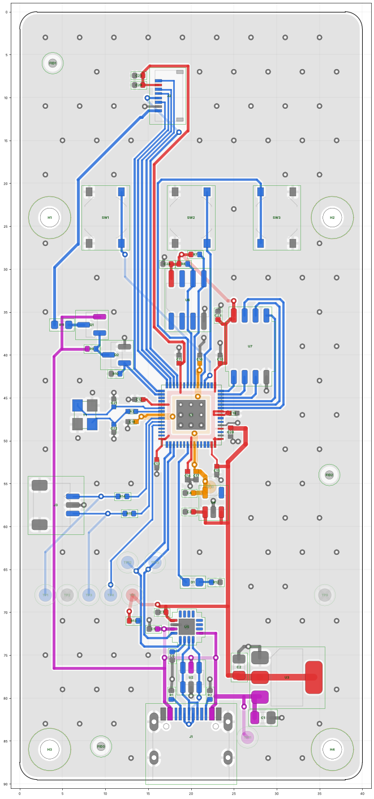

# Tally: a second take on Mono's idea, with no inductor

*Design, 2026-11-13. Written by a script, [gen_tally.py](gen_tally.py), with KiCad 7.0.11: KiCad
reads the schematic back (netlist) and runs its DRC on the routed board, and both come out clean.
Ten agents then reviewed it; what they found and what was changed is in [REVIEW.md](REVIEW.md).
The repo's own checks (`tools/keypcb check` and `jlc`) want KiCad 10 and were **not run**: see
[What is checked, and how](#what-is-checked-and-how). Not ordered, nothing built, no panel folded
against it, and no firmware profile for it yet. Tally is a working name.*



*The board file's front copper, drawn by a throwaway plotting script that is not in the repository
(KiCad 7 has no 3D render; `tools/keypcb render tally` will make proper ones on KiCad 10). Blue is
signal, red 3.3 V, orange 1.1 V, purple 5 V, grey ground. Pale lines are on the back.
[The back](renders/tally-back.png), seen through the board, is in the same folder.*

Tally is an independent design of the same console as [Mono](../mono/README.md): a 40 × 89.5 mm
bar with no radio, the key soldered on, a small screen for clear signing and three buttons. It
starts from Mono's outline and pins and makes its own choices where Mono's parts are hard to buy or
its first relative, console-rp, misbehaved.

```
   computer (the relay) ── USB-C ── CH343P ── UART1 ── RP2350A ── I2C0 ── ATECC608C (the key that signs)
   no key, no say in                                  │
   what gets signed                                   └─ SPI1 ── 1.14" panel;  D0 D1 D2
   firmware goes in over SWD only: J3 on the front, pads on the back, 100 Ω in each line
```

The computer can't reach the RP2350's REPL, reset it or hold BOOTSEL: the CH343P's modem pins go
nowhere, and the RP2350's own USB pins go nowhere either. The generator checks both
([The link](#the-link)).

## What is different from Mono, and why

| | Mono | Tally | why |
|---|---|---|---|
| the core's 1.1 V | the RP2350's switching regulator: Abracon inductor, 33 Ω, three capacitors | a fixed 1.1 V LDO, **TLV74311PDBVR**, from 3.3 V; one capacitor at the chip's regulator pins | the inductor is the hardest part to buy (JLCPCB 756, LCSC 0, one maker, polarity matters). console-rp's board 1 read 1.4 V on DVDD where 1.1 V is expected, and nobody knows why. An LDO has nothing to lay out wrong. It costs about 0.14 W more from USB at 45 mA of core current |
| the crystal | Abracon ABM8-272-T3, the one Raspberry Pi names | YXC **X322512MSB4SI** (C9002) on Raspberry Pi's 15 pF and 1 kΩ | JLCPCB has 1 of the Abracon, LCSC 0. The YXC is a Basic part with 494,234 in stock. Not Raspberry Pi's tested part: see [Open](#open) |
| the chip's own USB, BOOT | on pads, through 27 Ω and 1 kΩ | **not connected** | console-rp's own USB never enumerated; SWD is how its board 1 was loaded. Three parts and three pads fewer, and one less way in. It has a cost: see [Open](#open) |
| the debug way in | pads for a pogo jig | the same pads at Mono's places, and **J3**, Raspberry Pi's 3-pin JST-SH debug socket | a Debug Probe's cable plugs in. No jig is needed for the first boards |
| the second key's site | KEY 2: a footprint, a switched supply, a header | none | not needed for a first product |
| the USB-C | left of centre | centred | the bridge and the ESD diodes sit in line above it |
| on VBUS | 5.7 µF | 11 µF, as console-rp | WCH asks for 10 µF beside a CH343P fed from VBUS, whose limit is 6.0 V. See [Open](#open) |
| the link's idle level | none until the firmware drives it | 4.7 kΩ to 3.3 V on the chip's TX | the bridge sees a clean idle while the chip is in reset or blank |
| the backlight's driver | an NPN and a base resistor | an N-FET, AO3400A | one part fewer |
| parts | 87 on the drawing, 67 fitted | 70 on the drawing, **53 fitted**, of 25 kinds | |

Kept: the outline, the four M2 holes, the glass and the three buttons where Mono has them; the
RP2350A with Raspberry Pi's copper round it (`rpi_minimal.json`, MIT,
[lib/RPI-MINIMAL-LICENSE.txt](lib/RPI-MINIMAL-LICENSE.txt)); the CH343P link; the ATECC608C in
SOIC-8; the ZIF and the panel; the LDL1117S33R; the backlight fed from 5 V; and **every GPIO**
([PINS.md](PINS.md)), so one board profile can serve console-rp, Mono and Tally.

**Mono's case does not fit as it is.** The board's outline, holes, glass and buttons are Mono's.
The USB-C's opening moves to the middle, the LED is 66.5 mm from the top where Mono's is 71, and
J3 opens toward the left wall. `cad/consoles/mono.py` was not run on Tally and stops on it today
(it has no size for J3's package).

**An ESP32 instead?** No. Every ESP32 that JLCPCB can solder has a radio on the chip except the
ESP32-P4, which needs Standard assembly, costs $5.41, and had 111 in stock. The RP2350A has no radio
on the chip, costs $1.23, and the firmware already runs on it.

## The core's supply

The RP2350 datasheet (section 6.3.7, figure 24) allows it: "If the digital core supply (DVDD) is
powered from an external 1.1 V supply, the on-chip regulator can be disabled and the application
circuit simplified. Power must still be provided on the regulator's analogue supply (VREG_AVDD)
and input supply (VREG_VIN) ... But the inductor can be omitted and only a single input capacitor
is required. Connect VREG_FB directly to ground."

So on Tally:
- VREG_VIN (pin 49) and VREG_AVDD (pin 46) are on 3.3 V with C20, 4.7 µF.
- VREG_FB (pin 50) and VREG_PGND (pin 47) are on ground. VREG_LX (pin 48) is open.
- U4 feeds the three DVDD pins: 4.7 µF at its output, 100 nF at pins 6 and 39, 4.7 µF at pin 23.
- TP10 on the back is DVDD, to put a meter on.

**What the firmware must know**, which it need not on Mono:
1. **Never let the regulator go to its low-power mode.** The datasheet: "Don't put the regulator
   into low-power mode if DVDD is being powered from an external supply." That mode is the reset
   default for the P1.x sleep states (`VREG_LP_ENTRY.MODE` resets to 1). `firmware/` uses no sleep
   today. Before any is used on this board, write `VREG_LP_ENTRY` with HIZ 1 and MODE 0, and find
   out what MicroPython's `lightsleep` does on an RP2350.
2. **`VREG.HIZ` is optional, and not for a shared image.** Left alone, the chip's regulator stays
   on with nothing to drive: "a safe mode of operation, though the regulator will consume
   approximately 400 µA until it's shut down". An image only for Tally can write 1 to `VREG.HIZ`
   on every boot (it does not survive a reset). On Mono or console-rp the same write takes the
   core's supply away: "If the on-chip regulator is supplying DVDD, entering high-impedance mode
   causes a reset event". So an image shared by the three must not write it.

The TLV74311P is ±1.4 % over temperature by its datasheet, so 1.085 to 1.115 V, inside the chip's
1.05 to 1.16 V. It gives 300 mA. Its heat is (3.3 − 1.1) V × the core's current: about 0.1 W at
45 mA. How it holds up under the core's load steps was not measured or simulated.

## The link

The same as Mono's. The USB-C's D+ and D− go through the USBLC6-2SC6 to the CH343P and stop. The
CH343P's TXD and RXD go to GPIO21 and GPIO20 (UART1) and to two pads on the back, to watch the
link. R13 pulls the chip's TX to 3.3 V, so the bridge sees an idle line before the firmware runs.
`gen_tally.py` stops if:
- any pin of the CH343P is on another net than its name allows: TXD on LINK_RX, RXD on LINK_TX,
  VIO on 3.3 V, and DTR, RTS, ACT, DCD, DSR, CTS and RI on nothing at all;
- the RP2350's USB_DP or USB_DM is connected at all;
- the USB-C and the RP2350 share any net but ground;
- any of 23 nets reaches a part that is not on its list: D+, D−, both CC lines, the bridge's V3,
  the link's two lines, SWCLK and SWDIO on each side of their resistors, RUN, the key's bus, the
  three buttons and the flash's six lines.

## The front, top to bottom

- **The panel**, a 1.14-inch 240 × 135 ST7789 (ER-TFT1.14-2) on tape, where Mono has it. Its ribbon
  folds under into J2. Only J2 and two capacitors are under the glass. Four silkscreen corners
  show where the glass goes.
- **D0, D1, D2**, 10 mm apart, 24 mm from the top, as Mono.
- **The backlight's switch** on the left: Q2 (GPIO13, 4.7 kΩ to ground) pulls Q1's gate; Q1 feeds
  the LED from 5 V through 150 Ω, about 13 mA. High is on.
- **The key**, U6, under D1, with its pull-ups and capacitor.
- **The RP2350A**, turned a quarter turn, and **the flash** beside it.
- **U4**, the 1.1 V regulator, under the chip.
- **The red LED** (GPIO25), 66.5 mm from the top.
- **J3**, the debug socket, on the left edge, with 100 Ω in SWCLK and SWDIO.
- **The bridge, the ESD diodes and the USB-C** in line at the bottom; the 3.3 V regulator beside them.

Nothing is fitted on the back. It has the pads and the text.

## The pads on the back

| pad | net | |
|---|---|---|
| TP1, TP2, TP3 | SWCLK, GND, SWDIO | at Mono's places, 2.54 mm apart; on J3's side of the 100 Ω |
| TP4 | RUN | low resets the chip |
| TP5, TP9 | 3V3, GND | to measure |
| TP10 | 1V1 | the core's supply |
| TP11 | VBUS | |
| TP12, TP13 | TX, RX | the link, to watch with a logic probe |

Mono's BOOT, D+ and D− pads have no twin here. No pad has a via at its centre, so a pogo pin lands
on copper.

## Parts at JLCPCB

Read from JLCPCB's and LCSC's listings on 2026-11-13. Stock and prices move daily.

| | part | LCSC | tier | JLCPCB stock | each |
|---|---|---|---|---|---|
| U1 | RP2350A | C42411118 | Extended | 5,813 | $1.29 |
| U7 | W25Q128JVSIQ, 16 MB | C97521 | Basic | 70,193 | $2.26 |
| U6 | ATECC608C-SSHDA-T | C28975195 | Extended | 3,664 | $1.75 |
| U5 | CH343P | C2846043 | Extended | 18,478 | $1.00 |
| U3 | LDL1117S33R | C435835 | Extended | 53,806 | $0.49 |
| U4 | TLV74311PDBVR | C485147 | Extended | 10,900 | $0.07 |
| U2 | USBLC6-2SC6 (ST) | C7519 | Extended | 43,645 | $0.16 |
| J1 | TYPE-C-31-M-12 | C165948 | Extended | 539,075 | $0.19 |
| J2 | 0.5K-HX-8PWB | C2919492 | Extended | 13,441 | $0.10 |
| J3 | SM03B-SRSS-TB | C160403 | Extended | 26,795 | $0.19 |
| Y1 | X322512MSB4SI, 12 MHz | C9002 | Basic | 494,234 | $0.10 |
| Q1, Q2 | AO3401A, AO3400A | C15127, C20917 | Basic | over 1,000,000 each | $0.08 |
| SW1 to SW3 | TS-1187A-B-A-B | C318884 | Basic | 826,275 | $0.02 |
| the rest | 24 capacitors, 12 resistors, 1 LED, all 0402 but four | | Basic | | $0.17 together |

- **About $8.00 of parts a board**, at JLCPCB's price for one.
- **Nine Extended kinds.** On Economic assembly that is 9 × $3.07, with $8.18 setup, $1.53 stencil
  and $0.45: about $38 an order before boards, parts and joints.
- **Two fees could go.** J3 can be left off the BOM (the pads on the back do the same job with a
  jig). JLCPCB lists an SRV05-4 (C7420376) as a Preferred part with no fee, in the USBLC6's package;
  its maker is not ST and its pinout was not checked here, so Tally keeps the ST part.
- **With the flash inside the chip.** `BUILD = "RP2354A"` in the generator fits an RP2354A
  (C41378174, 1,418 in stock, $1.24 at ten) and leaves U7 and its capacitor off: about $2.30 less a board.
  It has 2 MB, so it needs a MicroPython build told so; the stock Pico 2 image assumes 4 MB. The
  default stays the RP2350A with the 16 MB flash, which is what console-rp's board 1 ran.
- The panel is not JLCPCB's: 100 ER-TFT1.14-2 were bought at $3.71.
- **Placement angles.** JLCPCB lays its own footprint for each part on the CPL's point. Eight of
  them have pin 1 in another corner than KiCad's: U2, U4, U5, U6 and U7 need a quarter turn, and U3,
  Q1 and Q2 a half. `cpl.csv` carries those turns. The schematic has them as the field
  `JLCPCB Rotation Offset`, which `tools/keypcb fab` reads too. J1's point is where JLCPCB's
  footprint has its origin, 1.4 mm from KiCad's. All of it comes from JLCPCB's own footprints,
  laid pad for pad on KiCad's ([REVIEW.md](REVIEW.md#the-placement-file)). None of it is proven on a
  board. **U5 is the one to watch:** a QFN-16 fits its pads at every quarter turn. In JLCPCB's
  placement preview, hold each IC's dot against the silkscreen's mark before paying.

## Routing

Two layers, 0.15 mm least track and gap, 0.6 mm vias with 0.3 mm holes. Every track is drawn by
the script, by coordinates: nothing was autorouted.
- **Round the chip** the copper is Raspberry Pi's, turned with it: the 3.3 V and 1.1 V rings under
  the chip, each supply pin's track to its capacitor, the crystal's corner. Their switching
  regulator's corner is left out.
- **The back is ground**, with these tracks on it: the 1.1 V tracks under the chip (Raspberry Pi's);
  D0, 18 mm from the chip to the left button; the key's 3.3 V, 8 mm; the screen's DC, 5 mm under the
  glass; 5 V across the bridge; D− for 4 mm under the USB-C; and stubs to five pads. Three of them
  exist because GPIO2, 3 and 6 leave the chip in the opposite order to D0, D1, D2, and Tally keeps
  Mono's pins rather than untangle them.
- **90 ground vias** join the two pours on a 4 mm grid, and one more sits beside each capacitor the
  grid left far from one.
- **5 V runs up the left edge** to the backlight's switch, about 55 mm of 0.25 mm track at 13 mA. It
  passes under R11 between its pads.
- The screen's six lines run 25 mm side by side. SCK has 0.5 mm to its neighbours.

## What is checked, and how

Run here, with KiCad 7.0.11 on Linux, on 2026-11-13:
- `python3 gen_tally.py`: writes everything, then checks it. `python3 gen_tally.py check` checks
  the files as they are. Two runs give the same bytes.
- **The table against itself:** each GPIO can do the job it is given (SPI1, I2C0, UART1); the
  screen's and key's pins are `firmware/board.py`'s Pico defaults; the link's rules above.
- **KiCad's netlist of the schematic against the table:** every net has exactly the pins the table
  lists, every part its value, footprint and LCSC number.
- **The board against the netlist:** every pad on its net, every schematic pin on a pad, every part
  at its place and side.
- **KiCad's DRC on the routed board**, with the project's rules: 0 violations, 0 unconnected.
- **fab/, the project file and PINS.md:** each written again into a temporary folder and compared
  (the Gerbers with their date lines left out).
- **Six broken copies** (TXD and RXD swapped, two screen pins swapped, PINS.md edited, every DRC
  severity set to ignore, the zip replaced, a pad cut from a footprint): the check stops on each.
- **A review** by ten agents: [REVIEW.md](REVIEW.md). It read the Gerbers back with an unmodified
  copy of `tools/jlc/gerb_check.py` and ran `tools/jlc/netlist_check.py` on the BOM and CPL.

Not run, and why:
- **`tools/keypcb check tally` and `tools/keypcb jlc tally`** (KiCad 10's ERC, DRC with schematic
  parity, JLCPCB's limits, the 3D fit). They need KiCad 10. This session could not install it:
  adding KiCad's package source and running its Docker image were both refused by the session's
  permissions. `tools/keypcb` knows the board, so a bare `tools/keypcb check` now includes it.
  `gen_tally.py` has a `jlc_spec()` for it, written by Mono's keys and never executed.
- **KiCad's ERC.** KiCad 7's command line has none.
- **`gen_tally.py` under KiCad 10's Python**, which is how `tools/keypcb gen-tally` runs it. It was
  written and run on KiCad 7's. Five calls that changed names are handled; others may not be.
- **A 3D render or the case.**
- **Anything electrical.** No simulation, no board.

## Steps to a board

1. On a machine with KiCad 10: `tools/keypcb gen-tally check`, `tools/keypcb check tally`, then
   `tools/keypcb fab tally` and `tools/keypcb jlc tally`. Fix what they find. `tools/keypcb fab`
   rewrites `tally/fab/`; `gen_tally.py check` accepts its files.
2. Measure a real panel's ribbon in a real J2 (Mono's README, "The panel"). Tally's J2 is where
   Mono's is, 19.5 mm in from the glass's ribbon end. By the connector's drawing the ribbon may want
   it about 1.2 mm further in; console-rp's sits further out and works with a loop.
3. Decide the first two things under [Open](#open).
4. Order five on Economic assembly: 2 layers, 1.6 mm, lead-free HASL, or ENIG for the 0.4 mm QFN.
   Pay for "Confirm Production file" to see where JLCPCB puts its tooling holes and rails. In the
   placement preview, hold each IC's dot against the silkscreen's mark.
5. Bring-up, in this order:
   - 5 V and 3.3 V with nothing else; **1.1 V on TP10 before anything else**.
   - SWD on J3 with a Debug Probe; then console-rp's bench scripts.
   - The crystal: read `XOSC.STATUS` on every board, and again cold.
   - A scope on TP11 at plug-in with a short thick cable: VBUS must stay under 6.0 V.
   - VBUS ramped from 0 to 5 V over 0.1, 1 and 5 s, and cut for 0.3 to 2 ms: it must boot each time.
   - `lsusb -v`: the bridge's `bMaxPower` against a draw of about 80 mA, 150 mA at peaks.

## Open

- **The chip's own USB is not brought out.** `picotool`'s OTP commands work only over that USB, so
  turning on secure boot later would need a program loaded over SWD instead. And once SWD is closed
  in OTP, a board with no USB and no BOOT pad cannot be loaded again at all. If secure boot is on
  the road, put Mono's three pads back: two 27 Ω resistors, 1 kΩ, three pads, and three thin tracks
  past C19. Ask and it is a small change.
- **The crystal is not Raspberry Pi's.** They ask for the ABM8-272-T3 by name: 10 pF, 50 Ω at most.
  The YXC part is 20 pF and 80 Ω at most. On Raspberry Pi's 15 pF and 1 kΩ it will run 50 to 100 ppm
  fast, which nothing here minds (the UART tolerates percent; the chip's USB is not used). It also
  needs 1.6 times the gain to start, and the chip's gain is not published: an unknown margin, not a
  known fault. Test it as in the steps above before ordering more than five. The footprint takes the
  Abracon, or a 10 pF part (JLCPCB lists C5310728 and C50430, both Extended), with no other change.
- **The firmware.** No profile exists for this board or for Mono. It needs the pins, the 240 × 135
  screen at MADCTL 0x60, and what "The core's supply" says. Three things in today's code would bite:
  an unknown board name falls back to a profile that reads GPIO20 and GPIO21, here the link, as keys;
  `usblink.py` talks to the chip's own USB, which reaches nothing here, so the link must be opened as
  `UART(1, tx=20, rx=21)` (MicroPython's UART1 default pins are the key's bus); and maintenance uses
  a REPL on that USB, so until one is designed for UART1 every firmware change goes in over SWD. A
  new image is a new release fingerprint.
- **VBUS at plug-in, two ways.** 11 µF sits on VBUS, where USB allows 10 µF, because the bridge's
  supply pin has a 6.0 V limit and WCH asks for 10 µF beside it; console-rp has the same and works,
  and Mono has 5.7 µF. The charge taken at plug-in, with what fills through the two regulators, is
  about 125 µC by the capacitors' printed values, against USB-IF's 50 µC mark. Neither the overshoot
  nor the charge was measured. C1 can go back to 4.7 µF with no other change.
- **Nothing holds the chip in reset until 3.3 V is in range.** Its reset watches the core's supply
  only, and U4 makes 1.1 V from 1.4 V up. A gap in VBUS of about a millisecond can leave the core
  running while the flash is below its range: a hang that a replug cures. A supervisor on RUN would
  close it. None is fitted; test first.
- **No fuse and no TVS on VBUS** beyond the USBLC6's clamp, as Mono.
- **The 3.3 V regulator's tab** is its output and has no large pour. At 0.11 A it makes about 0.2 W.
- **Under USB suspend nothing drops**: the RP2350 can't see the bus. About 80 mA is drawn always.
- **The name.**
