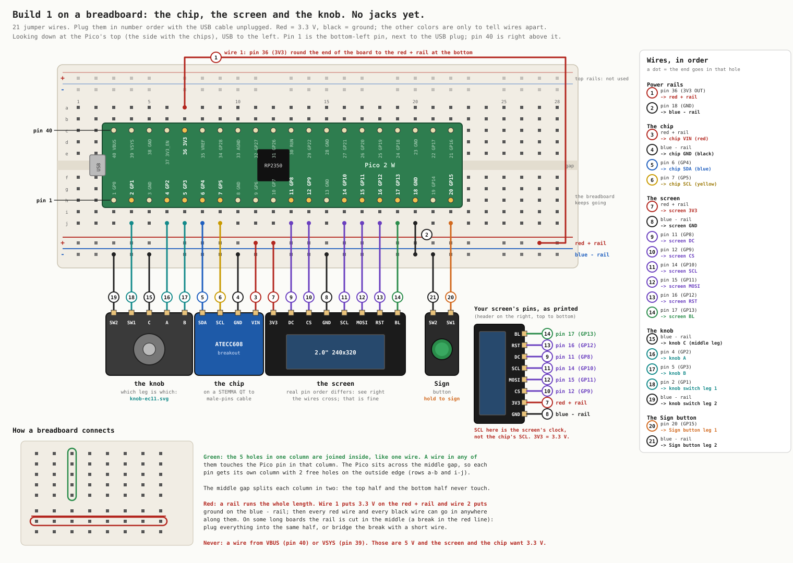
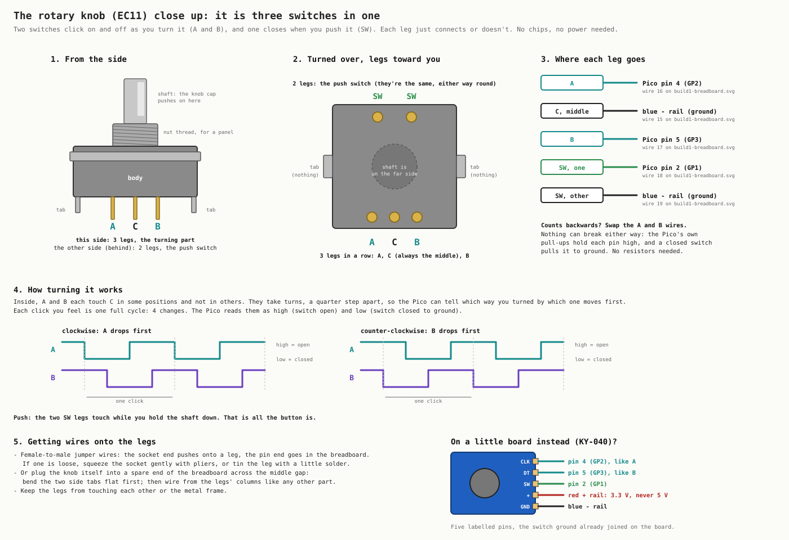

# Build 1 on a breadboard (no jacks yet)

Start here. This is Build 1 with nothing soldered: a Pico 2 W, the 2.0″ screen, the rotary knob and an
ATECC608 chip on a breadboard, joined by jumper wires.

The chip is wired straight to the Pico for now. The key jacks come later
([BUILD1.md](BUILD1.md)). Every signal uses the same Pico pin in both versions, so nothing you learn
here changes when the jacks arrive.

The knob close up, which leg is which and how it works:

`tools/wiring-breadboard` redraws both pictures. `tools/wiring-breadboard --check` confirms that the
wire table below still matches them.

## What you need

- the Pico 2 W, with its header pins soldered on
- a breadboard; a full-size one (830 holes) is plenty
- jumper wires, also called Dupont wires:
  - **male-to-male** for breadboard hole to breadboard hole
  - **female-to-male** for the screen's pins and the knob's legs; the female end pushes onto the pin
- an ATECC608 breakout and a **STEMMA QT to male pins** cable (Adafruit 4209, or any JST SH 4-pin to
  male header cable). A cable with the small connector on both ends won't go into a breadboard.
- the 2.0″ screen and the knob
- a micro-USB cable that carries data, not a charge-only one

A multimeter helps with the checks at the end but isn't required.

## Before the first wire

1. **Keep the USB cable unplugged** while you wire. Plug it in only after the checks.
2. **Find pin 1.** Hold the Pico with the USB plug to the left and the chips facing up:
   - the bottom row of pins, left to right, is pins 1 to 20
   - the top row, left to right, is pins 40 down to 21
   - pin 1 is the bottom-left pin, beside the USB plug

   The GP names (GP4 and so on) are printed on the underside. Turn the Pico over once and check a
   couple against the picture before it goes in.
3. **Push the Pico into the breadboard across the middle gap**, USB to the left, near the left end.
   Put the top pins in row c and the bottom pins in row h. That leaves two free holes (rows a and b,
   and rows i and j) on the outside of every pin. Press evenly along both rows; the pins are stiff.

## How a breadboard connects

- **Each short column of 5 holes is joined inside**, like one wire. A wire in either free hole next
  to a Pico pin is connected to that pin.
- **The middle gap splits the columns.** The top half and bottom half of a column don't touch. That's
  why the Pico sits across the gap: its two rows of pins stay separate.
- **The long rails along the edges are joined end to end.** Wire 1 puts 3.3 V on the bottom red +
  rail and wire 2 puts ground on the bottom blue − rail. After that, every red wire can go in
  anywhere along the red rail, and every black wire anywhere along the blue one.
- On some long breadboards each rail is cut in the middle; look for a break in the red and blue
  lines. Keep everything in the same half, or bridge the break with a short wire.
- The rails along the top edge aren't used in this build.

## The wires

19 wires. Plug them in this order; each group is one part. "Pico pin 6" means a free hole in the same
column as the Pico's pin 6.

| # | from | to | wire |
|---|---|---|---|
| 1 | Pico pin 36 (3V3 OUT) | red + rail | red. Pin 36 is on the top row, so run this one round the right end of the Pico to the bottom rail |
| 2 | Pico pin 18 (GND) | blue - rail | black |
| 3 | red + rail | chip VIN (red) | the cable's red wire |
| 4 | blue - rail | chip GND (black) | the cable's black wire |
| 5 | Pico pin 6 (GP4) | chip SDA (blue) | the cable's blue wire |
| 6 | Pico pin 7 (GP5) | chip SCL (yellow) | the cable's yellow wire |
| 7 | red + rail | screen VCC | red |
| 8 | blue - rail | screen GND | black |
| 9 | Pico pin 11 (GP8) | screen DC | any color |
| 10 | Pico pin 12 (GP9) | screen CS | any color |
| 11 | Pico pin 14 (GP10) | screen CLK | any color |
| 12 | Pico pin 15 (GP11) | screen DIN | any color |
| 13 | Pico pin 16 (GP12) | screen RST | any color |
| 14 | Pico pin 17 (GP13) | screen BL | any color |
| 15 | blue - rail | knob C (middle leg) | black |
| 16 | Pico pin 4 (GP2) | knob A | any color |
| 17 | Pico pin 5 (GP3) | knob B | any color |
| 18 | Pico pin 2 (GP1) | knob switch leg 1 | any color |
| 19 | blue - rail | knob switch leg 2 | black |

Red for 3.3 V and black for ground aren't required, but they make the check at the end easy.

### The chip

The STEMMA QT cable plugs into either socket on the breakout; the two sockets are the same. Adafruit's
cables are red VIN, black GND, blue SDA and yellow SCL. A cable from a mixed kit may use other colors.
In that case, find which wire goes to which pad with a meter before powering up, as in
[SOLDERING.md section 1](SOLDERING.md#1-the-chip-four-wires). Swapping SDA and SCL does no harm, but
swapping VIN and GND does.

The breakout has its own pull-up resistors and runs on 3.3 V, so the four wires are all it needs.

### The screen

The screen has one row of 8 pins. Use female-to-male wires: the female end on the screen, the male
end in the breadboard. **Go by the names printed next to its pins, not by their order**, because
makers order them differently. Some print other names for the same pins:

| printed | same as |
|---|---|
| SDA, MOSI | DIN |
| SCL, SCK | CLK |
| RS, A0 | DC |
| LED, BLK | BL |

SDA and SCL on a screen are its data and clock. They have nothing to do with the chip's SDA and SCL.

### The knob

A bare EC11 has five metal legs, three on one side and two on the other ([close up](knob-ec11.svg)):

- **The 3-leg side is the turning part.** The middle leg is **C**, which goes to ground (the blue
  rail). The outer two are **A** and **B**, which go to pins 4 and 5. If turning clockwise counts
  down, swap the A and B wires; nothing breaks either way.
- **The 2-leg side is the push button.** Pressing the shaft joins the two legs. One goes to pin 2, the
  other to the blue rail. They're identical, so either way round works.
- **The two wide flat tabs** on the sides only hold the knob in a panel. They connect to nothing.

Female-to-male wires push onto the legs. If one is loose, squeeze its socket gently with pliers. You
can also plug the knob straight into a spare part of the breadboard across the middle gap: bend the
two side tabs flat first, then wire from the legs' columns.

**A knob on a small board** with five labeled pins (KY-040 style) is wired like this:

| pin | goes to |
|---|---|
| CLK | pin 4 (GP2), like A |
| DT | pin 5 (GP3), like B |
| SW | pin 2 (GP1) |
| + | red rail. It must be 3.3 V, never 5 V |
| GND | blue rail |

## Check before the USB goes in

- [ ] Nothing is in the columns of pin 40 (VBUS) or pin 39 (VSYS), the two top-left pins. Those carry
      5 V.
- [ ] The red + rail has exactly three wires: 1, 3 and 7. Add a fourth if you have a KY-040.
- [ ] No red wire goes into the blue rail, and no black wire into the red rail.
- [ ] With a meter on continuity, touch one probe to the red rail and one to the blue rail. It must
      **not** beep.
- [ ] No bare metal, such as knob legs or wire ends, touches its neighbor.

## Try it

Plug the USB cable into your computer. Then:

1. Run `tools/usb push`. It copies the firmware, `bench1.py` included, and restarts the Pico.
2. Run `tools/usb` to open the Pico's prompt.
3. Type `import wallet; wallet.stop()` to stop the wallet, which starts on its own.
4. Type `import bench1`.

The screen should show:

- a small **TL** in the top-left corner, and bars reading **red, green, blue, white** from left to
  right
- **KNOB** counting up by one each click clockwise, and **PUSH** showing DOWN while you press
- **BUS 60** and **CHIP 608A** or **608B**, a serial number, and `config open data open`

Pressing the knob reads the chip again. Holding it for 2 seconds prints a full chip report at the
prompt. `bench1.stop()` ends the test.

bench1 only reads the chip. It can't write to it or lock it; locking is permanent, and that's a later
decision ([HANDOFF.md](../HANDOFF.md#7-open-decisions)).

| what you see | what to check |
|---|---|
| screen dark, backlight off | wires 7, 8 and 14; that VCC is in the red rail |
| backlight on, no picture | wires 9 to 13, going by the printed names. Then try `SPI_BAUD = 10_000_000` at the top of `bench1.py` |
| picture upside down or mirrored | `MADCTL` at the top of `bench1.py`: try `0xA0` |
| red and blue swapped | add `0x08` to `MADCTL` |
| colors look like a photo negative | `INVERT = False` |
| BUS says `nothing` | wires 3 to 6. Swap 5 and 6 to test; that's harmless |
| knob counts down when turned clockwise | swap wires 16 and 17 |
| knob counts 2 per click, or every other click | `STEPS_PER_CLICK` at the top of `bench1.py` |
| PUSH never shows DOWN | wires 18 and 19 must be on the 2-leg side |

## Later: the jacks

When you're ready for the jacks, [BUILD1.md](BUILD1.md) has the rest:

- The chip moves into a key with two plugs.
- Its power moves from the red rail to GP6, so the Pico can switch the key on and off.
- `JACKS = True` in `bench1.py` turns on key detection.

Every other wire stays where it is. BUILD1.md takes ground from the Pico's own GND pins (3, 8 and 13)
instead of the blue rail. Those pins are the same ground, so either works.
