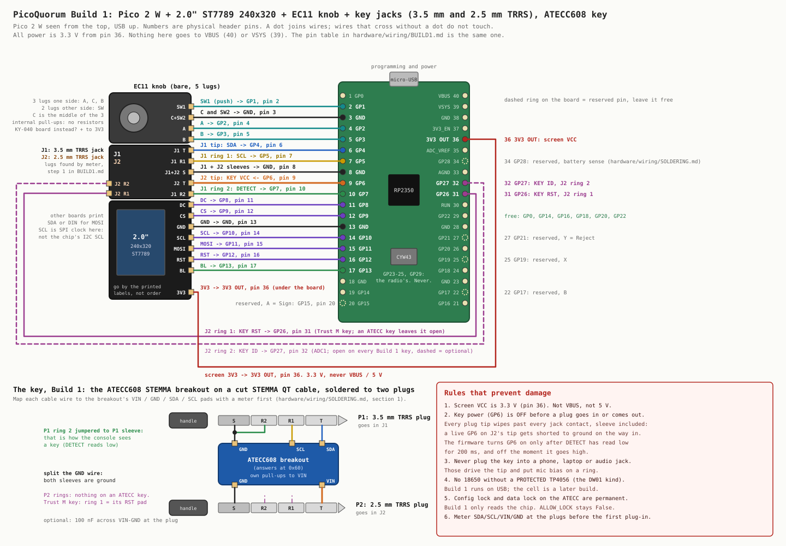

# Build 1: screen, knob, key jacks, ATECC608 key

**New to breadboards, or not doing the jacks yet? Start with [BREADBOARD.md](BREADBOARD.md)**: the
same build on a breadboard with the chip wired straight to the Pico, 19 numbered wires, and a close-up
of the knob.

This is the first console build on the bench that isn't the Waveshare dev console:

- a Pico 2 W
- a 2.0″ ST7789 240×320 SPI screen (the 8-pin kind)
- an EC11 rotary encoder with push
- a 3.5 mm and a 2.5 mm TRRS jack
- a key: an ATECC608 STEMMA breakout soldered to a 3.5 mm and a 2.5 mm TRRS plug

It runs on USB power only. The battery comes in a later build
([SOLDERING.md](SOLDERING.md#2-battery-switch-diode)).

It only reads the chip. Nothing in this build writes or locks it.

`tools/wiring-build1` redraws the diagram. `tools/wiring-build1 --check` confirms that the tables
below, the summary in [HANDOFF.md](../HANDOFF.md) and `firmware/bench1.py` all match the pin table
in the script.

Physical pin numbers count from the USB end, like [SOLDERING.md](SOLDERING.md): pins 1–20 run down
the left side and 40–21 down the right, looking at the Pico from the top with USB up.

**The connector changed from the kickoff draft.** The [kickoff](../../docs/KICKOFF.md#key-connector-draft-pinout)
drafts a ¼″ TRS plus a 3.5 mm TRS. Build 1 uses the 3.5 mm and 2.5 mm TRRS parts that are on the
bench. That gives 8 contacts instead of 6, which leaves room for DETECT, the Trust M's RST and an ID
line. Which connector the real keys use is still open ([HANDOFF.md](../HANDOFF.md#7-open-decisions)).

## Pin map

### Screen: 2.0″ ST7789, 240×320

<!-- pins: screen -->
| contact | signal | GPIO | Pico pin | notes |
|---|---|---|---|---|
| 3V3 | 3.3 V | 3V3 | 36 | 3V3 OUT. **Not VBUS, not 5 V**. Other boards print VCC |
| GND | ground | GND | 13 | |
| MOSI | SPI1 MOSI | GP11 | 15 | other boards print DIN or SDA |
| SCL | SPI1 SCK | GP10 | 14 | the SPI clock. Other boards print CLK or SCK |
| CS | chip select | GP9 | 12 | |
| DC | data/command | GP8 | 11 | some boards print RS or A0 |
| RST | reset | GP12 | 16 | |
| BL | backlight PWM | GP13 | 17 | some boards print LED or BLK |

These are the same SPI1 pins the Waveshare board uses, so `lcd.py`'s pin constants still apply. Only
the size is new.

The names in the table are the ones printed on the bench screen. Its 8 pins run BL, RST, DC, SCL,
MOSI, CS, 3V3, GND from top to bottom, with the header on the right.

On any other screen, wire by the labels printed on it, not by pin order, because the order varies
between makers. SCL (or SDA) on a screen is the SPI clock (or data). It has nothing to do with the
key's I2C SCL and SDA on GP5 and GP4.

### Knob: EC11 with push

<!-- pins: knob -->
| contact | signal | GPIO | Pico pin | notes |
|---|---|---|---|---|
| A | encoder A | GP2 | 4 | |
| B | encoder B | GP3 | 5 | |
| C | encoder common | GND | 3 | the middle lug of the three |
| SW1 | push | GP1 | 2 | |
| SW2 | push, other side | GND | 3 | shares pin 3 with C |

A bare EC11 has three lugs on one side (A, C, B) and two on the other (the push switch). The
firmware turns on the internal pull-ups, so no resistors are needed.

If clockwise counts down, swap the A and B wires. `STEPS_PER_CLICK` in `bench1.py` handles the
other common difference between encoders.

On a KY-040 board instead of a bare encoder: CLK goes to A, DT to B and SW to SW1. + goes to 3V3
(pin 36), never 5 V, because the board's pull-ups go to +.

### Sign button: SPST momentary

<!-- pins: button -->
| contact | signal | GPIO | Pico pin | notes |
|---|---|---|---|---|
| SW1 | Sign (hold) | GP15 | 20 | internal pull-up; reads low while pressed |
| SW2 | ground | GND | 23 | on the breadboard, the blue rail instead |

A plain push-to-make button with two legs, either way round. On a 4-leg tactile switch the legs
are joined in pairs, so use two diagonally opposite corners.

GP15 is the pin the firmware already calls **A** (`board.BUTTONS`), and A held down is the Sign
hold in `quorum.py`: 2 s, or 3 s when any page of the transaction is red. So on the console this
button is already Sign. Holding it to confirm every other permanent action is on the firmware list
in [HANDOFF.md](../HANDOFF.md#6-firmware-to-do-in-order). `bench1.py` shows how long it's held.

### J1: 3.5 mm TRRS jack (the I2C jack)

<!-- pins: J1 -->
| contact | signal | GPIO | Pico pin | notes |
|---|---|---|---|---|
| T | SDA | GP4 | 6 | I2C0, what `atecc.py` and `trustm.py` use |
| R1 | SCL | GP5 | 7 | |
| R2 | DETECT | GP7 | 10 | internal pull-up; the key ties it to sleeve |
| S | ground | GND | 8 | |

### J2: 2.5 mm TRRS jack (the power jack)

<!-- pins: J2 -->
| contact | signal | GPIO | Pico pin | notes |
|---|---|---|---|---|
| T | KEY VCC | GP6 | 9 | powered from the GPIO, on only while a key is in |
| R1 | KEY RST | GP26 | 31 | Trust M key only; an ATECC key leaves it open |
| R2 | KEY ID | GP27 | 32 | ADC1; open on every Build 1 key |
| S | ground | GND | 8 | shares pin 8 with J1's sleeve |

### Reserved and free

| pins | GPIO | kept for |
|---|---|---|
| 22, 25, 27 | GP17, GP19, GP21 | B, X, Y (Reject): more buttons later, on the Waveshare's pins so `lcd.Keys` still works. A (Sign) on GP15 is wired now |
| 34 | GP28 | battery sense, the divider in [SOLDERING.md](SOLDERING.md#2-battery-switch-diode) (`power.py`) |
| 1, 19, 21, 24, 26, 29 | GP0, GP14, GP16, GP18, GP20, GP22 | free: status LED, the Sign guard's arm switch, a second knob |
| none | GP23, GP24, GP25, GP29 | never. On a Pico 2 W they belong to the radio and are not on the header. The LED is `Pin("LED")`, not `Pin(25)` |

Nothing connects to VBUS (40), VSYS (39), 3V3_EN (37), RUN (30) or ADC_VREF (35).

## How the key is detected and powered

**Detect.** The key shorts J1's ring 2 to its sleeve. GP7 has a pull-up, so it reads low only when
a key is in.

Ring 2 is the last contact the jack's R2 spring can reach, so it touches only at full depth. On the
way in, that spring wipes over the plug's tip and ring 1, which are SDA and SCL of a chip that isn't
powered yet. That's harmless.

A CTIA headset also has ground on ring 2 and would read as a key. The next rule handles that.

**Power.** The firmware (`bench1.py` today, and `wallet.py` later) works like this:

1. DETECT reads low for 200 ms.
2. GP6 goes high, then waits 5 ms.
3. It scans the bus up to 3 times.
4. It reads the chip.

If nothing answers at a known address (0x60, 0x35 or 0x6A for an ATECC608, 0x30 for a Trust M),
GP6 goes low again. The screen says "not a key" and the firmware waits for the plug to come out.

When DETECT goes high, GP6 goes low at once. SDA and SCL become plain inputs with no pull-ups, so
nothing feeds the chip through its bus pins.

**Why switched power.** Every plug tip wipes past every jack contact on the way in, sleeve
included. A live tip on J2 would short to ground for a moment. So key power is off whenever a plug
moves.

Running the key straight from a GPIO is fine for reading an ATECC608, which draws a few mA. If
signing ever browns out, the symptom is a key that wakes and reads but fails on Sign. The fix then
is a PNP high-side switch (open decision). Check the Trust M's current draw before running it from
GP6.

**Pull-ups.** The STEMMA breakouts carry their own I2C pull-ups to their VIN, which is key VCC, so
the pull-ups switch off with the key. A bare chip on a key PCB won't have them. Then the pull-ups
(10k) go on the console side, to the switched key VCC. Don't take them to 3V3: pull-ups on 3V3
would power a switched-off chip through SDA and SCL.

## The key, Build 1

An ATECC608 STEMMA breakout with its STEMMA QT cable cut, soldered to two plugs. Map each cable
wire to the breakout's VIN, GND, SDA and SCL pads with a meter first, as in
[SOLDERING.md section 1](SOLDERING.md#1-the-chip-four-wires). Don't trust the colors.

| breakout pad | plug contact | why |
|---|---|---|
| SDA | P1 (3.5 mm) tip | J1 tip, GP4 |
| SCL | P1 ring 1 | J1 ring 1, GP5 |
| GND | P1 sleeve **and** P2 (2.5 mm) sleeve | split the ground wire |
| VIN | P2 tip | J2 tip, GP6 |
| (jumper) | P1 ring 2 to P1 sleeve | DETECT |
| none | P2 ring 1, P2 ring 2 | open on an ATECC key. On a Trust M key, its RST pad goes to P2 ring 1 |

Optional: a 100 nF cap across VIN and GND at the plug end.

Meter the key before it goes in for the first time:

- P1 tip to the SDA pad beeps.
- P1 ring 1 to SCL beeps.
- P2 tip to VIN beeps.
- P1 ring 2 to P1 sleeve beeps, because that jumper is the detect.
- P1 sleeve to P2 sleeve beeps.
- P2 tip to P2 sleeve does **not** beep. Swapping VIN and GND is the one mistake that hurts the chip.

## Order of work

The full checklist is in [HANDOFF.md](../HANDOFF.md#4-build-order), with a pass test for each step.
In short:

0. **ATECC608 today, no jacks.** Wire a breakout exactly as in
   [SOLDERING.md section 1](SOLDERING.md#1-the-chip-four-wires):
   - VIN to pin 36
   - GND to pin 8
   - SDA to pin 6
   - SCL to pin 7

   At the REPL, `import bench1` then `bench1.probe()` shows the scan and the chip's serial,
   revision and lock state. So does a knob press, once the knob is wired.

   To try the switched power path before the jacks exist, move VIN from pin 36 to pin 9 (GP6), and
   put a jumper from pin 10 (GP7) to pin 8 (GND). The jumper means "a key is in"; pull it and the key
   is out.
1. Mark the jack lugs with a meter.
2. Screen.
3. Knob.
4. Jacks.
5. Solder the key.
6. The key scans as `['0x60']` through the jacks.
7. Read the chip's status.

## Firmware: `bench1.py`

A read-only bench test for this build. It never writes the config zone, never locks, and never
generates a key.

To run it:

1. `tools/usb push` copies it with the rest of `firmware/`.
2. Stop the wallet with `import wallet; wallet.stop()`.
3. Run `import bench1`.

Set `JACKS = True` at the top of `bench1.py` once the jacks are wired. The default, `False`, is the
breadboard build, with the chip on 3.3 V and no key detection.

It runs from a 20 ms Timer, so the REPL stays free. `bench1.stop()` ends it and cuts key power.

The screen shows:

- orientation and color checks: a TL mark in the top-left corner and red, green, blue and white bars
- the knob count and the push state
- DETECT, and whether key power is on
- the bus scan
- the chip's revision, serial number and lock state

The knob does three things:

- turn: counts clicks
- press: scans the bus now, even with no key in, for a chip wired straight to 3V3
- hold for 2 s: prints the full read-only [chipcheck](../../firmware/chipcheck.py) report on the REPL

Settings at the top of the file:

| setting | what it fixes |
|---|---|
| `MADCTL` | screen upside down or mirrored; add `0x08` if red and blue are swapped |
| `INVERT` | colors look like a photo negative |
| `SPI_BAUD` | noise on the screen: go down to 10 MHz on long jumper wires |
| `STEPS_PER_CLICK` | one click counts as 2, or only every other click counts |

The wallet firmware doesn't know this build yet. Teaching it is the firmware list in
[HANDOFF.md](../HANDOFF.md#6-firmware-to-do-in-order).
