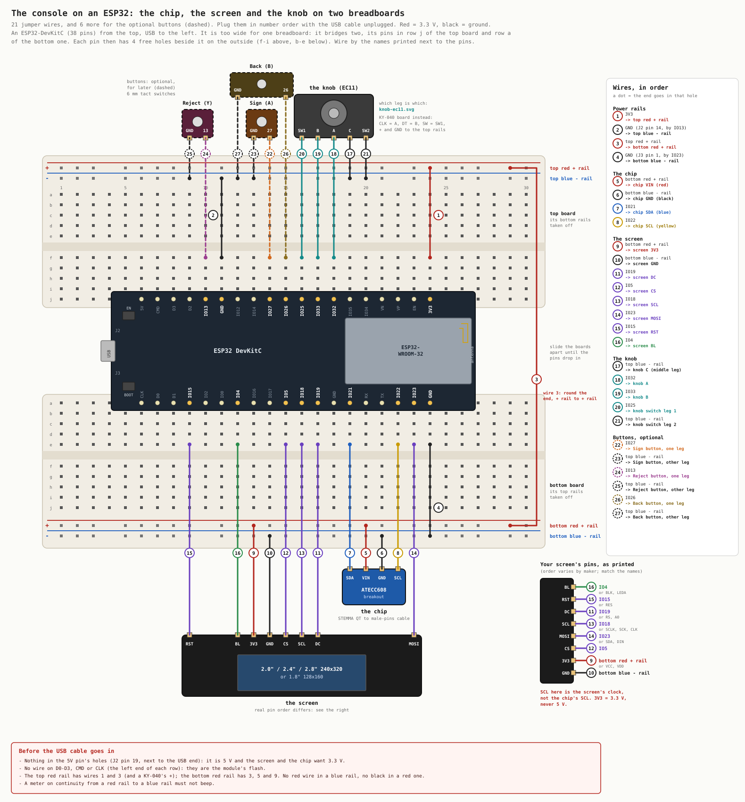
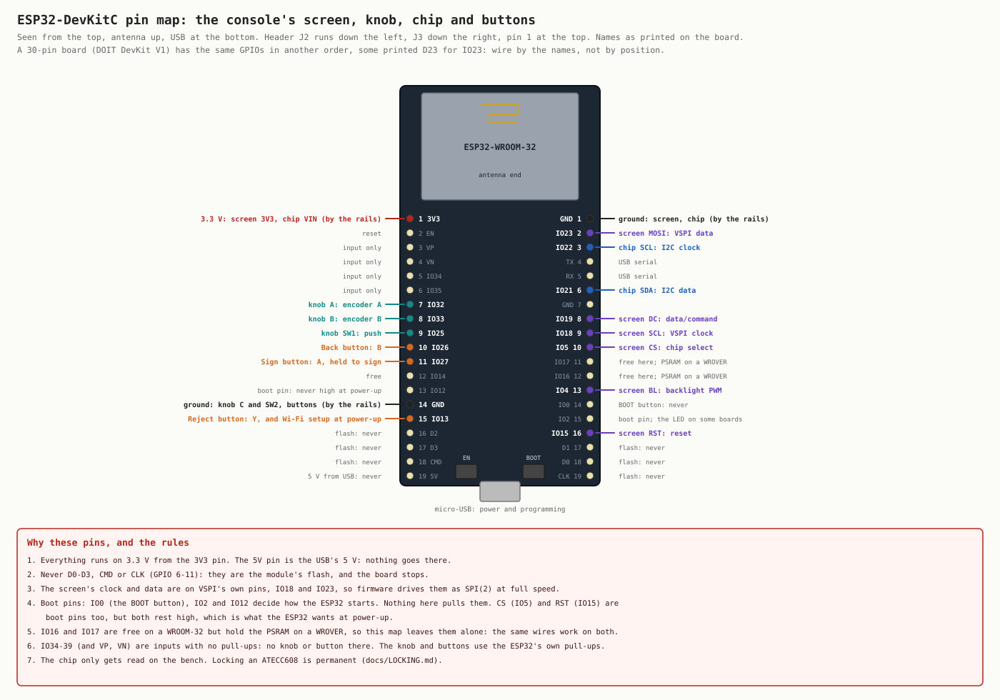

# The console on an ESP32, on breadboards

Build 1's parts on an ESP32 DevKit instead of a Pico 2 W:

- an ESP32 DevKit with an ESP32-WROOM-32 module. The pictures show Espressif's 38-pin DevKitC. A
  30-pin board (DOIT DevKit V1 and its clones) has the same GPIOs in another order.
- a screen from the panel pack, the Lonely Binary 6-pack ([SCREENS.md](../../docs/quorum-ui/SCREENS.md)):
  the 2.0″, 2.4″ or 2.8″ ST7789 (240 × 320), or the 1.8″ ST7735S (128 × 160)
- the EC11 rotary knob, or a KY-040 knob board
- an ATECC608 breakout on a STEMMA QT to male pins cable (Adafruit 4209)
- optional, for later: three 6 mm tact switches for Sign, Reject and Back

The firmware is the same image as the Pico's. On an ESP32, `firmware/board.py` always picks its
`"esp32"` profile, so there is nothing to set but the screen size.

**Not yet run on an ESP32.** What has been checked, and how:

- Every MicroPython call on the ESP32 path was read against MicroPython 1.26's ESP32 port: pins,
  SPI, I2C, timers, the pulse counter, the clock, TLS.
- `python3 test-vectors/esp32_test.py` runs those paths on CPython against a stand-in made from that
  source, bench1 included. CI runs it.
- The Pico's own suites still pass, the console in the emulator among them.

Nothing has been checked on hardware: the screen on long jumpers, which way the knob counts, Wi-Fi,
HTTPS, the watchdog, or memory. Nor have `tools/usb` and `tools/fw` been run against an ESP32.

## Will the whole console fit?

Probably not on a WROOM-32. Plan on the bench test there, and on a board with PSRAM for the console.

- The modules a running console keeps loaded come to about 124 KB of bytecode (mpy-cross 1.26 for
  the ESP32, 2026-10-08). The console also keeps about 70 KB of fonts and buffers.
- A WROOM-32 has no PSRAM. Its 520 KB of RAM is shared with ESP-IDF, Wi-Fi and every TLS handshake.
  MicroPython starts with a 56 KB heap and adds to it from whatever is left.
- So the console is expected to stop with a MemoryError while it loads. It shows STOPPED and leaves
  `error.log`. This has not been tried.
- An ESP32-WROVER board has 4 to 8 MB of PSRAM. Flash it with MicroPython's `ESP32_GENERIC-SPIRAM`
  build and the console has room. The wiring is the same. Its PSRAM uses GPIO16 and GPIO17, so
  nothing here does.

The bench test (`bench1.py`) is small and draws in 30-row bands (19 KB), so it should fit a WROOM-32.

## The pictures





Which knob leg is which: [knob-ec11.svg](knob-ec11.svg), from the Pico build.

`tools/wiring-esp32` redraws both pictures. `tools/wiring-esp32 --check` confirms that the tables on
this page, `board.py`'s `"esp32"` profile and the DevKitC's headers all still agree with its pin
table.

## What you need

- the ESP32 DevKit and a micro-USB cable that carries data, not a charge-only one
- **two** full-size breadboards (830 holes)
- jumper wires: male-to-male between holes, female-to-male for the screen's pins and the knob's legs
- the screen, the knob and the chip from the list above

A multimeter helps with the checks before power, but isn't required.

The DevKit's USB-to-serial chip is a CP2102 or a CH340. macOS and Windows may need its driver. The
board then shows up as `/dev/ttyUSB0` on Linux, and as `/dev/cu.usbserial-…` or
`/dev/cu.wchusbserial…` on macOS.

## Two breadboards

The DevKitC is too wide for one breadboard. On one board, one row of its pins has no free hole
beside it. So it bridges two.

1. **Take the power rails off one long side of each board.** On most boards they slide or peel off.
2. **Lay the two boards side by side**, the bare sides facing each other. The top board keeps the
   rails along its top edge, and the bottom board keeps the rails along its bottom edge.
3. **Hold the DevKitC over the gap**, USB to the left and its chips facing up. Slide the boards apart
   until one row of pins drops into **row j of the top board** and the other into **row a of the
   bottom board**. Press it in evenly.

Each pin then has 4 free holes on the outside: rows f to i above it, rows b to e below it. "ESP32
IO19" in the table means any of those free holes in IO19's column.

There are two pairs of rails, and they don't touch. Wire 1 puts 3.3 V on the top red rail, wire 2
ground on the top blue rail, wire 3 joins the two red rails, and wire 4 puts ground on the bottom
blue rail. Long boards sometimes cut each rail in the middle. Look for a break in the red and blue
lines, and keep everything in one half or bridge it with a short wire.

**Wire by the names printed next to the pins**, not by counting. The pictures show the 38-pin
DevKitC. A 30-pin board puts the same GPIOs in other places and may print `D23` for IO23.

## The wires

21 wires, and 6 more for the buttons. Plug them in this order, with the USB cable unplugged. Each
group is one part.

| # | from | to | wire |
|---|---|---|---|
| 1 | ESP32 3V3 | top red + rail | red |
| 2 | ESP32 GND (J2 pin 14, by IO13) | top blue - rail | black |
| 3 | top red + rail | bottom red + rail | red, round the antenna end of the DevKit |
| 4 | ESP32 GND (J3 pin 1, by IO23) | bottom blue - rail | black |
| 5 | bottom red + rail | chip VIN (red) | the cable's red wire |
| 6 | bottom blue - rail | chip GND (black) | the cable's black wire |
| 7 | ESP32 IO21 | chip SDA (blue) | the cable's blue wire |
| 8 | ESP32 IO22 | chip SCL (yellow) | the cable's yellow wire |
| 9 | bottom red + rail | screen 3V3 | red |
| 10 | bottom blue - rail | screen GND | black |
| 11 | ESP32 IO19 | screen DC | any color |
| 12 | ESP32 IO5 | screen CS | any color |
| 13 | ESP32 IO18 | screen SCL | any color |
| 14 | ESP32 IO23 | screen MOSI | any color |
| 15 | ESP32 IO15 | screen RST | any color |
| 16 | ESP32 IO4 | screen BL | any color |
| 17 | top blue - rail | knob C (middle leg) | black |
| 18 | ESP32 IO32 | knob A | any color |
| 19 | ESP32 IO33 | knob B | any color |
| 20 | ESP32 IO25 | knob switch leg 1 | any color |
| 21 | top blue - rail | knob switch leg 2 | black |
| 22 | ESP32 IO27 | Sign button, one leg | any color; optional |
| 23 | top blue - rail | Sign button, other leg | black; optional |
| 24 | ESP32 IO13 | Reject button, one leg | any color; optional |
| 25 | top blue - rail | Reject button, other leg | black; optional |
| 26 | ESP32 IO26 | Back button, one leg | any color; optional |
| 27 | top blue - rail | Back button, other leg | black; optional |

Red for 3.3 V and black for ground aren't required, but they make the checks easy.

### The screen

The pack's panels share one set of 8 wires. Wire by the names printed on the panel. The order varies
between makers, and some print other names for the same pin:

| printed | also printed as | goes to | wire |
|---|---|---|---|
| 3V3 | VCC, VDD | bottom red + rail | 9 |
| GND | | bottom blue - rail | 10 |
| DC | RS, A0 | IO19 | 11 |
| CS | | IO5 | 12 |
| SCL | SCLK, SCK, CLK | IO18 | 13 |
| MOSI | SDA, DIN | IO23 | 14 |
| RST | RES | IO15 | 15 |
| BL | BLK, LEDA, LED | IO4 | 16 |

- **SCL on the screen is the screen's own clock.** It goes to IO18, not to the chip's SCL on IO22.
  **SDA on a screen** is its data line, MOSI, and goes to IO23, not to the chip's SDA.
- **3.3 V, never 5 V.** The panel's maker says so too.
- The pack's own ESP32 examples (lonelybinary/TFT-LCD) put DC on GPIO2 and the backlight on GPIO32.
  This page keeps GPIO2 free because it decides how the ESP32 boots. Wire by this page.
- The 0.96″ and the 3.5″ from the pack don't work with the firmware yet.

Tell the firmware which panel it is in `secrets.py`. `SCREEN = "2.8"` is the default and drives the
2.0″, 2.4″ and 2.8″ (only the 2.8″ is proven, on a Pico). The 1.8″ needs `SCREEN = "1.8"`.

### The knob

Wired like the Pico's ([BREADBOARD.md](BREADBOARD.md#the-knob), [close up](knob-ec11.svg)):

- **The 3-leg side turns.** The middle leg is C and goes to ground. The outer two are A and B.
- **The 2-leg side is the push button.** One leg goes to IO25, the other to ground. Either way round.
- **The two wide tabs** only hold the knob in a panel. They connect to nothing.

A knob on a small board (KY-040): CLK to IO32 like A, DT to IO33 like B, SW to IO25, + to the top
red rail (3.3 V, never 5 V), GND to the top blue rail.

The firmware reads the knob the way the Pico build reads the same knob, A and B taken the other way
round. If clockwise counts down, swap wires 18 and 19. Nothing breaks either way.

### The buttons, for later

The knob alone does everything: turn to move, press to choose, and hold it down to sign. The
buttons add what the console's case will have. Each is one wire to a GPIO and one to the top blue
rail:

- **Sign** (A, IO27): signs, held, and does nothing else.
- **Reject** (Y, IO13): rejects. Held while the board starts, it opens Wi-Fi setup.
- **Back** (B, IO26).

There is no X on the ESP32: the knob's press does what it does.

### The chip

As on the Pico ([BREADBOARD.md](BREADBOARD.md#the-chip)): Adafruit's cable is red VIN, black GND,
blue SDA and yellow SCL. A cable from a mixed kit may use other colors, so find which wire goes to
which pad with a meter first. Swapping SDA and SCL does no harm. Swapping VIN and GND does.

## Pin map

The one pin table, in the order of the parts. The header pin is the DevKitC's (J2 down the left, J3
down the right, antenna up, pin 1 at the top).

### Screen

<!-- pins: screen -->
| contact | signal | ESP32 pin | header pin | notes |
|---|---|---|---|---|
| 3V3 | 3.3 V | 3V3 | J2-1 | by the rails. Never the 5V pin |
| GND | ground | GND | J3-1 | by the rails |
| DC | data/command | IO19 | J3-8 | |
| CS | chip select | IO5 | J3-10 | a boot pin; it rests high, which is what the ESP32 wants |
| SCL | VSPI clock | IO18 | J3-9 | VSPI's own pin: SPI(2) at full speed |
| MOSI | VSPI data | IO23 | J3-2 | VSPI's own pin |
| RST | reset | IO15 | J3-16 | a boot pin; it rests high |
| BL | backlight PWM | IO4 | J3-13 | |

### Chip

<!-- pins: chip -->
| contact | signal | ESP32 pin | header pin | notes |
|---|---|---|---|---|
| VIN | 3.3 V | 3V3 | J2-1 | by the rails |
| GND | ground | GND | J3-1 | by the rails |
| SDA | I2C data | IO21 | J3-6 | the ESP32's usual I2C pins; the breakout has its own pull-ups |
| SCL | I2C clock | IO22 | J3-3 | |

### Knob

<!-- pins: knob -->
| contact | signal | ESP32 pin | header pin | notes |
|---|---|---|---|---|
| A | encoder A | IO32 | J2-7 | counted by the ESP32's pulse counter |
| B | encoder B | IO33 | J2-8 | |
| C | encoder common | GND | J2-14 | by the rails |
| SW1 | push | IO25 | J2-9 | held at power-up: maintenance |
| SW2 | push, other side | GND | J2-14 | by the rails |

### Buttons

<!-- pins: buttons -->
| contact | signal | ESP32 pin | header pin | notes |
|---|---|---|---|---|
| Sign | A, held to sign | IO27 | J2-11 | optional |
| Reject | Y, and Wi-Fi setup at power-up | IO13 | J2-15 | optional |
| Back | B | IO26 | J2-10 | optional |

### Left free, and why

| pins | why |
|---|---|
| D0-D3, CMD, CLK (GPIO 6-11) | the module's flash. Never |
| 5V | the USB's 5 V. Never |
| IO0 | the BOOT button. Held at reset, the ESP32 waits for new firmware |
| IO2 | decides how the ESP32 boots. Some boards hang a blue LED on it; the firmware lights it as the status LED |
| IO12 | must be low at power-up or the flash gets the wrong voltage |
| IO16, IO17 | free on a WROOM-32, the PSRAM on a WROVER |
| IO14 | free |
| IO34, IO35, VP, VN | inputs only, with no pull-ups |
| TX, RX | the USB serial port |

## Check before the USB goes in

- [ ] Nothing in the 5V pin's holes (J2 pin 19, next to the USB end).
- [ ] No wire on D0-D3, CMD or CLK, at the USB end of each row.
- [ ] The top red rail has wires 1 and 3 (and a KY-040's +). The bottom red rail has 3, 5 and 9.
- [ ] No red wire in a blue rail, no black wire in a red one.
- [ ] A meter on continuity from either red rail to either blue rail must **not** beep.
- [ ] No bare metal, such as knob legs or wire ends, touches its neighbor.

## Try it

**1. MicroPython.** Once, with `esptool` (`pip install esptool`). Download MicroPython 1.26 for the
board from [micropython.org](https://micropython.org/download/ESP32_GENERIC/): `ESP32_GENERIC` for a
WROOM-32, `ESP32_GENERIC-SPIRAM` for a WROVER. Then, as that page says:

```sh
export PICO_PORT=/dev/ttyUSB0         # macOS: /dev/cu.usbserial-… or /dev/cu.wchusbserial…
esptool.py --chip esp32 --port $PICO_PORT erase_flash
esptool.py --chip esp32 --port $PICO_PORT --baud 460800 write_flash -z 0x1000 ESP32_GENERIC-<date>-v1.26.x.bin
```

`erase_flash` empties the ESP32's own flash. It doesn't touch the ATECC608.

**2. The firmware.** `tools/usb` and `tools/fw` find a Pico on their own; for an ESP32 they use
`PICO_PORT`.

```sh
tools/usb exec "open('maint', 'w').close()"   # start in maintenance: the prompt, nothing else
tools/usb push                                # every firmware file, never secrets.py
tools/usb                                     # the prompt; Ctrl-] leaves
```

**3. The bench test.** At the prompt, type `import bench1`. The screen should show:

- **ESP32 BENCH**, a small **TL** in the top-left corner, and bars reading **red, green, blue,
  white** from left to right
- **KNOB** counting up by one each click clockwise, and **PUSH** showing DOWN while you press
- **BUS 60** and **CHIP 608A** or **608B**, a serial number, and `config open data open`

Pressing the knob reads the chip again. Holding it for 2 seconds prints the full chip report at the
prompt. `bench1.stop()` ends the test. It draws for the 240 × 320 panels only; on the 1.8″ its
picture comes out wrong, and the console itself drives that one with `SCREEN = "1.8"`. It only reads the chip: locking an ATECC608 is permanent
([LOCKING.md](../../docs/LOCKING.md)).

| what you see | what to check |
|---|---|
| screen dark, backlight off | wires 9, 10 and 16; that wire 3 joins the two red rails |
| backlight on, no picture | wires 11 to 15, going by the printed names. Then `SPI_BAUD = 10_000_000` at the top of `bench1.py` |
| picture upside down or mirrored | `MADCTL` at the top of `bench1.py`: try `0xA0` |
| red and blue swapped | add `0x08` to `MADCTL` |
| colors look like a photo negative | `INVERT = False` |
| BUS says `nothing` | wires 5 to 8. Swap 7 and 8 to test; that's harmless |
| knob counts down when turned clockwise | swap wires 18 and 19 |
| knob counts 2 per click, or every other click | `STEPS_PER_CLICK` at the top of `bench1.py` |
| PUSH never shows DOWN | wires 20 and 21 must be on the 2-leg side |
| the board resets as the prompt opens | some DevKits reset when the serial port opens. Open it again |
| `MemoryError` | on a WROOM-32, start from maintenance (step 2), so nothing else is loaded |

**4. The console**, on a board with PSRAM (see [Will the whole console fit?](#will-the-whole-console-fit)).
Take the maintenance file away (`tools/usb exec "import os; os.remove('maint')"`), set up `secrets.py`
as for a Pico ([the owner's guide](../../docs/guide/README.md)), and push the console image with
`tools/fw push console`. With no Wi-Fi saved, it opens Wi-Fi setup first.

## Rules that prevent damage

- **Everything runs on 3.3 V** from the 3V3 pin. The 5V pin is the USB's 5 V: nothing goes there.
- **Never GPIO 6 to 11.** They are the module's flash.
- **Nothing may pull IO12 high at power-up**, a KY-040's pull-ups included: the flash gets the wrong
  voltage and the board doesn't start.
- **Config lock and data lock on the ATECC608 are permanent.** The bench test only reads.
  `ALLOW_LOCK` and `ALLOW_GENKEY` stay `False` in `secrets.py`.

## What changes in the firmware

The same files run on both. Where an ESP32 differs, `firmware/board.py` says so in one place:

| | Pico 2 W | ESP32 |
|---|---|---|
| profile | `secrets.BOARD` | always `"esp32"` |
| screen | SPI1, GP10/GP11 | SPI(2), VSPI's own IO18/IO23 |
| knob | hard pin interrupts | the pulse counter, `machine.Encoder` (no hard pin interrupts there) |
| timers | virtual, any number, hard if asked | four, by number (`board.TIMERS`), never hard |
| status LED | `Pin("LED")` | GPIO2 (`board.LED`) |
| the chip's bus | GP4/GP5 | IO21/IO22 |
| `time.time()` | from 1970 | from 2000: `board.unix()` adds the difference wherever a time meets the outside |
| HTTPS | certificates checked, a 40 KB reserve for mbedTLS | certificates checked, no reserve: mbedTLS takes ESP-IDF's memory, not MicroPython's |
